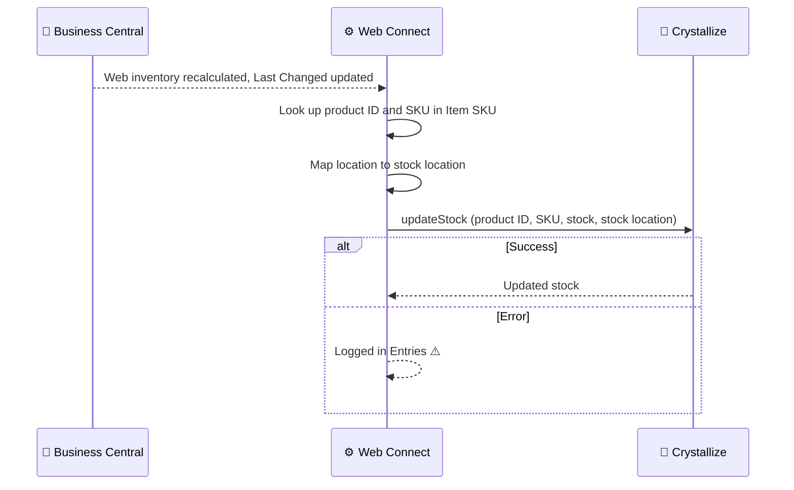

# Business Central to Crystallize: stock

Business Central calculates available stock per location in Web Connect Item Inventory. When the value changes, Web Connect sends it to the matching stock location on the Crystallize product variant. Negative stock is sent as 0.

| | |
|---|---|
| **Direction** | Business Central → Crystallize |
| **Trigger** | The field Last Changed in Web Connect Item Inventory changes |
| **Result** | The stock on the Crystallize product variant and stock location is updated |
| **Part of** | [Business Central and Crystallize integration](../overview.md) |

## Step by step

1. Stock changes in Business Central, for example a sales order is created or a purchase is received.
2. Web Connect recalculates the web inventory for the item, variant and location in Web Connect Item Inventory, and Last Changed is updated.
3. Web Connect finds the Crystallize product ID and SKU in Web Connect Item SKU, with or without variant.
4. Web Connect maps the Business Central location to a Crystallize stock location.
5. Web Connect sends the stock with a GraphQL mutation (`updateStock`). Negative stock is sent as 0.

## Next available date

Web Connect can also send the next available date from Web Connect Item Inventory to a separate stock location in Crystallize, for items that have one. It uses its own location mapping. The date is sent in the stock field as an integer, a Unix timestamp, because the field only takes whole numbers. The web shop uses it to show when an item that is out of stock is available again.

## Data mapping

| Business Central field | Crystallize field | Note |
|---|---|---|
| Product ID in Web Connect Item SKU | `productId` | From [product matching](product-matching.md) |
| SKU in Web Connect Item SKU | `sku` | With or without variant |
| Web Inventory | `stock` | Negative values are sent as 0 |
| Next Available Date | `stock` on the stock location for the next available date | Sent as a Unix timestamp (integer) |
| Location | `stockLocationIdentifier` | Mapped with a text mapping |

## Web Connect objects

| Object | Role |
|---|---|
| `CRYST-UPDATE-STOCK` | Sends available stock per stock location |
| `CRYST-UPDATE-NEXTRECEIVAL` | Sends the next available date to a separate stock location |

## Error handling

| Situation | What happens | What to do |
|---|---|---|
| No product ID for the SKU | Crystallize cannot match the product | Run [product matching](product-matching.md) and force export the line in Web Connect Item Inventory |
| Location not in the mapping | No stock location is sent | Add the location to the mapping |
| Stock is negative and keeps changing | 0 is sent on every change | Turn on duplicate check on the web object if the web shop should not get repeated 0 values |

## Frequently asked questions

### Why is the same stock value sent to Crystallize several times?

Every change to the calculated web inventory triggers a new message. When stock is negative, 0 is sent each time it changes. Duplicate check on the web object compares the message with the last one sent and stops identical messages.

## Related

- [Business Central and Crystallize integration](../overview.md)
- [Product matching](product-matching.md)
- [Web Connect Item Inventory](../../../general/item-inventory.md) · [Destinations](../../../general/destinations.md)
