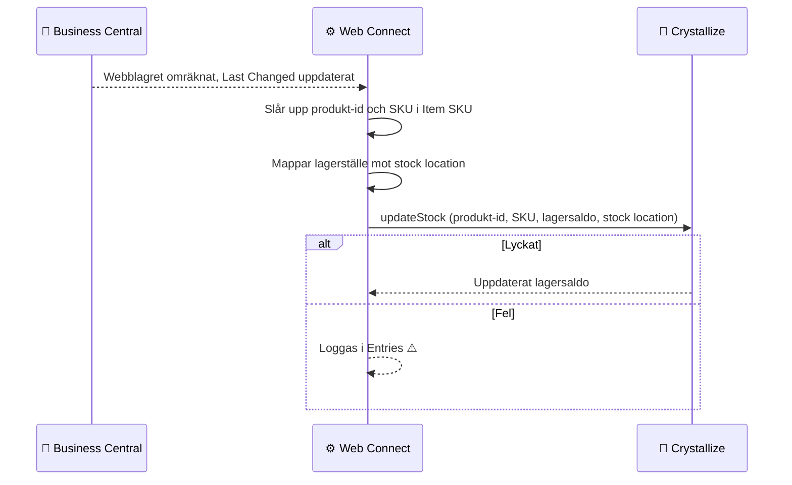

# Från Business Central till Crystallize: lagersaldo

Business Central räknar ut tillgängligt lagersaldo per lagerställe i Web Connect Item Inventory. När värdet ändras skickar Web Connect det till motsvarande stock location på produktvarianten i Crystallize. Negativt lagersaldo skickas som 0.

| | |
|---|---|
| **Riktning** | Business Central → Crystallize |
| **Startas av** | Fältet Last Changed i Web Connect Item Inventory ändras |
| **Resultat** | Lagersaldot på produktvarianten och stock location i Crystallize uppdateras |
| **Del av** | [Business Central och Crystallize: integration](../overview.md) |

## Steg för steg

1. Lagersaldot ändras i Business Central, till exempel när en försäljningsorder skapas eller ett inköp tas emot.
2. Web Connect räknar om webblagret för artikeln, varianten och lagerstället i Web Connect Item Inventory, och Last Changed uppdateras.
3. Web Connect hittar produkt-id och SKU för Crystallize i Web Connect Item SKU, med eller utan variant.
4. Web Connect mappar lagerstället i Business Central mot en stock location i Crystallize.
5. Web Connect skickar lagersaldot med en GraphQL-mutation (`updateStock`). Negativt lagersaldo skickas som 0.

## Nästa tillgängliga datum

Web Connect kan också skicka nästa tillgängliga datum från Web Connect Item Inventory till en separat stock location i Crystallize, för artiklar som har ett sådant datum. Det har en egen mappning av lagerställen. Datumet skickas i lagerfältet som ett heltal, en Unix-tidsstämpel, eftersom fältet bara tar emot heltal. Webbshopen använder det för att visa när en slutsåld artikel finns i lager igen.

## Mappning av data

| Fält i Business Central | Fält i Crystallize | Kommentar |
|---|---|---|
| Produkt-id i Web Connect Item SKU | `productId` | Från [produktmatchningen](product-matching.md) |
| SKU i Web Connect Item SKU | `sku` | Med eller utan variant |
| Web Inventory | `stock` | Negativa värden skickas som 0 |
| Next Available Date | `stock` på stock location för nästa tillgängliga datum | Skickas som Unix-tidsstämpel (heltal) |
| Location | `stockLocationIdentifier` | Mappas med en textmappning |

## Objekt i Web Connect

| Objekt | Roll |
|---|---|
| `CRYST-UPDATE-STOCK` | Skickar tillgängligt lagersaldo per stock location |
| `CRYST-UPDATE-NEXTRECEIVAL` | Skickar nästa tillgängliga datum till en separat stock location |

## Felhantering

| Situation | Vad som händer | Vad du gör |
|---|---|---|
| Inget produkt-id för SKU:n | Crystallize kan inte matcha produkten | Kör [produktmatchningen](product-matching.md) och tvinga fram en export av raden i Web Connect Item Inventory |
| Lagerstället finns inte i mappningen | Ingen stock location skickas | Lägg till lagerstället i mappningen |
| Lagersaldot är negativt och ändras hela tiden | 0 skickas vid varje ändring | Slå på dubblettkontrollen på webbobjektet om webbshopen inte ska få upprepade nollor |

## Vanliga frågor

### Varför skickas samma lagersaldo till Crystallize flera gånger?

Varje ändring av det beräknade webblagret ger ett nytt meddelande. När lagersaldot är negativt skickas 0 varje gång det ändras. Dubblettkontrollen på webbobjektet jämför meddelandet med det senast skickade och stoppar identiska meddelanden.

## Relaterat

- [Business Central och Crystallize: integration](../overview.md)
- [Produktmatchning](product-matching.md)
- [Web Connect Item Inventory](../../../general/item-inventory.md) · [Destinations](../../../general/destinations.md)
