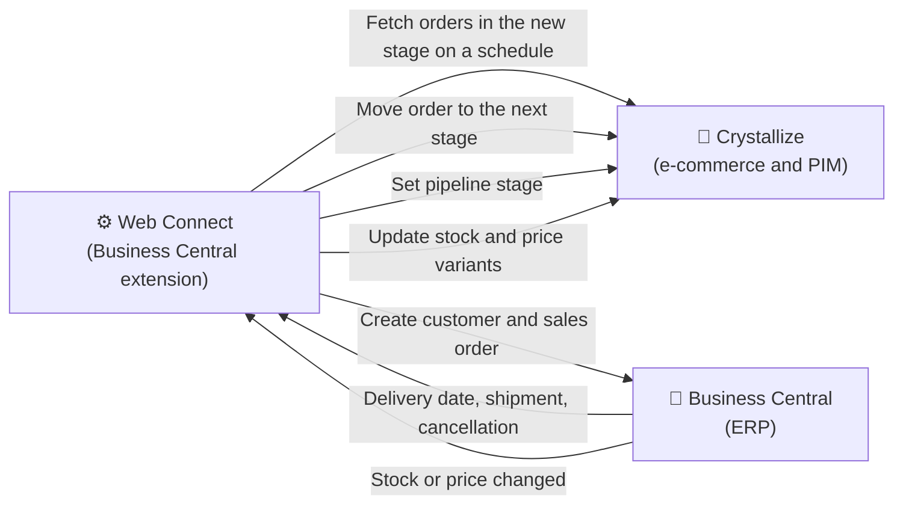
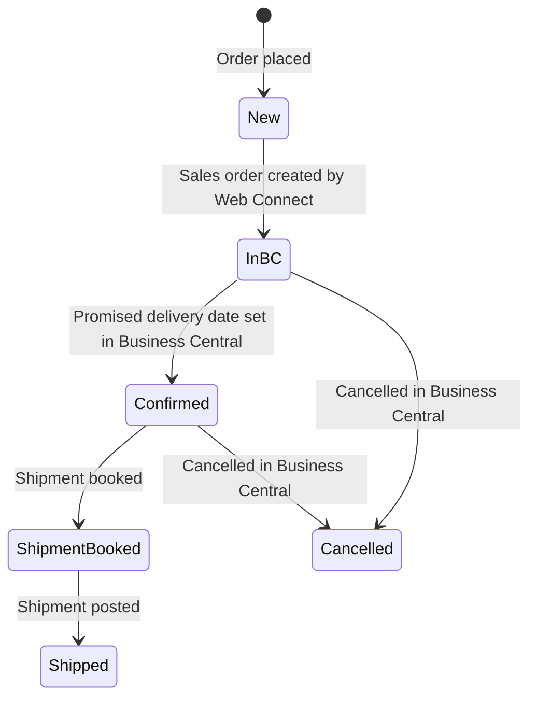
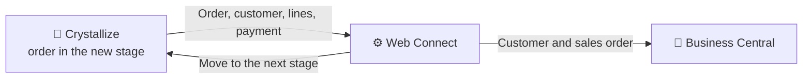
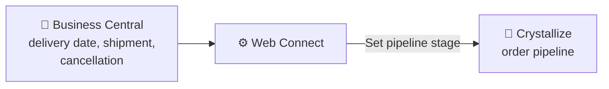
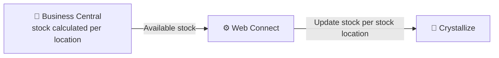
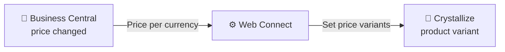
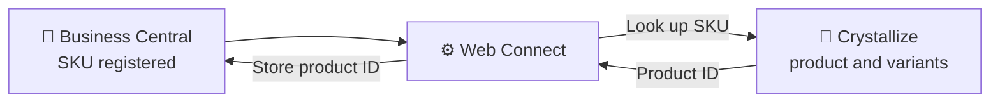

# Business Central and Crystallize integration

Web Connect by CombineIT connects Microsoft Dynamics 365 Business Central with Crystallize, the e-commerce platform and PIM. Orders are fetched from Crystallize into Business Central, and order status, stock and prices are sent back to Crystallize. All mappings and rules live in your own Business Central, where you can see and change them yourself.

## At a glance

| | |
|---|---|
| **System** | Crystallize (e-commerce and PIM) |
| **Integration product** | Web Connect for Microsoft Dynamics 365 Business Central |
| **Runs in** | Your own Business Central environment, as an extension. Web Connect fetches new orders from Crystallize on a schedule in the Business Central job queue and sends order status, stock and prices to Crystallize. The integration does not use incoming webhooks, and no external integration platform is involved. |
| **Configured by** | You, in Business Central: mappings, conditions, triggers and flows. You can do all of it yourself. If you want, CombineIT takes part in any step, as a sounding board or by doing the work. |
| **Connection** | Crystallize PIM API (GraphQL), authenticated with a Crystallize access token |
| **Crystallize API** | [Crystallize PIM API](https://crystallize.com/learn/developer-guides/pim-api) |
| **Data flows** | 5: orders, order status, stock, prices and product matching |
| **Business Central editions** | Essentials and Premium |
| **Available from** | [Web Connect on Microsoft AppSource](https://marketplace.microsoft.com/sv-se/product/PUBID.martitab1633951001710%7CAID.webconnect%7CPAPPID.9f3a7223-19db-4ac7-832f-cf8e4699186f?tab=Overview). [ATT FYLLA I: whether the Crystallize integration is included in the Web Connect Ready Integrations app] |

## What can be synchronized

Web Connect has five data flows between Business Central and Crystallize.

| Data | Direction | What happens |
|---|---|---|
| [Orders](flows/order-inbound.md) | Crystallize → Business Central | Orders in a chosen pipeline stage are fetched, the customer is found or created and a sales order is created |
| [Order status](flows/order-status.md) | Business Central → Crystallize | The order is moved between stages in the Crystallize order pipeline: in Business Central, confirmed, shipment booked, shipped and cancelled |
| [Stock](flows/stock-update.md) | Business Central → Crystallize | Available stock per location is sent to the matching Crystallize stock location |
| [Prices](flows/prices.md) | Business Central → Crystallize | Prices are set on the price variants of each Crystallize product variant, one per currency |
| [Product matching](flows/product-matching.md) | Crystallize → Business Central | The Crystallize product ID is fetched for each SKU and stored in Business Central |

Orders and product matching are the base of the integration. Order status, stock and prices are chosen when the integration is set up. See [Choose your setup](#choose-your-setup).

## How it works

Crystallize keeps orders in pipelines, where each order sits in a stage. Web Connect asks Crystallize on a schedule for the orders in the stage for new orders, using a GraphQL query. For each order it fetches the full order, creates the sales order in Business Central and moves the order to the next stage in Crystallize. When something changes in Business Central (a promised delivery date is set, stock moves, a price changes), Web Connect sends the change to Crystallize with a GraphQL mutation. Every message in both directions is logged in Web Connect Entries, where it can be inspected and resent.

### Order stages in Crystallize

The stages are set up in the Crystallize order pipeline, and each stage is linked to Web Connect with an integration variable. The names below are the stages Web Connect moves orders to.

## Choose your setup

Each flow has to fit how your business works: which system owns the data, where people do their work, and what the accounting needs. That is why the flows are decided together when a new integration is set up. The options below are the ones Web Connect customers use today.

Crystallize is used by one Web Connect customer today. No option is therefore marked as **common setup**, because there is no basis for saying what most customers use. **Recommended** marks CombineIT's best practice, where there is one.

### Orders

| Option | How it works | When it fits |
|---|---|---|
| **Crystallize → Business Central** | Orders in a chosen pipeline stage are fetched and created as sales orders in Business Central. Private customers and companies are told apart, and a customer is found or created in Business Central for each order | Always. This is the core of the integration |

#### Orders from Crystallize to Business Central

### Order status

| Option | How it works | When it fits |
|---|---|---|
| **Pipeline stages set from Business Central** | Web Connect moves the order between stages in the Crystallize order pipeline as the order is handled in Business Central | You want the status in Crystallize, and in what the customer sees, to follow the work in Business Central |

#### Order status set from Business Central

### Stock

| Option | How it works | When it fits |
|---|---|---|
| **Calculated in Business Central** | Business Central calculates available stock per location in Web Connect Item Inventory, and Web Connect sends it to the matching Crystallize stock location. A next available date can be sent to a separate stock location | Business Central has the correct stock, also when the warehouse is run in a warehouse system integrated with Business Central |

#### Stock calculated in Business Central

### Prices

| Option | How it works | When it fits |
|---|---|---|
| **Business Central → Crystallize** | Prices are calculated in Web Connect Item Price from the Business Central price lists and set on the price variants in Crystallize, one per currency | Prices are decided in Business Central |

#### Prices from Business Central to Crystallize

### Products

| Option | How it works | When it fits |
|---|---|---|
| **Created in Crystallize, matched by SKU** | Products are created and enriched in Crystallize. The items exist in Business Central with the same SKU, and Web Connect fetches the Crystallize product ID for each SKU | Crystallize is used as the PIM, and the web team owns product content |

#### Products created in Crystallize, matched by SKU

Products, variants, product content and the order pipeline with its stages are always maintained in Crystallize.

## What you need

- Microsoft Dynamics 365 Business Central, Essentials or Premium
- Web Connect installed from Microsoft AppSource, with an activated Web Connect license
- Your approval for Web Connect to be installed and to act in your Business Central environment
- A Crystallize access token (token ID and secret) with access to orders and products, created in Crystallize. [ATT FYLLA I: where in Crystallize the token is created and which permissions it needs]
- A Crystallize order pipeline with the stages the integration uses, and the tenant ID of your Crystallize tenant
- Stock locations and price variants in Crystallize that match what is sent from Business Central
- Items in Business Central with the same SKUs as the product variants in Crystallize

## Setting it up

1. Decide which flows to use and which option to choose for each, see [Choose your setup](#choose-your-setup).
2. Install Web Connect in Business Central, activate the license and give your approval. [ATT FYLLA I: how the Crystallize integration is installed, as a ready integration or by importing a configuration]
3. Store the Crystallize access token in Web Connect [Secret Value Storage](../../general/secret-value-storage.md).
4. Enter the tenant ID, the pipeline ID and the ID of each pipeline stage as integration variables.
5. Set up the configuration choices below.
6. Run product matching so every SKU has its Crystallize product ID.
7. Test the whole order flow in a Business Central sandbox before going live. [ATT FYLLA I: which Crystallize tenant or environment is used for test]

## Configure it yourself in Business Central

All configuration and logic in the integration is visible and editable in Business Central. There is no external integration platform where the logic is hidden.

| What you can change | Where in Web Connect | Example |
|---|---|---|
| Which orders are fetched | Integration variables and the query on the fetch object | Change which pipeline stage new orders are fetched from |
| Private customers and companies | [Condition List](../../general/condition-list.md) | Use the billing address for companies and the delivery address for private customers |
| Customer template per country | [Text Mapping](../../general/text-mapping.md) | Create new customers from a different template depending on the delivery country |
| Field mapping on orders | [Incoming Data mapping](../../general/incoming-data/mapping.md) | Map a Crystallize order meta field to a field on the sales order |
| Payment method and location | [Text Mapping](../../general/text-mapping.md) | Map the Crystallize payment provider to a payment method code, and the warehouse on an order line to a location |
| What triggers order status | [Outgoing Sync Triggers](../../general/outgoing-mapping/outgoing-sync-triggers.md) | Move the order to Confirmed when the promised delivery date is set |
| Which stock is sent | [Item Inventory](../../general/item-inventory.md) and [Destinations](../../general/destinations.md) | Map each Business Central location to a Crystallize stock location |
| Which prices are sent | [Item Price](../../general/outgoing-mapping/item-price.md) and [Dynamic Flow Fields](../../general/dynamic-flow-fields.md) | Choose which price list feeds each Crystallize price variant |
| Monitoring and resending | [Entries](../../general/entries.md) | See every order and update, and [resend a message](../../../../how-to/web-connect/resend-outgoing-message.md) |

## Configuration choices

- **Pipeline and stages:** which Crystallize pipeline is used, which stage new orders are fetched from, and which stages Web Connect moves orders to.
- **Orders per run:** how many orders are fetched each time the job runs.
- **Customer handling:** customers are found by the customer identifier in Crystallize. Whether an order is from a company is decided by whether the company name is filled in, and new customers get a customer template based on the delivery country.
- **Item matching:** the SKU on the order line is looked up in Web Connect Item SKU, which gives the item number and the variant code.
- **Prices including VAT:** sales orders are created with prices including VAT, and the gross line price from Crystallize is used as unit price.
- **Currency:** the currency on the order total is mapped to a Business Central currency code, with the local currency left blank.
- **Payment:** the payment provider and payment properties on the order are mapped to a payment method code, and the payment transaction ID can be stored on the sales order.
- **Locations:** a warehouse value on each order line can be mapped to a Business Central location.
- **Stock locations and price variants:** which Business Central locations map to which Crystallize stock locations, and which currencies and price lists map to which price variants.
- **Duplicate check on stock:** stock is sent every time the calculated web inventory changes. When stock is negative, that means 0 is sent again on each change. Duplicate check on the web object compares the message with the last one sent and stops identical messages, if the web shop should not get repeated updates.
- **Extra fields:** order meta fields in Crystallize, such as the order number, a customer message or a reference, can be mapped to fields or dimensions on the sales order.

## Limitations

- **Products are not created in Crystallize from Business Central.** Products and variants are created in Crystallize. Business Central needs items with the same SKUs.
- **Stock and prices need a product ID.** A SKU without a Crystallize product ID in Web Connect Item SKU cannot get stock or prices in Crystallize. Run product matching after new products are created.
- **Order fetching follows the pipeline stage.** An order that is moved out of the stage for new orders in Crystallize before Web Connect has fetched it is not imported.
- **Negative stock is sent as 0.**
- **Prices are set on a fixed set of price variants.** Adding a currency or price variant in Crystallize means adding it to the mapping in Web Connect as well.
- [ATT FYLLA I: known limitations from support, for example token expiry or API rate limits in Crystallize]

## Frequently asked questions

### Can Business Central be integrated with Crystallize?

Yes. Web Connect connects Business Central with Crystallize through the Crystallize PIM API (GraphQL). Orders are fetched into Business Central, and order status, stock and prices are sent to Crystallize.

### How does Web Connect know which Crystallize orders to fetch?

Web Connect fetches the orders that are in a chosen stage of a Crystallize order pipeline. When the sales order has been created in Business Central, the order is moved to another stage, so it is not fetched again.

### How are Business Central items matched to Crystallize products?

By SKU. Web Connect asks Crystallize for the product ID of each SKU and stores it in Business Central. Stock and prices are then sent to the right product and variant in Crystallize.

### [ATT FYLLA I: a real question from support or a customer meeting about Crystallize]

[ATT FYLLA I: answer]

## Related

- Flows: [Order inbound](flows/order-inbound.md) · [Order status](flows/order-status.md) · [Stock update](flows/stock-update.md) · [Prices](flows/prices.md) · [Product matching](flows/product-matching.md)
- How-to: [Resend an outgoing message](../../../../how-to/web-connect/resend-outgoing-message.md) · [Integrations not running](../../../../how-to/web-connect/integration-not-running.md)
- [Web Connect general documentation](../../general/README.md)
- [Crystallize developer documentation](https://crystallize.com/learn/developer-guides/api-overview)

## About Web Connect

Web Connect is an integration platform for Microsoft Dynamics 365 Business Central, developed by CombineIT. It is installed in your own Business Central and connects it with e-commerce platforms, warehouse systems, POS, returns, marketplaces and EDI. Every flow, mapping and rule is configured in Business Central, where you can see and change it yourself, without custom code for each integration. [Web Connect on Microsoft AppSource](https://marketplace.microsoft.com/sv-se/product/PUBID.martitab1633951001710%7CAID.webconnect%7CPAPPID.9f3a7223-19db-4ac7-832f-cf8e4699186f?tab=Overview) · [Contact CombineIT](https://www.combineit.se/contact/)
