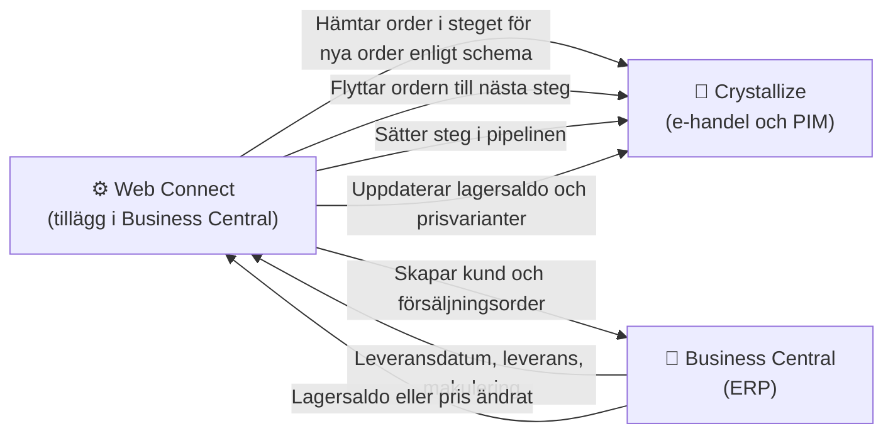
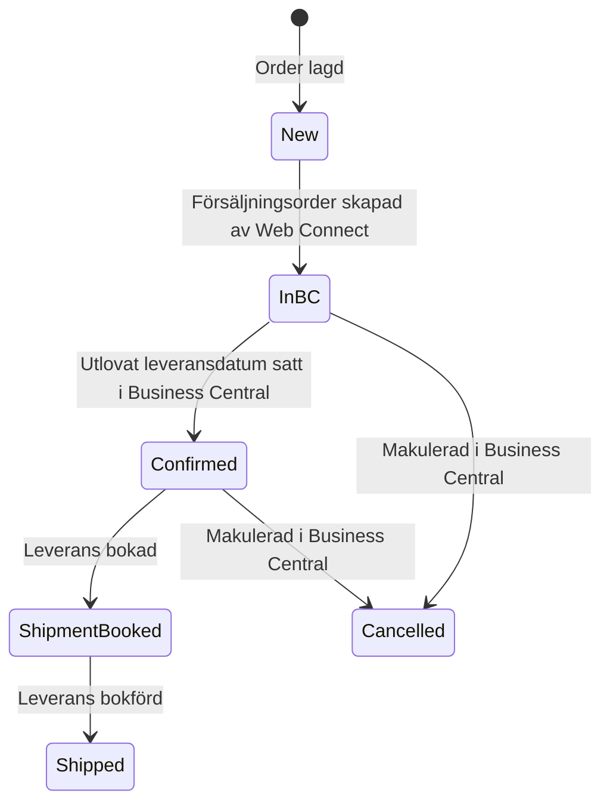
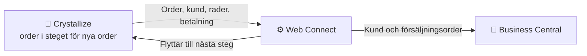
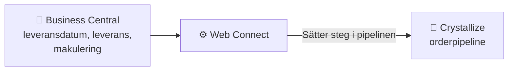
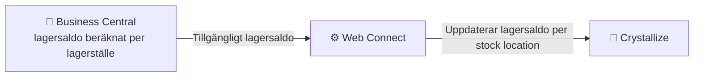
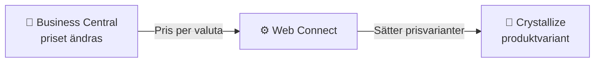
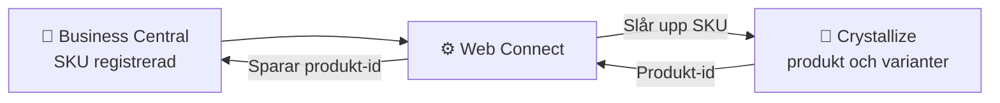

# Business Central och Crystallize: integration

Web Connect från CombineIT kopplar Microsoft Dynamics 365 Business Central till Crystallize, som är e-handelsplattform och PIM. Order hämtas från Crystallize till Business Central, och orderstatus, lagersaldo och priser skickas tillbaka till Crystallize. Alla mappningar och regler finns i ditt eget Business Central, där du kan se och ändra dem själv.

## I korthet

| | |
|---|---|
| **System** | Crystallize (e-handel och PIM) |
| **Integrationsprodukt** | Web Connect för Microsoft Dynamics 365 Business Central |
| **Körs i** | Din egen Business Central-miljö, som ett tillägg. Web Connect hämtar nya order från Crystallize enligt schema i jobbkön i Business Central och skickar orderstatus, lagersaldo och priser till Crystallize. Integrationen använder inga inkommande webhooks, och ingen extern integrationsplattform är inblandad. |
| **Konfigureras av** | Dig, i Business Central: mappningar, villkor, triggers och flöden. Du kan göra allt själv. Om du vill är CombineIT med i vilket steg som helst, som bollplank eller genom att göra jobbet. |
| **Koppling** | Crystallize PIM API (GraphQL), och Crystallize Order API för det förväntade leveransdatumet. Båda autentiseras med en åtkomsttoken från Crystallize |
| **Crystallizes API** | [Crystallize PIM API](https://crystallize.com/learn/developer-guides/pim-api) |
| **Dataflöden** | 5: order, orderstatus, lagersaldo, priser och produktmatchning |
| **Business Central-utgåvor** | Alla utgåvor, Essentials och Premium, även den senaste versionen |
| **Finns på** | [Web Connect på Microsoft AppSource](https://marketplace.microsoft.com/sv-se/product/PUBID.martitab1633951001710%7CAID.webconnect%7CPAPPID.9f3a7223-19db-4ac7-832f-cf8e4699186f?tab=Overview). Crystallize-integrationen ingår inte i appen Web Connect Ready Integrations. Den sätts upp som en konfiguration i Web Connect |

## Det här kan synkas

Web Connect har fem dataflöden mellan Business Central och Crystallize.

| Data | Riktning | Vad som händer |
|---|---|---|
| [Order](flows/order-inbound.md) | Crystallize → Business Central | Order i ett valt steg i pipelinen hämtas, kunden hittas eller skapas och en försäljningsorder skapas |
| [Orderstatus](flows/order-status.md) | Business Central → Crystallize | Ordern flyttas mellan stegen i orderpipelinen i Crystallize: i Business Central, bekräftad, leverans bokad, skickad och makulerad. Det utlovade leveransdatumet skickas som förväntat leveransdatum |
| [Lagersaldo](flows/stock-update.md) | Business Central → Crystallize | Tillgängligt lagersaldo per lagerställe skickas till motsvarande stock location i Crystallize |
| [Priser](flows/prices.md) | Business Central → Crystallize | Priserna sätts på prisvarianterna för varje produktvariant i Crystallize, en per valuta |
| [Produktmatchning](flows/product-matching.md) | Crystallize → Business Central | Produkt-id i Crystallize hämtas för varje SKU och sparas i Business Central |

Order och produktmatchning är grunden i integrationen. Orderstatus, lagersaldo och priser väljs när integrationen sätts upp. Se [Välj upplägg](#choose-your-setup).

## Så fungerar det

Crystallize håller orderna i pipelines, där varje order ligger i ett steg. Web Connect frågar Crystallize enligt schema efter de order som ligger i steget för nya order, med en GraphQL-fråga. För varje order hämtas hela ordern, försäljningsordern skapas i Business Central och ordern flyttas till nästa steg i Crystallize. När något ändras i Business Central (ett utlovat leveransdatum sätts, lagersaldot rör sig, ett pris ändras) skickar Web Connect ändringen till Crystallize med en GraphQL-mutation. Varje meddelande åt båda hållen loggas i Web Connect Entries, där det kan granskas och skickas igen.

### Ordersteg i Crystallize

Stegen sätts upp i orderpipelinen i Crystallize, och varje steg kopplas till Web Connect med en integrationsvariabel. Namnen nedan är de steg som Web Connect flyttar orderna till.

## Välj upplägg

Varje flöde måste passa hur ert företag arbetar: vilket system som äger datan, var medarbetarna gör sitt jobb och vad bokföringen behöver. Därför bestäms flödena tillsammans när en ny integration sätts upp. Alternativen nedan är de som kunder med Web Connect använder i dag.

Crystallize används av en kund med Web Connect i dag. Inget alternativ är därför markerat som **vanligast**, eftersom det inte finns underlag för att säga vad de flesta kunder använder. **Rekommenderas** visar CombineIT:s bästa praxis, där det finns en.

### Order

| Alternativ | Så fungerar det | När det passar |
|---|---|---|
| **Crystallize → Business Central** | Order i ett valt steg i pipelinen hämtas och skapas som försäljningsorder i Business Central. Privatkunder och företag skiljs åt, och för varje order hittas eller skapas en kund i Business Central | Alltid. Det här är kärnan i integrationen |

#### Order från Crystallize till Business Central

### Orderstatus

| Alternativ | Så fungerar det | När det passar |
|---|---|---|
| **Steg i pipelinen sätts från Business Central** | Web Connect flyttar ordern mellan stegen i orderpipelinen i Crystallize i takt med att ordern hanteras i Business Central | Du vill att statusen i Crystallize, och det kunden ser, ska följa arbetet i Business Central |

#### Orderstatus som sätts från Business Central

### Lagersaldo

| Alternativ | Så fungerar det | När det passar |
|---|---|---|
| **Beräknas i Business Central** | Business Central räknar ut tillgängligt lagersaldo per lagerställe i Web Connect Item Inventory, och Web Connect skickar det till motsvarande stock location i Crystallize. Ett nästa tillgängliga datum kan skickas till en separat stock location | Business Central har rätt lagersaldo, även när lagret sköts i ett lagersystem som är integrerat med Business Central |

#### Lagersaldo som beräknas i Business Central

### Priser

| Alternativ | Så fungerar det | När det passar |
|---|---|---|
| **Business Central → Crystallize** | Priserna räknas fram i Web Connect Item Price utifrån prislistorna i Business Central och sätts på prisvarianterna i Crystallize, en per valuta | Priserna bestäms i Business Central |

#### Priser från Business Central till Crystallize

### Produkter

| Alternativ | Så fungerar det | När det passar |
|---|---|---|
| **Skapas i Crystallize, matchas på SKU** | Produkterna skapas och berikas i Crystallize. Artiklarna finns i Business Central med samma SKU, och Web Connect hämtar produkt-id i Crystallize för varje SKU | Crystallize används som PIM, och webbteamet äger produktinnehållet |

#### Produkter som skapas i Crystallize och matchas på SKU

Produkter, varianter, produktinnehåll och orderpipelinen med dess steg underhålls alltid i Crystallize.

## Det här behöver du

- Microsoft Dynamics 365 Business Central, valfri utgåva (Essentials eller Premium), även den senaste versionen
- Web Connect installerat från Microsoft AppSource, med en aktiverad licens för Web Connect
- Ditt godkännande av att Web Connect installeras och agerar i din Business Central-miljö
- En åtkomsttoken från Crystallize (token-id och hemlighet), skapad i Crystallize
- En orderpipeline i Crystallize med de steg som integrationen använder, och tenant-id för din tenant i Crystallize
- Stock locations och prisvarianter i Crystallize som motsvarar det som skickas från Business Central
- Artiklar i Business Central med samma SKU:er som produktvarianterna i Crystallize

## Så kommer du igång

1. Bestäm vilka flöden ni ska använda och vilket alternativ ni väljer för vart och ett, se [Välj upplägg](#choose-your-setup).
2. Installera Web Connect i Business Central, aktivera licensen och ge ditt godkännande. Crystallize-integrationen ingår inte i appen Ready Integrations, så den sätts upp som en konfiguration i Web Connect.
3. Spara åtkomsttoken från Crystallize i [Secret Value Storage](../../general/secret-value-storage.md) i Web Connect.
4. Ange tenant-id, pipeline-id och id för varje steg i pipelinen som integrationsvariabler.
5. Ställ in valen i konfigurationen nedan.
6. Kör produktmatchningen så att varje SKU får sitt produkt-id från Crystallize.
7. Testa hela orderflödet i en sandlåda i Business Central mot en testmiljö i Crystallize innan ni går live.

## Konfigurera själv i Business Central

All konfiguration och logik i integrationen syns och går att ändra i Business Central. Det finns ingen extern integrationsplattform där logiken är gömd.

| Det här kan du ändra | Var i Web Connect | Exempel |
|---|---|---|
| Vilka order som hämtas | Integrationsvariablerna och frågan på hämtobjektet | Ändra vilket steg i pipelinen nya order hämtas från |
| Privatkunder och företag | [Condition List](../../general/condition-list.md) | Använd faktureringsadressen för företag och leveransadressen för privatkunder |
| Kundmall per land | [Text Mapping](../../general/text-mapping.md) | Skapa nya kunder från en annan mall beroende på leveransland |
| Fältmappning på order | [Incoming Data mapping](../../general/incoming-data/mapping.md) | Mappa ett metafält på ordern i Crystallize till ett fält på försäljningsordern |
| Betalningsmetod och lagerställe | [Text Mapping](../../general/text-mapping.md) | Mappa betalleverantören i Crystallize till en kod för betalningsmetod, och lagret på en orderrad till ett lagerställe |
| Vad som startar orderstatus | [Outgoing Sync Triggers](../../general/outgoing-mapping/outgoing-sync-triggers.md) | Flytta ordern till Confirmed när det utlovade leveransdatumet sätts |
| Vilket lagersaldo som skickas | [Item Inventory](../../general/item-inventory.md) och [Destinations](../../general/destinations.md) | Mappa varje lagerställe i Business Central till en stock location i Crystallize |
| Vilka priser som skickas | [Item Price](../../general/outgoing-mapping/item-price.md) och [Dynamic Flow Fields](../../general/dynamic-flow-fields.md) | Välj vilken prislista som matar varje prisvariant i Crystallize |
| Övervakning och omsändning | [Entries](../../general/entries.md) | Se varje order och uppdatering, och [skicka ett meddelande igen](../../../../how-to/web-connect/resend-outgoing-message.md) |

## Val i konfigurationen

- **Förväntat leveransdatum:** det utlovade leveransdatumet i Business Central skickas till ordern i Crystallize som metadata, under en nyckel som webbshopen läser.
- **Pipeline och steg:** vilken pipeline i Crystallize som används, vilket steg nya order hämtas från och vilka steg Web Connect flyttar orderna till.
- **Schema för hämtning:** hur ofta jobbkön hämtar nya order från Crystallize. Det kan anpassas efter vad ert företag behöver.
- **Order per körning:** hur många order som hämtas varje gång jobbet körs.
- **Hantering av kunder:** kunderna hittas på kundidentifieraren i Crystallize. Om en order kommer från ett företag avgörs av om företagsnamnet är ifyllt, och nya kunder får en kundmall utifrån leveranslandet.
- **Matchning av artiklar:** SKU:n på orderraden slås upp i Web Connect Item SKU, som ger artikelnummer och variantkod.
- **Priser inklusive moms:** försäljningsorder skapas med priser inklusive moms, och bruttoradpriset från Crystallize används som styckpris.
- **Valuta:** valutan på ordersumman mappas mot en valutakod i Business Central, och den lokala valutan lämnas tom.
- **Betalning:** betalleverantören och betalningsegenskaperna på ordern mappas mot en kod för betalningsmetod, och transaktions-id för betalningen kan sparas på försäljningsordern.
- **Lagerställen:** ett lagervärde på varje orderrad kan mappas mot ett lagerställe i Business Central.
- **Stock locations och prisvarianter:** vilka lagerställen i Business Central som motsvarar vilka stock locations i Crystallize, och vilka valutor och prislistor som motsvarar vilka prisvarianter.
- **Dubblettkontroll på lagersaldo:** lagersaldot skickas varje gång det beräknade webblagret ändras. Är lagersaldot negativt betyder det att 0 skickas igen vid varje ändring. Dubblettkontrollen på webbobjektet jämför meddelandet med det senast skickade och stoppar identiska meddelanden, om webbshopen inte ska få upprepade uppdateringar.
- **Extra fält:** metafält på ordern i Crystallize, som ordernumret, ett meddelande från kunden eller en referens, kan mappas till fält eller dimensioner på försäljningsordern.

## Begränsningar

- **Produkter skapas inte i Crystallize från Business Central.** Produkter och varianter skapas i Crystallize. Business Central behöver artiklar med samma SKU:er.
- **Lagersaldo och priser kräver ett produkt-id.** En SKU utan produkt-id från Crystallize i Web Connect Item SKU kan inte få lagersaldo eller priser i Crystallize. Kör produktmatchningen när nya produkter har skapats.
- **Hämtningen av order följer steget i pipelinen.** En order som flyttas ut ur steget för nya order i Crystallize innan Web Connect har hämtat den importeras inte.
- **Negativt lagersaldo skickas som 0.**
- **Priserna sätts på en fast uppsättning prisvarianter.** Lägger ni till en valuta eller prisvariant i Crystallize måste den också läggas till i mappningen i Web Connect.

## Vanliga frågor

### Går det att integrera Business Central med Crystallize?

Ja. Web Connect kopplar Business Central till Crystallize via Crystallize PIM API (GraphQL). Order hämtas in till Business Central, och orderstatus, lagersaldo och priser skickas till Crystallize.

### Hur vet Web Connect vilka order i Crystallize som ska hämtas?

Web Connect hämtar de order som ligger i ett valt steg i en orderpipeline i Crystallize. När försäljningsordern har skapats i Business Central flyttas ordern till ett annat steg, så att den inte hämtas igen.

### Hur matchas artiklarna i Business Central mot produkterna i Crystallize?

På SKU. Web Connect frågar Crystallize efter produkt-id för varje SKU och sparar det i Business Central. Lagersaldo och priser skickas sedan till rätt produkt och variant i Crystallize.

## Relaterat

- Flöden: [Order in](flows/order-inbound.md) · [Orderstatus](flows/order-status.md) · [Lagersaldo](flows/stock-update.md) · [Priser](flows/prices.md) · [Produktmatchning](flows/product-matching.md)
- Instruktioner: [Skicka ett utgående meddelande igen](../../../../how-to/web-connect/resend-outgoing-message.md) · [Integrationerna körs inte](../../../../how-to/web-connect/integration-not-running.md)
- [Allmän dokumentation för Web Connect](../../general/README.md)
- [Crystallizes dokumentation för utvecklare](https://crystallize.com/learn/developer-guides/api-overview)

## Om Web Connect

Web Connect är en integrationsplattform för Microsoft Dynamics 365 Business Central, utvecklad av CombineIT. Den installeras i ditt eget Business Central och kopplar det till e-handelsplattformar, lagersystem, kassasystem, returer, marknadsplatser och EDI. Varje flöde, mappning och regel konfigureras i Business Central, där du kan se och ändra det själv, utan specialkod för varje integration. [Web Connect på Microsoft AppSource](https://marketplace.microsoft.com/sv-se/product/PUBID.martitab1633951001710%7CAID.webconnect%7CPAPPID.9f3a7223-19db-4ac7-832f-cf8e4699186f?tab=Overview) · [Kontakta CombineIT](https://www.combineit.se/contact/)
