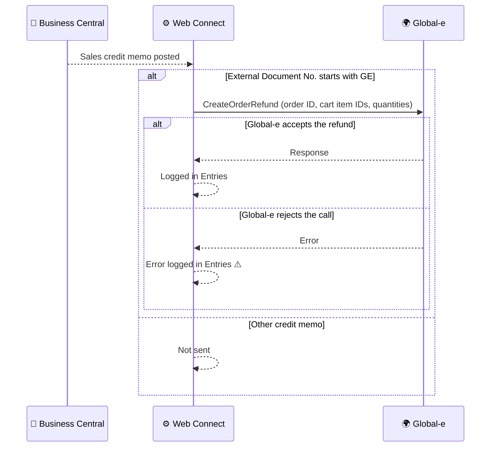

# Business Central to Global-e returns: refunds

When a sales credit memo is posted in Business Central for a Global-e order, Web Connect sends the refund to Global-e. The call carries the Global-e order ID and, for each returned item, the Global-e cart item ID and the refunded quantity. Credit memos for other orders are not sent.

| | |
|---|---|
| **Direction** | Business Central → Global-e |
| **Trigger** | Outgoing sync trigger when a sales credit memo is posted, for credit memos whose External Document No. starts with `GE` |
| **Result** | A refund request in Global-e for the order, with the returned items and quantities. The call and the response are kept in Web Connect Entries |
| **Part of** | [Business Central and Global-e returns integration](../overview.md) |

## Step by step

1. The return order is handled in Business Central and the sales credit memo is posted (Business Central).
2. The outgoing sync trigger picks up the posted credit memo if its External Document No. starts with `GE` (Web Connect).
3. Web Connect builds the refund: the External Document No. as the Global-e order ID, and one line per credit memo line that has a Global-e cart item ID (Web Connect).
4. Web Connect calls `Order/CreateOrderRefund` on the Global-e API with your merchant GUID and the refund (Web Connect).
5. Global-e registers the refund for the order (Global-e).

## Data mapping

| Global-e field | Business Central field | Note |
|---|---|---|
| `merchantGUID` (URL parameter) | Fixed value | Your Global-e merchant GUID |
| `orderRefund.OrderId` (URL parameter) | Sales Cr.Memo Header, External Document No. | The Global-e order ID |
| `CartItemId` | Sales Cr.Memo Line, Global-e cart item ID | Received with the return. Lines without a cart item ID are not sent |
| `RefundQuantity` | Sales Cr.Memo Line, Quantity | Sent as an integer |

## Web Connect objects

| Object | Role |
|---|---|
| `GE_REFUND` | The refund. Triggered when the credit memo is posted and filtered on External Document No. starting with `GE`. Calls `Order/CreateOrderRefund` |
| `GE_HEADER` | Builds the URL parameters: the merchant GUID and the order ID |
| `GE_LINES` | One line per credit memo line with a Global-e cart item ID, with the cart item ID and quantity |

## Error handling

| Situation | What happens | What to do |
|---|---|---|
| Global-e rejects the refund | The message is logged with the response from Global-e | Read the response in [Entries](../../../general/entries.md), correct the credit memo data and [resend](../../../../../how-to/web-connect/resend-outgoing-message.md) |
| The refund is not sent | The External Document No. on the credit memo does not start with `GE` | Check that the credit memo was created from the Global-e return, so it carries the Global-e order ID |
| A returned item is missing in the refund | The credit memo line has no Global-e cart item ID | Create the credit memo from the return order that came from Global-e, so the cart item ID follows the line |

## Frequently asked questions

### Which credit memos are sent to Global-e?

Posted sales credit memos whose External Document No. starts with GE. The External Document No. is sent to Global-e as the order ID. Other credit memos are not sent.

### Does Web Connect send the refund amount to Global-e?

No. Web Connect sends the Global-e order ID and, for each line, the cart item ID and the refunded quantity. No amounts are sent from Business Central.

## Related

- [Business Central and Global-e returns integration](../overview.md)
- [Returns](returns.md)
- [Outgoing Sync Triggers](../../../general/outgoing-mapping/outgoing-sync-triggers.md) · [Outgoing Data](../../../general/outgoing-mapping/outgoing-data-web.md)
- How-to: [Resend an outgoing message](../../../../../how-to/web-connect/resend-outgoing-message.md)
