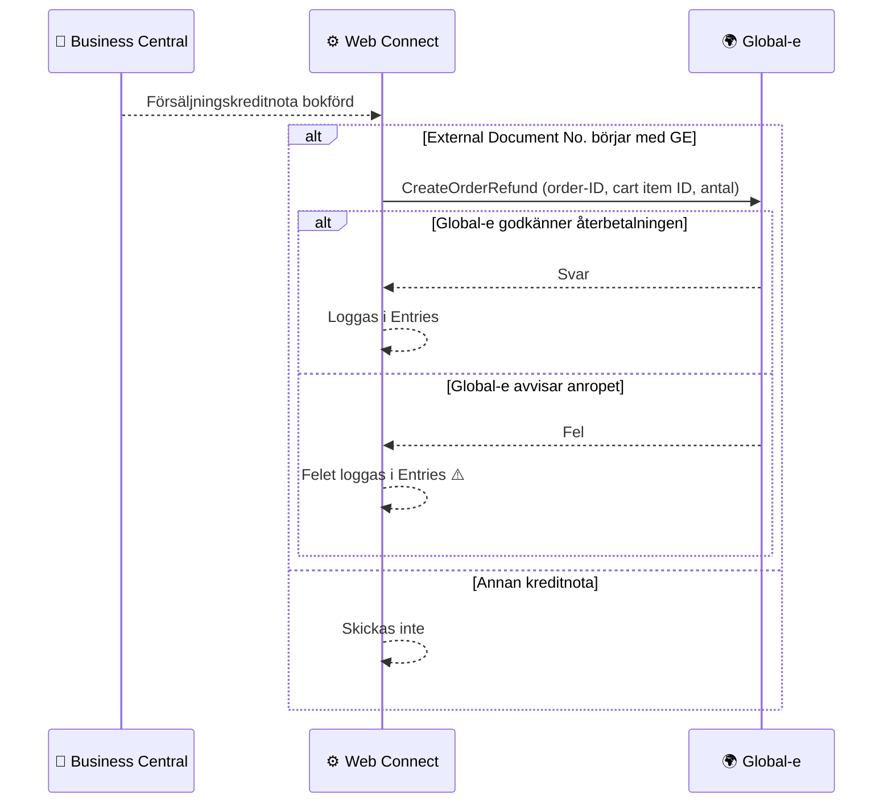

# Från Business Central till Global-e returns: återbetalningar

När en försäljningskreditnota för en Global-e-order bokförs i Business Central skickar Web Connect återbetalningen till Global-e. Anropet innehåller Global-e:s order-ID och, för varje returnerad artikel, Global-e:s cart item ID och det återbetalade antalet. Kreditnotor för andra order skickas inte.

| | |
|---|---|
| **Riktning** | Business Central → Global-e |
| **Startas av** | Utgående synktrigger när en försäljningskreditnota bokförs, för kreditnotor vars External Document No. börjar med `GE` |
| **Resultat** | En begäran om återbetalning i Global-e för ordern, med returnerade artiklar och antal. Anropet och svaret sparas i Web Connect Entries |
| **Del av** | [Business Central och Global-e returns: integration](../overview.md) |

## Steg för steg

1. Returordern hanteras i Business Central och försäljningskreditnotan bokförs (Business Central).
2. Den utgående synktriggern fångar upp den bokförda kreditnotan om dess External Document No. börjar med `GE` (Web Connect).
3. Web Connect bygger återbetalningen: External Document No. som Global-e:s order-ID, och en rad per rad på kreditnotan som har ett cart item ID från Global-e (Web Connect).
4. Web Connect anropar `Order/CreateOrderRefund` i Global-e:s API med ditt merchant GUID och återbetalningen (Web Connect).
5. Global-e registrerar återbetalningen för ordern (Global-e).

## Mappning av data

| Fält i Global-e | Fält i Business Central | Kommentar |
|---|---|---|
| `merchantGUID` (URL-parameter) | Fast värde | Ditt merchant GUID i Global-e |
| `orderRefund.OrderId` (URL-parameter) | Sales Cr.Memo Header, External Document No. | Global-e:s order-ID |
| `CartItemId` | Sales Cr.Memo Line, Global-e:s cart item ID | Kommer med returen. Rader utan cart item ID skickas inte |
| `RefundQuantity` | Sales Cr.Memo Line, Quantity | Skickas som heltal |

## Objekt i Web Connect

| Objekt | Roll |
|---|---|
| `GE_REFUND` | Återbetalningen. Startas när kreditnotan bokförs och filtreras på External Document No. som börjar med `GE`. Anropar `Order/CreateOrderRefund` |
| `GE_HEADER` | Bygger URL-parametrarna: merchant GUID och order-ID |
| `GE_LINES` | En rad per rad på kreditnotan som har ett cart item ID från Global-e, med cart item ID och antal |

## Felhantering

| Situation | Vad som händer | Vad du gör |
|---|---|---|
| Global-e avvisar återbetalningen | Meddelandet loggas med svaret från Global-e | Läs svaret i [Entries](../../../general/entries.md), rätta uppgifterna på kreditnotan och [skicka igen](../../../../../how-to/web-connect/resend-outgoing-message.md) |
| Återbetalningen skickas inte | External Document No. på kreditnotan börjar inte med `GE` | Kontrollera att kreditnotan skapades från returen från Global-e, så att den har Global-e:s order-ID |
| En returnerad artikel saknas i återbetalningen | Raden på kreditnotan har inget cart item ID från Global-e | Skapa kreditnotan från returordern som kom från Global-e, så att cart item ID följer med raden |

## Vanliga frågor

### Vilka kreditnotor skickas till Global-e?

Bokförda försäljningskreditnotor vars External Document No. börjar med GE. External Document No. skickas till Global-e som order-ID. Andra kreditnotor skickas inte.

### Skickar Web Connect återbetalningsbeloppet till Global-e?

Nej. Web Connect skickar Global-e:s order-ID och, för varje rad, cart item ID och det återbetalade antalet. Inga belopp skickas från Business Central.

## Relaterat

- [Business Central och Global-e returns: integration](../overview.md)
- [Returer](returns.md)
- [Outgoing Sync Triggers](../../../general/outgoing-mapping/outgoing-sync-triggers.md) · [Outgoing Data](../../../general/outgoing-mapping/outgoing-data-web.md)
- Instruktioner: [Skicka ett utgående meddelande igen](../../../../../how-to/web-connect/resend-outgoing-message.md)
