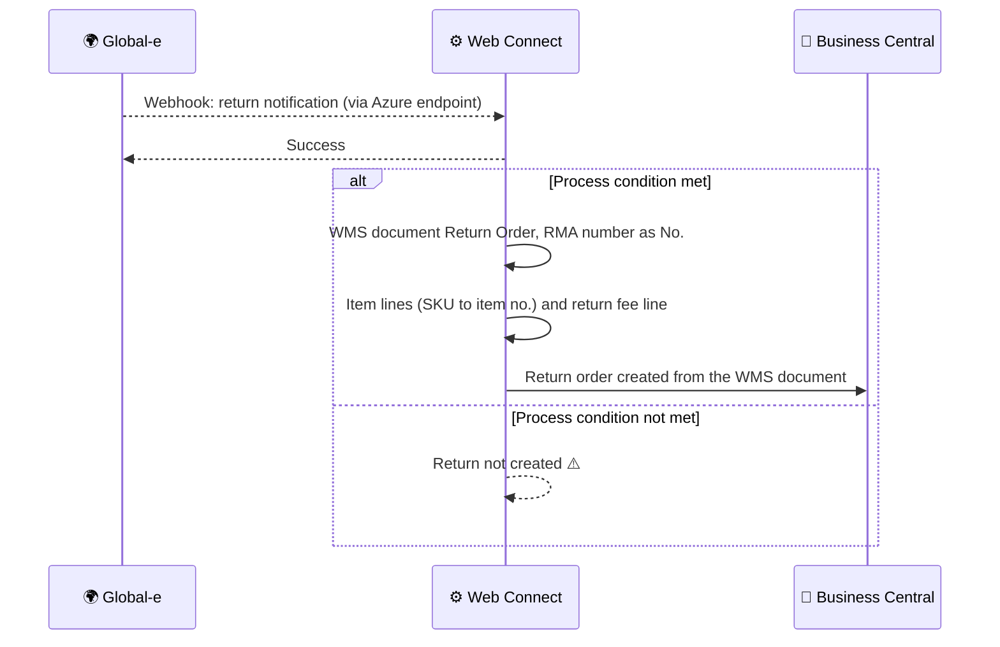

# Global-e returns to Business Central: returns

When a shopper registers a return in Global-e, Global-e sends a return notification to Web Connect as a webhook. Web Connect creates a WMS document of type Return Order with the RMA number, one line per returned item and a line for the return fee, and the return order in Business Central is created from it. The Global-e cart item ID is kept on each line, so the refund can be sent back to Global-e later.

| | |
|---|---|
| **Direction** | Global-e → Business Central |
| **Trigger** | Webhook from Global-e when a return is registered, received by an Azure endpoint and passed on to Web Connect |
| **Result** | A WMS document of type Return Order and a sales return order in Business Central, with item lines, return reasons, the return tracking number and a return fee line |
| **Part of** | [Business Central and Global-e returns integration](../overview.md) |

## Step by step

1. The shopper registers a return in Global-e and gets an RMA number and a return label (Global-e).
2. Global-e sends the return notification to the Web Connect webhook endpoint. Web Connect answers that the call was received and creates incoming data from the payload (Web Connect).
3. The download job checks the process condition on the return. A return that does not meet it is not created (Web Connect).
4. Web Connect creates the WMS document of type Return Order. The RMA number is the document number, and the Global-e order ID is stored as External ID (Web Connect).
5. One line is created for each returned product. The SKU is translated to a Business Central item number, and the quantity, product name, return reasons and cart item ID are stored on the line (Web Connect).
6. A return fee line is added with quantity 1 and the return shipping cost from Global-e as amount (Web Connect).
7. The return order is created in Business Central from the WMS document, through the WMS document mapping and the logistics setup (Business Central).

## Data mapping

Return header:

| Global-e field | Business Central or Web Connect field | Note |
|---|---|---|
| `RMANumber` | WMS document No. | Unique identifier. A new notification with the same RMA number updates the return |
| `OrderId` | External ID | The Global-e order ID |
| `MerchantOrderId` | Stored on the WMS document | The order number in your web shop |
| `ShipperName` | Stored on the WMS document | |
| `ReturnTrackingNumber` | Stored on the WMS document | Can be written to Package Tracking No. on the return order through the WMS document mapping |
| `TrackingURL` | Stored on the WMS document | |
| `CurrencyCode` | Used by the process condition | Not written to the return |
| (fixed) | Document Type `Return Order` and a logistics code for Global-e returns | Set by the mapping, not sent by Global-e |

Return lines, one per item in `ReturnedProducts`:

| Global-e field | Business Central or Web Connect field | Note |
|---|---|---|
| `SKU` | Item No. | Translated with a lookup in the Web Connect SKU table. Blank if not found |
| `ReturnQuantity` | Quantity | |
| `Name` | Stored on the line | The product name in Global-e |
| `CartItemId` | Global-e cart item ID on the return line | Carried to the return order line and used when the refund is sent |
| `MerchantReturnReasonCode` | Stored on the line | |
| `ReturnReasonName` | Stored on the line | The shopper's return reason |

Return fee line, one per return:

| Global-e field | Business Central or Web Connect field | Note |
|---|---|---|
| `ReturnShippingCost` | Amount on the return fee line | Quantity is always 1, and the line is marked as `RETURN FEE` |

## Web Connect objects

| Object | Role |
|---|---|
| `GE_RETURN_RMA` | Receives the webhook and creates the WMS document of type Return Order. Holds the process condition |
| `GE_RETURNEDPRODUCTS` | Creates one WMS document line per returned product |
| `GE_RETURN_FEE` | Creates the return fee line from the same notification |
| `GE_RETURNED_FEEE_PRODUCTS` | Reads the returned products inside the fee part of the notification. Nothing is written from it |

## Error handling

| Situation | What happens | What to do |
|---|---|---|
| The SKU is not in the Web Connect SKU table | The return line gets no item number | Add the SKU to the SKU table and process the incoming data again |
| A return is not created | The return did not meet the process condition, or the download job is not running | Check the condition on `GE_RETURN_RMA` and see [Nothing downloads to Business Central](../../../../../how-to/web-connect/nothing-downloads-to-business-central.md) |
| The same return arrives again | The RMA number matches the existing return, so it is updated | No action needed |

## Frequently asked questions

### What happens if Global-e sends the same return twice?

The RMA number is the unique identifier of the return in Web Connect. A second notification with the same RMA number updates the existing return instead of creating a new one.

### How is the Global-e SKU matched to an item in Business Central?

Through a lookup in the Web Connect SKU table, which translates the SKU to a Business Central item number. If the SKU is not found, the item number on the line is left blank.

## Related

- [Business Central and Global-e returns integration](../overview.md)
- [Refunds](refunds.md)
- [Web Connect WMS Documents](../../../general/wms-documents.md) · [WMS/Return Reason Codes](../../../general/wms-return-reason-codes.md) · [Webhooks](../../../general/webhooks.md)
