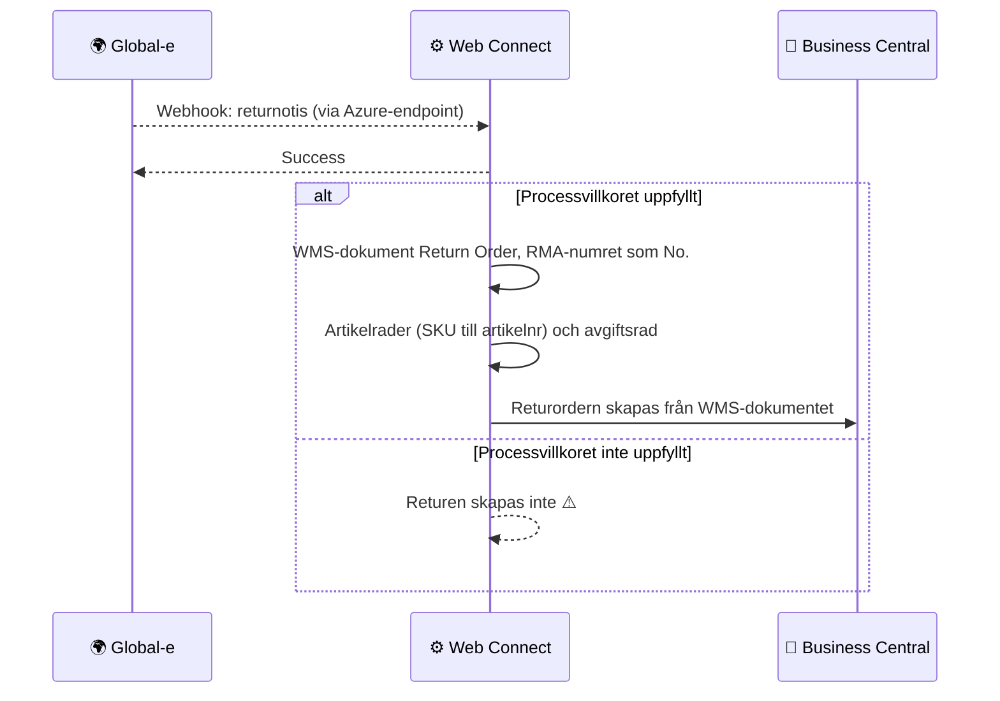

# Från Global-e returns till Business Central: returer

När en kund registrerar en retur i Global-e skickar Global-e en returnotis till Web Connect som en webhook. Web Connect skapar ett WMS-dokument av typen Return Order med RMA-numret, en rad per returnerad artikel och en rad för returavgiften, och utifrån det skapas returordern i Business Central. Global-e:s cart item ID sparas på varje rad, så att återbetalningen senare kan skickas tillbaka till Global-e.

| | |
|---|---|
| **Riktning** | Global-e → Business Central |
| **Startas av** | Webhook från Global-e när en retur registreras. Den tas emot av en Azure-endpoint och skickas vidare till Web Connect |
| **Resultat** | Ett WMS-dokument av typen Return Order och en försäljningsreturorder i Business Central, med artikelrader, returorsaker, returens spårningsnummer och en rad för returavgiften |
| **Del av** | [Business Central och Global-e returns: integration](../overview.md) |

## Steg för steg

1. Kunden registrerar en retur i Global-e och får ett RMA-nummer och en returetikett (Global-e).
2. Global-e skickar returnotisen till webhook-endpointen i Web Connect. Web Connect svarar att anropet tagits emot och skapar inkommande data från innehållet (Web Connect).
3. Nedladdningsjobbet kontrollerar processvillkoret på returen. En retur som inte uppfyller det skapas inte (Web Connect).
4. Web Connect skapar WMS-dokumentet av typen Return Order. RMA-numret blir dokumentnummer, och Global-e:s order-ID sparas som External ID (Web Connect).
5. En rad skapas för varje returnerad produkt. SKU:n översätts till ett artikelnummer i Business Central, och antal, produktnamn, returorsaker och cart item ID sparas på raden (Web Connect).
6. En rad för returavgiften läggs till med antal 1 och returfrakten från Global-e som belopp (Web Connect).
7. Returordern skapas i Business Central från WMS-dokumentet, via mappningen av WMS-dokument och logistikinställningarna (Business Central).

## Mappning av data

Returens huvud:

| Fält i Global-e | Fält i Business Central eller Web Connect | Kommentar |
|---|---|---|
| `RMANumber` | WMS document No. | Unik identifierare. En ny notis med samma RMA-nummer uppdaterar returen |
| `OrderId` | External ID | Global-e:s order-ID |
| `MerchantOrderId` | Sparas på WMS-dokumentet | Ordernumret i din webbshop |
| `ShipperName` | Sparas på WMS-dokumentet | |
| `ReturnTrackingNumber` | Sparas på WMS-dokumentet | Kan skrivas till Package Tracking No. på returordern via mappningen av WMS-dokument |
| `TrackingURL` | Sparas på WMS-dokumentet | |
| `CurrencyCode` | Används av processvillkoret | Skrivs inte till returen |
| (fast värde) | Document Type `Return Order` och en logistikkod för Global-e-returer | Sätts av mappningen, skickas inte av Global-e |

Returrader, en per artikel i `ReturnedProducts`:

| Fält i Global-e | Fält i Business Central eller Web Connect | Kommentar |
|---|---|---|
| `SKU` | Item No. | Översätts med ett uppslag i SKU-tabellen i Web Connect. Tomt om den inte hittas |
| `ReturnQuantity` | Quantity | |
| `Name` | Sparas på raden | Produktnamnet i Global-e |
| `CartItemId` | Global-e:s cart item ID på returraden | Följer med till returorderns rad och används när återbetalningen skickas |
| `MerchantReturnReasonCode` | Sparas på raden | |
| `ReturnReasonName` | Sparas på raden | Kundens returorsak |

Rad för returavgiften, en per retur:

| Fält i Global-e | Fält i Business Central eller Web Connect | Kommentar |
|---|---|---|
| `ReturnShippingCost` | Belopp på raden för returavgiften | Antalet är alltid 1, och raden markeras som `RETURN FEE` |

## Objekt i Web Connect

| Objekt | Roll |
|---|---|
| `GE_RETURN_RMA` | Tar emot webhooken och skapar WMS-dokumentet av typen Return Order. Innehåller processvillkoret |
| `GE_RETURNEDPRODUCTS` | Skapar en rad i WMS-dokumentet per returnerad produkt |
| `GE_RETURN_FEE` | Skapar raden för returavgiften från samma notis |
| `GE_RETURNED_FEEE_PRODUCTS` | Läser de returnerade produkterna i notisens avgiftsdel. Inget skrivs från det |

## Felhantering

| Situation | Vad som händer | Vad du gör |
|---|---|---|
| SKU:n finns inte i SKU-tabellen i Web Connect | Returraden får inget artikelnummer | Lägg till SKU:n i SKU-tabellen och bearbeta den inkommande datan igen |
| En retur skapas inte | Returen uppfyllde inte processvillkoret, eller så körs inte nedladdningsjobbet | Kontrollera villkoret på `GE_RETURN_RMA` och se [Inget laddas ner till Business Central](../../../../../how-to/web-connect/nothing-downloads-to-business-central.md) |
| Samma retur kommer igen | RMA-numret matchar den befintliga returen, så den uppdateras | Inget behöver göras |

## Vanliga frågor

### Vad händer om Global-e skickar samma retur två gånger?

RMA-numret är returens unika identifierare i Web Connect. En andra notis med samma RMA-nummer uppdaterar den befintliga returen i stället för att skapa en ny.

### Hur matchas SKU:n från Global-e mot en artikel i Business Central?

Via ett uppslag i SKU-tabellen i Web Connect, som översätter SKU:n till ett artikelnummer i Business Central. Hittas inte SKU:n lämnas artikelnumret på raden tomt.

## Relaterat

- [Business Central och Global-e returns: integration](../overview.md)
- [Återbetalningar](refunds.md)
- [Web Connect WMS Documents](../../../general/wms-documents.md) · [WMS/Return Reason Codes](../../../general/wms-return-reason-codes.md) · [Webhooks](../../../general/webhooks.md)
