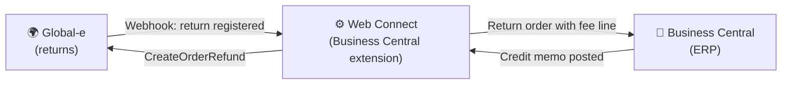
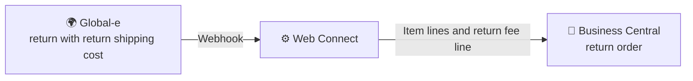
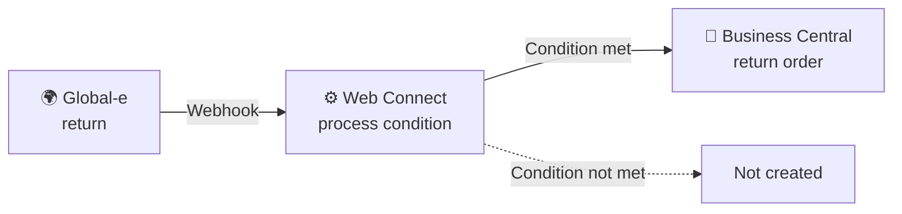

# Business Central and Global-e returns integration

Web Connect by CombineIT connects Microsoft Dynamics 365 Business Central with Global-e returns. When a shopper registers a return in Global-e, the return arrives in Business Central as a return order with the returned items, return reasons and a return fee line. When the credit memo is posted, Web Connect sends the refund to Global-e with the returned items and quantities. All mappings and rules live in your own Business Central, where you can see and change them yourself.

## At a glance

| | |
|---|---|
| **System** | Global-e returns (returns) |
| **Integration product** | Web Connect for Microsoft Dynamics 365 Business Central |
| **Runs in** | Your own Business Central environment, as an extension. Returns come in as webhooks from Global-e, received by an Azure endpoint that passes them on to Web Connect. Refunds are sent from Business Central when the credit memo is posted. All processing and configuration stays in Business Central. |
| **Configured by** | You, in Business Central: mappings, conditions, triggers and flows. You can do all of it yourself. If you want, CombineIT takes part in any step, as a sounding board or by doing the work. |
| **Connection** | Global-e REST API (JSON) and webhooks from Global-e |
| **Global-e API** | [Global-e API integration guides](https://docs-nce.global-e.com/api-integration-guides) |
| **Data flows** | 2: returns with return fee, and refunds |
| **Business Central editions** | All editions, Essentials and Premium, including the latest version |
| **Available from** | [Web Connect on Microsoft AppSource](https://marketplace.microsoft.com/sv-se/product/PUBID.martitab1633951001710%7CAID.webconnect%7CPAPPID.9f3a7223-19db-4ac7-832f-cf8e4699186f?tab=Overview). The Global-e returns integration is not part of the Web Connect Ready Integrations app. It is set up as a configuration in Web Connect |

## What can be synchronized

Web Connect has two data flows between Business Central and Global-e returns.

| Data | Direction | What happens |
|---|---|---|
| [Returns](flows/returns.md) | Global-e → Business Central | A return registered in Global-e becomes a return order in Business Central, with one line per returned item, the return reason, the return tracking number and a return fee line |
| [Refunds](flows/refunds.md) | Business Central → Global-e | When the credit memo is posted, the refund is sent to Global-e with the Global-e order ID and the cart item ID and quantity for each returned item |

Both flows are part of every Global-e returns integration. The return fee line and the conditions that decide which returns are processed are chosen at setup, see [Choose your setup](#choose-your-setup).

## How it works

Global-e sends a return notification as a webhook when a return is registered. An Azure endpoint receives it and passes it on to Web Connect, which answers Global-e that the call was received and creates the return as incoming data. The download job then creates a [WMS document](../../general/wms-documents.md) of type Return Order, with the RMA number as document number, and the return order in Business Central is created from it. Each returned SKU is translated to a Business Central item number, and the Global-e cart item ID is kept on the return line.

When the credit memo for the return is posted, an outgoing sync trigger sends the refund to Global-e. The call carries the Global-e order ID and one line per returned item with the cart item ID and the refunded quantity. Every message received and sent is kept in Web Connect [Entries](../../general/entries.md).

## Choose your setup

Each flow has to fit how your business works: which system owns the data, where people do their work, and what the accounting needs. That is why the flows are decided together when a new integration is set up. The options below are the ones Web Connect customers use today. **Common setup** marks the option most Web Connect customers with Global-e returns use. **Recommended** marks CombineIT's best practice, where there is one.

The Global-e returns integration is in use with two Web Connect customers today, with the same setup. That is too few to say what is common, so no option below is marked as common setup.

### Return fee

| Option | How it works | When it fits |
|---|---|---|
| **Return fee as a line on the return order** | The return shipping cost that Global-e sends with the return becomes a separate line on the return, with quantity 1 and the return shipping cost as amount | The shopper pays for the return, and the fee should reduce the refund and be booked in Business Central |

#### Return fee as a line on the return order

### Which returns are processed

| Option | How it works | When it fits |
|---|---|---|
| **Returns filtered by a condition** | A process condition on the return object is checked before the return is created. Returns that do not meet it stay in Web Connect and no return order is created, for example returns in a currency that is handled another way | Some Global-e returns are handled outside the integration, for example for one market |

#### Returns filtered by a condition

The return itself, the RMA number, the return label and the shopper's return reasons are always handled in Global-e.

## What you need

- Microsoft Dynamics 365 Business Central, any edition (Essentials or Premium), including the latest version
- Web Connect installed from Microsoft AppSource, with an activated Web Connect license
- Your approval for Web Connect to be installed and to act in your Business Central environment
- Your Global-e merchant GUID, which Web Connect sends with every refund
- A return notification webhook in Global-e that points to your Web Connect webhook endpoint. The webhook is set up in Global-e, by Global-e or by you
- Global-e SKUs that can be translated to Business Central item numbers through the Web Connect SKU table
- A WMS document mapping and a Web Connect logistics setup that create return orders from incoming WMS documents, see [Logistics Setup](../../general/logistics-setup.md)

## Setting it up

1. Decide how the return fee is handled and which returns the integration processes, see [Choose your setup](#choose-your-setup).
2. Install Web Connect in Business Central, activate the license and give your approval. Set up the Global-e returns integration source and its objects. The objects are set up as a configuration in Web Connect, not installed from the Ready Integrations app.
3. Enter your Global-e merchant GUID in the refund call.
4. Set up the WMS document mapping for return orders, with the logistics code for Global-e returns, and map return reasons with [WMS/Return Reason Codes](../../general/wms-return-reason-codes.md).
5. Point the Global-e return notification webhook to Web Connect.
6. Test with a few returns in a Business Central sandbox before going live.

## Configure it yourself in Business Central

All configuration and logic in the integration is visible and editable in Business Central. There is no external integration platform where the logic is hidden. The Azure endpoint that receives webhooks only passes the call on to Web Connect.

| What you can change | Where in Web Connect | Example |
|---|---|---|
| Field mapping from Global-e | [Incoming Data mapping](../../general/incoming-data/mapping.md) | Store another field from the return notification on the return, for example the shipper name or the tracking URL |
| Which returns are processed | [Condition List](../../general/condition-list.md) | Skip returns in a specific currency, or only process returns from one web store |
| SKU to item number | Lookup value on the SKU field | Translate the Global-e SKU to the Business Central item number through the Web Connect SKU table |
| Return reasons | [WMS/Return Reason Codes](../../general/wms-return-reason-codes.md) | Translate a Global-e return reason to a Business Central return reason code |
| Return order fields | [Logistics Setup](../../general/logistics-setup.md) and WMS document mapping | Write the return tracking number to the Package Tracking No. field on the return order |
| Field mapping to Global-e | [Outgoing Data](../../general/outgoing-mapping/outgoing-data-web.md) | Change which credit memo field is sent as the Global-e order ID |
| What triggers a refund | [Outgoing Sync Triggers](../../general/outgoing-mapping/outgoing-sync-triggers.md) | Send the refund when the credit memo is posted, only for credit memos whose External Document No. starts with GE |
| Monitoring and resending | [Entries](../../general/entries.md) | See every return received and every refund sent, and [resend a message](../../../../how-to/web-connect/resend-outgoing-message.md) |

## Configuration choices

- **Return document:** returns arrive as WMS documents of type Return Order with a logistics code for Global-e returns. The WMS document mapping decides which values are written to the return order header and lines.
- **Item lookup:** the Global-e SKU is translated to a Business Central item number through the Web Connect SKU table. If no item is found, the item number is left blank.
- **Return reasons:** Global-e sends both the shopper's return reason and the merchant's return reason code. Which one is translated, and to which Business Central return reason code, depends on the return reasons you have in Global-e and in Business Central. It is decided in the mapping at setup.
- **Return fee:** the return shipping cost from Global-e becomes a separate line with quantity 1. You choose the item or account the return fee line uses, and it is set up in the mapping.
- **Process condition:** a condition decides which returns create a return order, for example by currency.
- **Refund filter:** which posted credit memos are sent to Global-e. In the standard setup it is the credit memos whose External Document No. starts with `GE`.

## Limitations

- **Refunds carry items and quantities, not amounts.** Web Connect sends the cart item ID and the refunded quantity for each line. No amounts are sent from Business Central, and the return fee line is not part of the refund call.
- **Only lines with a Global-e cart item ID are refunded.** Credit memo lines without a cart item ID, for example lines added by hand in Business Central, are not sent to Global-e.
- **The External Document No. must hold the Global-e order ID.** The refund is only sent for credit memos whose External Document No. starts with `GE`, and that value is sent to Global-e as the order ID. The Global-e order ID is written to External Document No. on the sales order when the order is imported from the e-commerce platform, for example from an order attribute that holds the Global-e order ID. [ATT FYLLA I: how the value carries over from the sales order to the return order and the posted credit memo]
- **Unknown SKUs are not created as items.** A SKU that is not found in the Web Connect SKU table gives a return line without an item number. Add the SKU to the SKU table before the return is processed.
- **Return status is not sent back to Global-e.** The integration does not tell Global-e when the goods are received in the warehouse. Only the refund is sent.

## Frequently asked questions

### Can Business Central be integrated with Global-e returns?

Yes. Web Connect connects Business Central with Global-e through the Global-e API. Returns registered in Global-e arrive in Business Central as return orders, and the refund is sent to Global-e when the credit memo is posted in Business Central.

### How does a Global-e return reach Business Central?

Global-e sends a return notification to Web Connect as a webhook. Web Connect creates a WMS document of type Return Order with one line per returned item and a line for the return fee, and the return order is created in Business Central from it.

### When is the refund sent to Global-e?

When a sales credit memo is posted in Business Central and its External Document No. starts with GE. Web Connect sends the Global-e order ID and, for each returned item, the cart item ID and the refunded quantity.

### Can some returns be left out of the integration?

Yes. A condition on the return object decides which returns are processed. It can, for example, skip returns in a currency that is handled another way.

## Related

- Flows: [Returns](flows/returns.md) · [Refunds](flows/refunds.md)
- [Web Connect WMS Documents](../../general/wms-documents.md) · [WMS/Return Reason Codes](../../general/wms-return-reason-codes.md) · [Webhooks](../../general/webhooks.md)
- How-to: [Resend an outgoing message](../../../../how-to/web-connect/resend-outgoing-message.md) · [Nothing downloads to Business Central](../../../../how-to/web-connect/nothing-downloads-to-business-central.md)
- [Web Connect general documentation](../../general/README.md)
- [Global-e API integration guides](https://docs-nce.global-e.com/api-integration-guides)

## About Web Connect

Web Connect is an integration platform for Microsoft Dynamics 365 Business Central, developed by CombineIT. It is installed in your own Business Central and connects it with e-commerce platforms, warehouse systems, POS, returns, marketplaces and EDI. Every flow, mapping and rule is configured in Business Central, where you can see and change it yourself, without custom code for each integration. [Web Connect on Microsoft AppSource](https://marketplace.microsoft.com/sv-se/product/PUBID.martitab1633951001710%7CAID.webconnect%7CPAPPID.9f3a7223-19db-4ac7-832f-cf8e4699186f?tab=Overview) · [Contact CombineIT](https://www.combineit.se/contact/)
