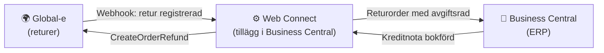
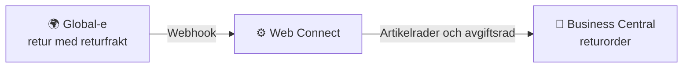
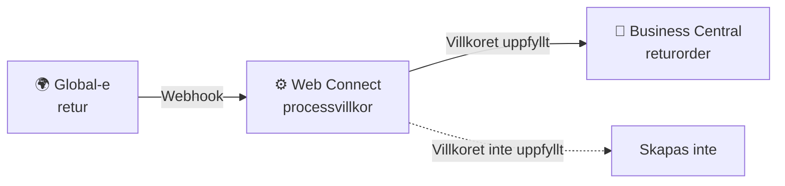

# Business Central och Global-e returns: integration

Web Connect från CombineIT kopplar ihop Microsoft Dynamics 365 Business Central med Global-e returns. När en kund registrerar en retur i Global-e kommer den till Business Central som en returorder med de returnerade artiklarna, returorsakerna och en rad för returavgiften. När kreditnotan bokförs skickar Web Connect återbetalningen till Global-e med returnerade artiklar och antal. Alla mappningar och regler finns i ditt eget Business Central, där du själv kan se och ändra dem.

## I korthet

| | |
|---|---|
| **System** | Global-e returns (returer) |
| **Integrationsprodukt** | Web Connect för Microsoft Dynamics 365 Business Central |
| **Körs i** | Din egen Business Central-miljö, som ett tillägg. Returer kommer in som webhooks från Global-e och tas emot av en Azure-endpoint som skickar dem vidare till Web Connect. Återbetalningar skickas från Business Central när kreditnotan bokförs. All bearbetning och konfiguration ligger kvar i Business Central. |
| **Konfigureras av** | Dig, i Business Central: mappningar, villkor, triggers och flöden. Du kan göra allt själv. Vill du kan CombineIT vara med i vilket steg som helst, som bollplank eller genom att göra jobbet. |
| **Koppling** | Global-e REST API (JSON) och webhooks från Global-e |
| **Global-e API** | [Global-e API integration guides](https://docs-nce.global-e.com/api-integration-guides) |
| **Dataflöden** | 2: returer med returavgift, och återbetalningar |
| **Business Central-utgåvor** | Alla utgåvor, Essentials och Premium, även den senaste versionen |
| **Finns på** | [Web Connect på Microsoft AppSource](https://marketplace.microsoft.com/sv-se/product/PUBID.martitab1633951001710%7CAID.webconnect%7CPAPPID.9f3a7223-19db-4ac7-832f-cf8e4699186f?tab=Overview). Integrationen med Global-e returns ingår inte i appen Web Connect Ready Integrations. Den sätts upp som en konfiguration i Web Connect |

## Det här kan synkas

Web Connect har två dataflöden mellan Business Central och Global-e returns.

| Data | Riktning | Vad som händer |
|---|---|---|
| [Returer](flows/returns.md) | Global-e → Business Central | En retur som registreras i Global-e blir en returorder i Business Central, med en rad per returnerad artikel, returorsaken, returens spårningsnummer och en rad för returavgiften |
| [Återbetalningar](flows/refunds.md) | Business Central → Global-e | När kreditnotan bokförs skickas återbetalningen till Global-e med Global-e:s order-ID samt varukorgsradens ID (cart item ID) och antal för varje returnerad artikel |

Båda flödena ingår i varje integration med Global-e returns. Raden för returavgiften och villkoren som avgör vilka returer som hanteras väljs när integrationen sätts upp, se [Välj upplägg](#choose-your-setup).

## Så fungerar det

Global-e skickar en returnotis som en webhook när en retur registreras. En Azure-endpoint tar emot den och skickar den vidare till Web Connect, som svarar Global-e att anropet tagits emot och skapar returen som inkommande data. Nedladdningsjobbet skapar sedan ett [WMS-dokument](../../general/wms-documents.md) av typen Return Order, med RMA-numret som dokumentnummer, och utifrån det skapas returordern i Business Central. Varje returnerad SKU översätts till ett artikelnummer i Business Central, och Global-e:s cart item ID sparas på returraden.

När kreditnotan för returen bokförs skickar en utgående synktrigger återbetalningen till Global-e. Anropet innehåller Global-e:s order-ID och en rad per returnerad artikel med cart item ID och återbetalat antal. Alla meddelanden som tas emot och skickas sparas i Web Connect [Entries](../../general/entries.md).

## Välj upplägg

Varje flöde måste passa hur ditt företag arbetar: vilket system som äger datan, var personalen gör sitt arbete och vad bokföringen behöver. Därför bestäms flödena tillsammans när en ny integration sätts upp. Alternativen nedan är de som Web Connect-kunder använder i dag. **Vanligt upplägg** markerar det alternativ som flest Web Connect-kunder med Global-e returns använder. **Rekommenderas** markerar CombineIT:s bästa praxis, där det finns en.

Integrationen med Global-e returns används i dag av två Web Connect-kunder, med samma upplägg. Det är för få för att säga vad som är vanligt, så inget alternativ nedan är markerat som vanligt upplägg.

### Returavgift

| Alternativ | Så fungerar det | När det passar |
|---|---|---|
| **Returavgiften som en rad på returordern** | Returfrakten som Global-e skickar med returen blir en egen rad på returen, med antal 1 och returfrakten som belopp | Kunden betalar för returen, och avgiften ska minska återbetalningen och bokföras i Business Central |

#### Returavgiften som en rad på returordern

### Vilka returer som hanteras

| Alternativ | Så fungerar det | När det passar |
|---|---|---|
| **Returer filtreras med ett villkor** | Ett processvillkor på returobjektet kontrolleras innan returen skapas. Returer som inte uppfyller det stannar i Web Connect och ingen returorder skapas, till exempel returer i en valuta som hanteras på annat sätt | Vissa returer från Global-e hanteras utanför integrationen, till exempel för en viss marknad |

#### Returer filtreras med ett villkor

Själva returen, RMA-numret, returetiketten och kundens returorsaker hanteras alltid i Global-e.

## Det här behöver du

- Microsoft Dynamics 365 Business Central, valfri utgåva (Essentials eller Premium), även den senaste versionen
- Web Connect installerat från Microsoft AppSource, med en aktiverad Web Connect-licens
- Ditt godkännande av att Web Connect installeras och får agera i din Business Central-miljö
- Ditt merchant GUID i Global-e, som Web Connect skickar med varje återbetalning
- En webhook för returnotiser i Global-e som pekar på din webhook-endpoint i Web Connect. Webhooken sätts upp i Global-e, av Global-e eller av dig
- SKU:er i Global-e som går att översätta till artikelnummer i Business Central via SKU-tabellen i Web Connect
- En mappning av WMS-dokument och logistikinställningar i Web Connect som skapar returorder från inkommande WMS-dokument, se [Logistics Setup](../../general/logistics-setup.md)

## Så kommer du igång

1. Bestäm hur returavgiften ska hanteras och vilka returer integrationen ska hantera, se [Välj upplägg](#choose-your-setup).
2. Installera Web Connect i Business Central, aktivera licensen och lämna ditt godkännande. Sätt upp integrationskällan för Global-e returns och dess objekt. Objekten sätts upp som en konfiguration i Web Connect och installeras inte från appen Ready Integrations.
3. Ange ditt merchant GUID i Global-e i anropet för återbetalningar.
4. Sätt upp mappningen av WMS-dokument för returorder, med logistikkoden för Global-e-returer, och mappa returorsaker med [WMS/Return Reason Codes](../../general/wms-return-reason-codes.md).
5. Peka webhooken för returnotiser i Global-e mot Web Connect.
6. Testa med några returer i en sandlåda i Business Central innan ni går live.

## Konfigurera själv i Business Central

All konfiguration och logik i integrationen går att se och ändra i Business Central. Det finns ingen extern integrationsplattform där logiken är dold. Azure-endpointen som tar emot webhooks skickar bara anropet vidare till Web Connect.

| Det här kan du ändra | Var i Web Connect | Exempel |
|---|---|---|
| Fältmappning från Global-e | [Incoming Data mapping](../../general/incoming-data/mapping.md) | Spara ett annat fält från returnotisen på returen, till exempel transportörens namn eller spårningslänken |
| Vilka returer som hanteras | [Condition List](../../general/condition-list.md) | Hoppa över returer i en viss valuta, eller hantera bara returer från en viss webbshop |
| SKU till artikelnummer | Uppslagsvärde på SKU-fältet | Översätt SKU:n från Global-e till artikelnumret i Business Central via SKU-tabellen i Web Connect |
| Returorsaker | [WMS/Return Reason Codes](../../general/wms-return-reason-codes.md) | Översätt en returorsak i Global-e till en returorsakskod i Business Central |
| Fält på returordern | [Logistics Setup](../../general/logistics-setup.md) och mappningen av WMS-dokument | Skriv returens spårningsnummer till fältet Package Tracking No. på returordern |
| Fältmappning till Global-e | [Outgoing Data](../../general/outgoing-mapping/outgoing-data-web.md) | Ändra vilket fält på kreditnotan som skickas som Global-e:s order-ID |
| Vad som startar en återbetalning | [Outgoing Sync Triggers](../../general/outgoing-mapping/outgoing-sync-triggers.md) | Skicka återbetalningen när kreditnotan bokförs, bara för kreditnotor vars External Document No. börjar med GE |
| Övervakning och omsändning | [Entries](../../general/entries.md) | Se varje retur som tagits emot och varje återbetalning som skickats, och [skicka ett meddelande igen](../../../../how-to/web-connect/resend-outgoing-message.md) |

## Val i konfigurationen

- **Returdokument:** returer kommer in som WMS-dokument av typen Return Order med en logistikkod för Global-e-returer. Mappningen av WMS-dokument avgör vilka värden som skrivs till returorderns huvud och rader.
- **Artikeluppslag:** SKU:n från Global-e översätts till ett artikelnummer i Business Central via SKU-tabellen i Web Connect. Hittas ingen artikel lämnas artikelnumret tomt.
- **Returorsaker:** Global-e skickar både kundens returorsak och handlarens returorsakskod. Vilken av dem som översätts, och till vilken returorsakskod i Business Central, beror på vilka returorsaker du har i Global-e och i Business Central. Det bestäms i mappningen när integrationen sätts upp.
- **Returavgift:** returfrakten från Global-e blir en egen rad med antal 1. Du väljer vilken artikel eller vilket konto raden för returavgiften använder, och det sätts upp i mappningen.
- **Processvillkor:** ett villkor avgör vilka returer som skapar en returorder, till exempel utifrån valuta.
- **Filter för återbetalningar:** vilka bokförda kreditnotor som skickas till Global-e. I standardupplägget är det kreditnotor vars External Document No. börjar med `GE`.

## Begränsningar

- **Återbetalningar innehåller artiklar och antal, inte belopp.** Web Connect skickar cart item ID och återbetalat antal för varje rad. Inga belopp skickas från Business Central, och raden för returavgiften ingår inte i anropet för återbetalningen.
- **Bara rader med ett cart item ID från Global-e återbetalas.** Rader på kreditnotan utan cart item ID, till exempel rader som lagts till för hand i Business Central, skickas inte till Global-e.
- **External Document No. måste innehålla Global-e:s order-ID.** Återbetalningen skickas bara för kreditnotor vars External Document No. börjar med `GE`, och det värdet skickas till Global-e som order-ID. Global-e:s order-ID skrivs till External Document No. på försäljningsordern när ordern importeras från e-handelsplattformen, till exempel från ett orderattribut som innehåller Global-e:s order-ID. Kreditnotan skapas från returordern.
- **Okända SKU:er skapas inte som artiklar.** En SKU som inte finns i SKU-tabellen i Web Connect ger en returrad utan artikelnummer. Lägg till SKU:n i SKU-tabellen innan returen hanteras.
- **Returstatus skickas inte tillbaka till Global-e.** Integrationen meddelar inte Global-e när varorna tagits emot i lagret. Bara återbetalningen skickas.

## Vanliga frågor

### Går det att integrera Business Central med Global-e returns?

Ja. Web Connect kopplar ihop Business Central med Global-e via Global-e:s API. Returer som registreras i Global-e kommer till Business Central som returorder, och återbetalningen skickas till Global-e när kreditnotan bokförs i Business Central.

### Hur kommer en retur från Global-e in i Business Central?

Global-e skickar en returnotis till Web Connect som en webhook. Web Connect skapar ett WMS-dokument av typen Return Order med en rad per returnerad artikel och en rad för returavgiften, och utifrån det skapas returordern i Business Central.

### När skickas återbetalningen till Global-e?

När en försäljningskreditnota bokförs i Business Central och dess External Document No. börjar med GE. Web Connect skickar Global-e:s order-ID och, för varje returnerad artikel, varukorgsradens ID (cart item ID) och det återbetalade antalet.

### Kan vissa returer hållas utanför integrationen?

Ja. Ett villkor på returobjektet avgör vilka returer som hanteras. Det kan till exempel hoppa över returer i en valuta som hanteras på annat sätt.

## Relaterat

- Flöden: [Returer](flows/returns.md) · [Återbetalningar](flows/refunds.md)
- [Web Connect WMS Documents](../../general/wms-documents.md) · [WMS/Return Reason Codes](../../general/wms-return-reason-codes.md) · [Webhooks](../../general/webhooks.md)
- Instruktioner: [Skicka ett utgående meddelande igen](../../../../how-to/web-connect/resend-outgoing-message.md) · [Inget laddas ner till Business Central](../../../../how-to/web-connect/nothing-downloads-to-business-central.md)
- [Allmän dokumentation för Web Connect](../../general/README.md)
- [Global-e API integration guides](https://docs-nce.global-e.com/api-integration-guides)

## Om Web Connect

Web Connect är en integrationsplattform för Microsoft Dynamics 365 Business Central, utvecklad av CombineIT. Den installeras i ditt eget Business Central och kopplar ihop det med e-handelsplattformar, lagersystem, kassasystem, returer, marknadsplatser och EDI. Varje flöde, mappning och regel konfigureras i Business Central, där du själv kan se och ändra den, utan specialkod för varje integration. [Web Connect på Microsoft AppSource](https://marketplace.microsoft.com/sv-se/product/PUBID.martitab1633951001710%7CAID.webconnect%7CPAPPID.9f3a7223-19db-4ac7-832f-cf8e4699186f?tab=Overview) · [Kontakta CombineIT](https://www.combineit.se/contact/)
