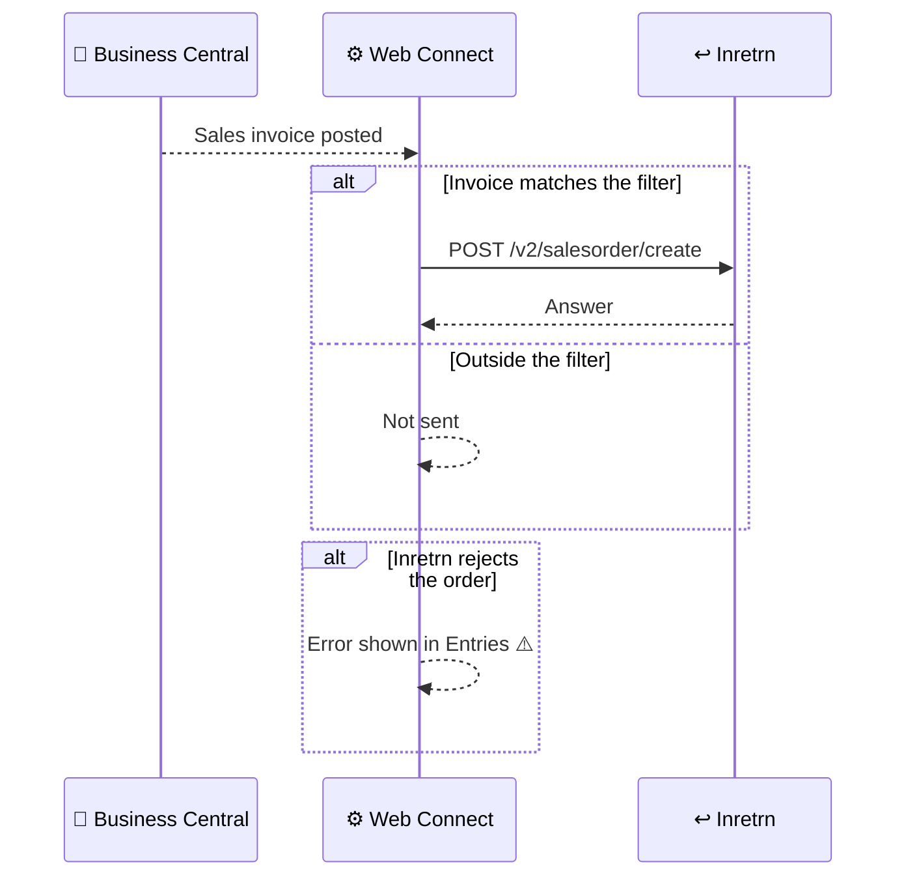

# Business Central to Inretrn: invoiced orders

When a sales invoice is posted in Business Central, Web Connect sends the order to Inretrn. The order is created in Inretrn with the order number, buyer, address, rows, prices, customs data and tracking number, so the customer can register a return against it.

| | |
|---|---|
| **Direction** | Business Central → Inretrn |
| **Trigger** | Outgoing sync trigger in Business Central: the sales invoice is posted |
| **Result** | The order exists in Inretrn and the customer can register a return against it |
| **Part of** | [Business Central and Inretrn integration](../overview.md) |

## Step by step

1. A sales invoice is posted in Business Central.
2. The outgoing sync trigger checks the filter on the posted invoice, for example the sell-to customer and the external document number. Invoices outside the filter are not sent.
3. Web Connect builds the order from the posted invoice, its rows and related records: the item for customs data and vendor, the item variant, the item reference for the barcode, the item category and the item unit of measure for the dimensions.
4. The order is sent with `POST` to `/v2/salesorder/create`, inside a `SalesOrders` array with one invoice per message.
5. The message and the answer from Inretrn are logged in Web Connect Entries.

## Data mapping

### Order

| Business Central field | Inretrn field | Note |
|---|---|---|
| Order No. on the posted invoice | `OrderNo` | |
| Order Date | `OrderDate` | |
| Currency Code | `Currency` | An empty currency code is replaced with the local currency through a value mapping |
| Shipping Agent Service Code | `TransportService` | |
| Package Tracking No. | `TrackingNo` | |
| Integration variable | `ExternalSellerReference` | The seller reference, set per Business Central company |
| Shipment Date | `ShipDate` | |

### Buyer and address

| Business Central field | Inretrn field | Note |
|---|---|---|
| Sell-to E-Mail | `Buyer.CustomerNo` and `Buyer.Email` | The e-mail address identifies the buyer in Inretrn |
| Sell-to Customer Name | `Buyer.Name` | |
| Ship-to Phone No. | `Buyer.MobilePhone` | |
| Bill-to Address and Address 2 | `Buyer.Address.AddressLine1` and `AddressLine2` | |
| Bill-to Post Code, City, County | `Buyer.Address.PostalCode`, `City`, `Region` | |
| Bill-to Country/Region Code | `Buyer.Address.Country` | |

### Rows

Item rows and G/L account rows on the invoice are sent.

| Business Central field | Inretrn field | Note |
|---|---|---|
| No. | `LineType` | Through a value mapping: ordinary rows get `1`, freight, gift card and other listed numbers get `2` |
| No. | `ItemNo` | |
| Variant Code | `ItemVariantNo` | |
| Item variant description | `ItemVariantDescription` | Looked up from the item variant |
| Description | `ItemDescription1` | |
| Item: Country/Region of Origin | `ItemCountryOfOrigin` | |
| Item: Tariff No. | `ItemHarmonizationCode` | |
| Item: Net Weight | `UnitNetWeight` | |
| Unit Cost (LCY) | `UnitInPrice` | Converted to the invoice currency with the currency factor when the invoice has a currency code |
| Item reference of type bar code | `ItemEan` | |
| Line No. | `LineNumber` | |
| Quantity | `OrderedQuantity` and `ShippedQuantity` | |
| Unit of Measure Code | `UnitOfMeasure` | |
| Amount divided by quantity | `UnitNetPrice` | Net price per unit excluding VAT |
| Amount Including VAT divided by quantity | `UnitGrossPrice` | Price per unit including VAT |
| Line Discount % | `DiscountPercent` | |
| VAT % | `VatPercent` | |
| Item: Vendor No. | `SupplierCodeName` | |
| Item: Vendor Item No. | `SupplierArticleNo` | |
| Item Category Code and its description | `ProductGroup` and `ProductGroupDescription` | |
| Item unit of measure: height, width, length | `UnitHeight`, `UnitWidth`, `UnitLength` | |
| Fixed values | `Attributes` | Row attributes with a fixed key and value, for example the country |

A brand field from an extension can be sent as `BrandName` and `BrandCodeName` on the rows.

## Web Connect objects

| Object | Role |
|---|---|
| `IR_SALESINVOICE` | The posted sales invoice. Holds the trigger, the filter and the path `/v2/salesorder/create` |
| `IR_SI_ENVELOPE` | Wraps the order in the `SalesOrders` array |
| `IR_INVOICEBUYER` | The buyer |
| `IR_ADDRESS` | The buyer's address |
| `IR_ORDERLINES` | The invoice rows |
| `IR_ATTRIBUTES` | Row attributes |
| `IR_ITEM`, `IR_VARIANT`, `IR_ITEMREF`, `IR_ITEMCAT`, `IR_ITEMUNITOFMEASURE` | Lookups on the item, the item variant, the item reference, the item category and the item unit of measure |

## Error handling

| Situation | What happens | What to do |
|---|---|---|
| Inretrn rejects the order | The message stops in Web Connect Entries with the answer from Inretrn | Correct the cause and [resend the message](../../../../../how-to/web-connect/resend-outgoing-message.md) |
| The invoice is not sent | The invoice is outside the filter on the object | Check the filter on `IR_SALESINVOICE` |
| The API key is not accepted | Inretrn answers with an authorization error | Check the API key in [Secret Value Storage](../../../general/secret-value-storage.md) |

## Frequently asked questions

### Which order number does Inretrn get?

The order number from the posted sales invoice, that is the number of the sales order the invoice was posted from. The customer uses the same order number when registering a return.

### Are freight and gift card rows sent to Inretrn?

Yes. Item rows and G/L account rows on the invoice are sent. Rows with the item or account number for freight or gift cards are sent with another line type than ordinary item rows, set through a value mapping.

### Can an invoice be sent again?

Yes. Every message is logged in Web Connect Entries, where it can be resent, for example after an error from Inretrn.

## Related

- [Business Central and Inretrn integration](../overview.md)
- [Return orders](return-orders.md)
- [Outgoing Sync Triggers](../../../general/outgoing-mapping/outgoing-sync-triggers.md) · [Dynamic Flow Fields](../../../general/dynamic-flow-fields.md) · [Text Mapping](../../../general/text-mapping.md)
