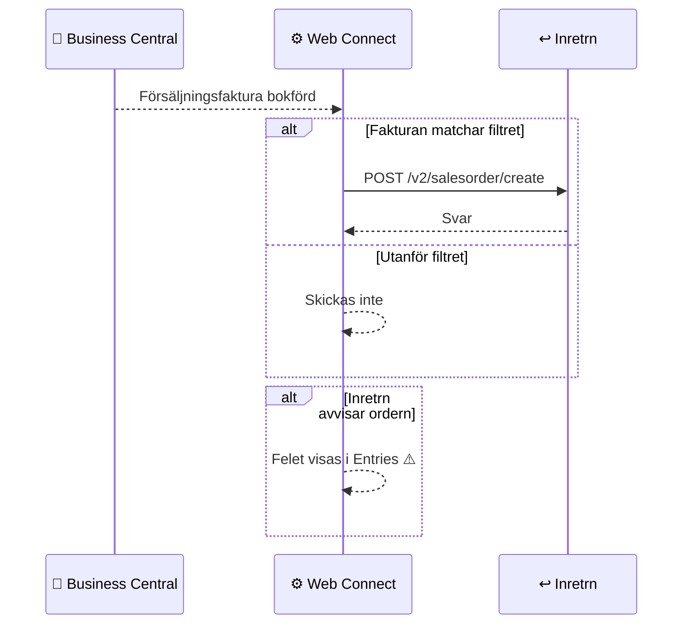

# Från Business Central till Inretrn: fakturerade order

När en försäljningsfaktura bokförs i Business Central skickar Web Connect ordern till Inretrn. Ordern skapas i Inretrn med ordernummer, köpare, adress, rader, priser, tulluppgifter och spårningsnummer, så att kunden kan registrera en retur mot den.

| | |
|---|---|
| **Riktning** | Business Central → Inretrn |
| **Startas av** | Utgående synktrigger i Business Central: försäljningsfakturan bokförs |
| **Resultat** | Ordern finns i Inretrn och kunden kan registrera en retur mot den |
| **Del av** | [Business Central och Inretrn: integration](../overview.md) |

## Steg för steg

1. En försäljningsfaktura bokförs i Business Central.
2. Den utgående synktriggern kontrollerar filtret på den bokförda fakturan, till exempel kunden (sell-to customer) och det externa dokumentnumret. Fakturor utanför filtret skickas inte.
3. Web Connect bygger ordern från den bokförda fakturan, dess rader och tillhörande poster: artikeln för tulluppgifter och leverantör, artikelvarianten, artikelreferensen för streckkoden, artikelkategorin och artikelns enhet för måtten.
4. Ordern skickas med `POST` till `/v2/salesorder/create`, i en `SalesOrders`-array med en faktura per meddelande.
5. Meddelandet och svaret från Inretrn loggas i Web Connect Entries.

## Mappning av data

### Order

| Fält i Business Central | Fält i Inretrn | Kommentar |
|---|---|---|
| Order No. på den bokförda fakturan | `OrderNo` | |
| Order Date | `OrderDate` | |
| Currency Code | `Currency` | En tom valutakod ersätts med den lokala valutan via en värdemappning |
| Shipping Agent Service Code | `TransportService` | |
| Package Tracking No. | `TrackingNo` | |
| Integrationsvariabel | `ExternalSellerReference` | Säljarreferensen, satt per företag i Business Central |
| Shipment Date | `ShipDate` | |

### Köpare och adress

| Fält i Business Central | Fält i Inretrn | Kommentar |
|---|---|---|
| Sell-to E-Mail | `Buyer.CustomerNo` och `Buyer.Email` | E-postadressen identifierar köparen i Inretrn |
| Sell-to Customer Name | `Buyer.Name` | |
| Ship-to Phone No. | `Buyer.MobilePhone` | |
| Bill-to Address och Address 2 | `Buyer.Address.AddressLine1` och `AddressLine2` | |
| Bill-to Post Code, City, County | `Buyer.Address.PostalCode`, `City`, `Region` | |
| Bill-to Country/Region Code | `Buyer.Address.Country` | |

### Rader

Artikelrader och rader med redovisningskonto på fakturan skickas.

| Fält i Business Central | Fält i Inretrn | Kommentar |
|---|---|---|
| No. | `LineType` | Via en värdemappning: vanliga rader får `1`, frakt, presentkort och andra listade nummer får `2` |
| No. | `ItemNo` | |
| Variant Code | `ItemVariantNo` | |
| Artikelvariantens beskrivning | `ItemVariantDescription` | Hämtas från artikelvarianten |
| Description | `ItemDescription1` | |
| Artikel: Country/Region of Origin | `ItemCountryOfOrigin` | |
| Artikel: Tariff No. | `ItemHarmonizationCode` | |
| Artikel: Net Weight | `UnitNetWeight` | |
| Unit Cost (LCY) | `UnitInPrice` | Räknas om till fakturans valuta med valutafaktorn när fakturan har en valutakod |
| Artikelreferens av typen streckkod | `ItemEan` | |
| Line No. | `LineNumber` | |
| Quantity | `OrderedQuantity` och `ShippedQuantity` | |
| Unit of Measure Code | `UnitOfMeasure` | |
| Amount delat med antal | `UnitNetPrice` | Nettopris per enhet utan moms |
| Amount Including VAT delat med antal | `UnitGrossPrice` | Pris per enhet med moms |
| Line Discount % | `DiscountPercent` | |
| VAT % | `VatPercent` | |
| Artikel: Vendor No. | `SupplierCodeName` | |
| Artikel: Vendor Item No. | `SupplierArticleNo` | |
| Item Category Code och dess beskrivning | `ProductGroup` och `ProductGroupDescription` | |
| Artikelns enhet: höjd, bredd, längd | `UnitHeight`, `UnitWidth`, `UnitLength` | |
| Fasta värden | `Attributes` | Radattribut med fast nyckel och fast värde, till exempel landet |

Ett varumärkesfält från ett tillägg kan skickas som `BrandName` och `BrandCodeName` på raderna.

## Objekt i Web Connect

| Objekt | Roll |
|---|---|
| `IR_SALESINVOICE` | Den bokförda försäljningsfakturan. Innehåller triggern, filtret och sökvägen `/v2/salesorder/create` |
| `IR_SI_ENVELOPE` | Lägger ordern i `SalesOrders`-arrayen |
| `IR_INVOICEBUYER` | Köparen |
| `IR_ADDRESS` | Köparens adress |
| `IR_ORDERLINES` | Fakturans rader |
| `IR_ATTRIBUTES` | Radattribut |
| `IR_ITEM`, `IR_VARIANT`, `IR_ITEMREF`, `IR_ITEMCAT`, `IR_ITEMUNITOFMEASURE` | Uppslag på artikeln, artikelvarianten, artikelreferensen, artikelkategorin och artikelns enhet |

## Felhantering

| Situation | Vad som händer | Vad du gör |
|---|---|---|
| Inretrn avvisar ordern | Meddelandet stannar i Web Connect Entries med svaret från Inretrn | Rätta orsaken och [skicka meddelandet igen](../../../../../how-to/web-connect/resend-outgoing-message.md) |
| Fakturan skickas inte | Fakturan ligger utanför filtret på objektet | Kontrollera filtret på `IR_SALESINVOICE` |
| API-nyckeln godkänns inte | Inretrn svarar med ett behörighetsfel | Kontrollera API-nyckeln i [Secret Value Storage](../../../general/secret-value-storage.md) |

## Vanliga frågor

### Vilket ordernummer får Inretrn?

Ordernumret från den bokförda försäljningsfakturan, alltså numret på den försäljningsorder som fakturan bokfördes från. Kunden använder samma ordernummer när returen registreras.

### Skickas frakt- och presentkortsrader till Inretrn?

Ja. Artikelrader och rader med redovisningskonto på fakturan skickas. Rader med artikel- eller kontonumret för frakt eller presentkort skickas med en annan radtyp än vanliga artikelrader, vilket styrs med en värdemappning.

### Går det att skicka en faktura igen?

Ja. Varje meddelande loggas i Web Connect Entries, där det går att skicka igen, till exempel efter ett fel från Inretrn.

## Relaterat

- [Business Central och Inretrn: integration](../overview.md)
- [Returorder](return-orders.md)
- [Outgoing Sync Triggers](../../../general/outgoing-mapping/outgoing-sync-triggers.md) · [Dynamic Flow Fields](../../../general/dynamic-flow-fields.md) · [Text Mapping](../../../general/text-mapping.md)
