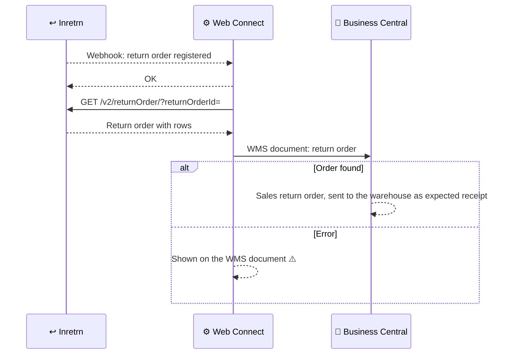

# Inretrn to Business Central: return orders

When a customer registers a return in Inretrn, Inretrn sends a webhook to Web Connect. Web Connect fetches the full return order from the Inretrn API and creates a WMS document of the type return order in Business Central, with item, variant, returned quantity and refund value per row.

| | |
|---|---|
| **Direction** | Inretrn → Business Central |
| **Trigger** | Webhook from Inretrn when a return order is registered |
| **Result** | A WMS document of the type return order and a sales return order in Business Central, with a line per returned row |
| **Part of** | [Business Central and Inretrn integration](../overview.md) |

## Step by step

1. The customer registers a return in Inretrn against an order that Web Connect sent earlier.
2. Inretrn sends a webhook, received by an Azure endpoint that passes it on to Web Connect. Web Connect answers `OK`.
3. Web Connect reads the return order ID from the webhook and fetches the return order with `GET` on `/v2/returnOrder/?returnOrderId=`.
4. Web Connect creates a [WMS document](../../../general/wms-documents.md) of the type return order with the logistics code for Inretrn. The Inretrn return order number is the key, and the original order number is stored on the document.
5. Each returned row becomes a line on the WMS document with item, variant, returned quantity and refund value. Freight rows are marked as freight.
6. The [logistics setup](../../../general/logistics-setup.md) for Inretrn creates the sales return order from the WMS document and, when your warehouse system is also connected through Web Connect, sends it on to the warehouse as an expected receipt (Business Central).
7. The logistics setup decides whether the return receipt is posted automatically when the warehouse reports that the goods have arrived. The credit memo and the refund follow in the system where the payment was captured.

## Data mapping

### Return order

| Inretrn field | Business Central field | Note |
|---|---|---|
| `returnOrderNumber` | WMS document number | The key. A return order that comes in again updates the same WMS document |
| `salesOrderNumber` | Original order number | The order number sent in [Invoiced orders](invoiced-orders.md) |
| `closedDate` | Date on the WMS document | |

The document type is always return order, and the logistics code is the one set up for Inretrn.

### Rows

| Inretrn field | Business Central field | Note |
|---|---|---|
| `internalOrderLineId` | Line reference on the WMS document line | |
| `itemNumber` | Item number | |
| `itemVariantNumber` | Variant code | |
| `returnedQuantity` | Quantity | |
| `lineType` | Freight line | Line type `2` marks the row as freight |
| `unitRefundValue` | Unit refund value | |

Inretrn also sends reason codes, exchange information, parcel number, customer comment and refund flags per row. They are not mapped in the standard setup, and can be added in the [Incoming Data mapping](../../../general/incoming-data/mapping.md).

## Web Connect objects

| Object | Role |
|---|---|
| `IR_RETURNORDER` | Receives the webhook, answers `OK` and starts the download of the return order |
| `IR_EXTIDURL` | Puts the return order ID from the webhook into the URL |
| `IR_GET_RETURNORDER` | Fetches the return order and creates the WMS document |
| `IR_RETURNORDERLINES` | The returned rows. A process condition decides which rows are processed |
| `IR_EXCHANGEINFO` | Exchange information on a row. Not read in the standard setup |

## Error handling

| Situation | What happens | What to do |
|---|---|---|
| The return order cannot be fetched | The download stops in Web Connect Entries with the answer from Inretrn | Check the API key and [resend the message](../../../../../how-to/web-connect/resend-outgoing-message.md) |
| The return order cannot be created in Business Central | The error is shown on the WMS document | Correct the cause, for example a missing item or order, and process the WMS document again |
| No returns arrive | The webhook is not reaching Web Connect | See [Nothing downloads to Business Central](../../../../../how-to/web-connect/nothing-downloads-to-business-central.md) and check the webhook in Inretrn |

## Frequently asked questions

### What does the webhook from Inretrn contain?

Only the ID of the return order and some information about the event. Web Connect answers the webhook and then fetches the full return order from the Inretrn API with that ID.

### Can the same return come in twice?

The Inretrn return order number is the key on the WMS document. If the same return order comes in again, the existing WMS document is updated instead of a new one being created.

## Related

- [Business Central and Inretrn integration](../overview.md)
- [Invoiced orders](invoiced-orders.md)
- [WMS Documents](../../../general/wms-documents.md) · [Logistics Setup](../../../general/logistics-setup.md) · [Webhooks](../../../general/webhooks.md)
