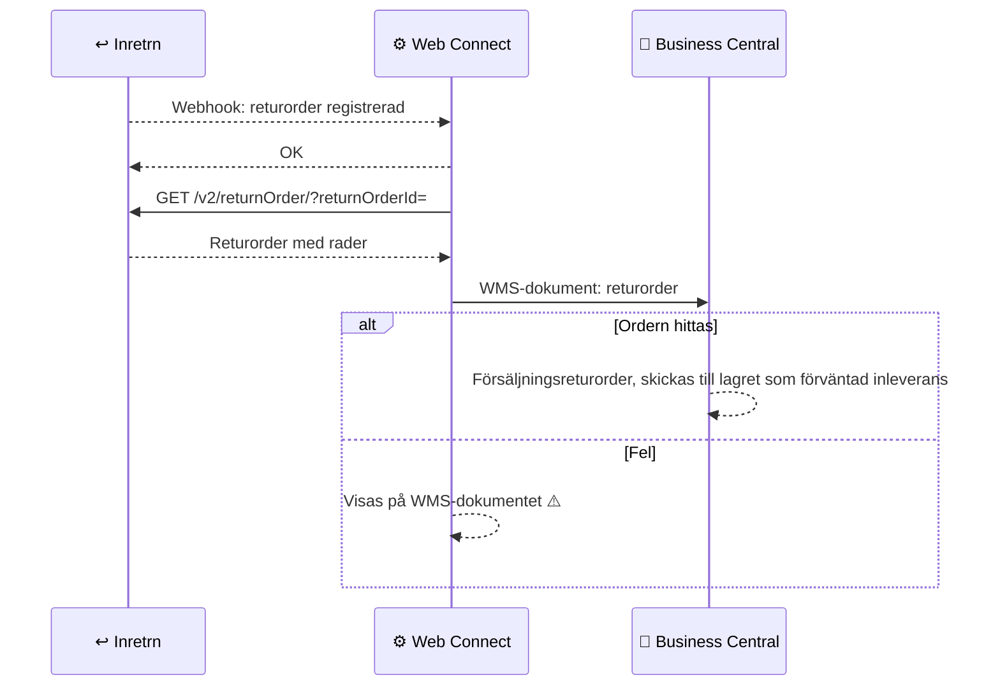

# Från Inretrn till Business Central: returorder

När en kund registrerar en retur i Inretrn skickar Inretrn en webhook till Web Connect. Web Connect hämtar hela returordern från Inretrns API och skapar ett WMS-dokument av typen returorder i Business Central, med artikel, variant, returnerat antal och återbetalningsvärde per rad.

| | |
|---|---|
| **Riktning** | Inretrn → Business Central |
| **Startas av** | Webhook från Inretrn när en returorder registreras |
| **Resultat** | Ett WMS-dokument av typen returorder och en försäljningsreturorder i Business Central, med en rad per returnerad rad |
| **Del av** | [Business Central och Inretrn: integration](../overview.md) |

## Steg för steg

1. Kunden registrerar en retur i Inretrn mot en order som Web Connect skickat tidigare.
2. Inretrn skickar en webhook som tas emot av en Azure-endpoint och skickas vidare till Web Connect. Web Connect svarar `OK`.
3. Web Connect läser returorderns ID från webhooken och hämtar returordern med `GET` på `/v2/returnOrder/?returnOrderId=`.
4. Web Connect skapar ett [WMS-dokument](../../../general/wms-documents.md) av typen returorder med logistikkoden för Inretrn. Inretrns returordernummer är nyckeln, och det ursprungliga ordernumret sparas på dokumentet.
5. Varje returnerad rad blir en rad på WMS-dokumentet med artikel, variant, returnerat antal och återbetalningsvärde. Fraktrader markeras som frakt.
6. [Logistikinställningarna](../../../general/logistics-setup.md) för Inretrn skapar försäljningsreturordern från WMS-dokumentet och skickar den, när ditt lagersystem också är kopplat via Web Connect, vidare till lagret som en förväntad inleverans (Business Central).
7. Logistikinställningarna avgör om returinleveransen bokförs automatiskt när lagret rapporterar att varorna har kommit. Kreditnotan och återbetalningen görs sedan i det system där betalningen drogs.

## Mappning av data

### Returorder

| Fält i Inretrn | Fält i Business Central | Kommentar |
|---|---|---|
| `returnOrderNumber` | WMS-dokumentets nummer | Nyckeln. En returorder som kommer in igen uppdaterar samma WMS-dokument |
| `salesOrderNumber` | Ursprungligt ordernummer | Ordernumret som skickades i [Fakturerade order](invoiced-orders.md) |
| `closedDate` | Datum på WMS-dokumentet | |

Dokumenttypen är alltid returorder, och logistikkoden är den som satts upp för Inretrn.

### Rader

| Fält i Inretrn | Fält i Business Central | Kommentar |
|---|---|---|
| `internalOrderLineId` | Radreferens på WMS-dokumentets rad | |
| `itemNumber` | Artikelnummer | |
| `itemVariantNumber` | Variantkod | |
| `returnedQuantity` | Antal | |
| `lineType` | Fraktrad | Radtyp `2` markerar raden som frakt |
| `unitRefundValue` | Återbetalningsvärde per enhet | |

Inretrn skickar också orsakskoder, uppgifter om byte, kollinummer, kundkommentar och återbetalningsflaggor per rad. De mappas inte i standardupplägget och kan läggas till i [Incoming Data mapping](../../../general/incoming-data/mapping.md).

## Objekt i Web Connect

| Objekt | Roll |
|---|---|
| `IR_RETURNORDER` | Tar emot webhooken, svarar `OK` och startar nedladdningen av returordern |
| `IR_EXTIDURL` | Lägger in returorderns ID från webhooken i URL:en |
| `IR_GET_RETURNORDER` | Hämtar returordern och skapar WMS-dokumentet |
| `IR_RETURNORDERLINES` | De returnerade raderna. Ett processvillkor avgör vilka rader som hanteras |
| `IR_EXCHANGEINFO` | Uppgifter om byte på en rad. Läses inte i standardupplägget |

## Felhantering

| Situation | Vad som händer | Vad du gör |
|---|---|---|
| Returordern går inte att hämta | Nedladdningen stannar i Web Connect Entries med svaret från Inretrn | Kontrollera API-nyckeln och [skicka meddelandet igen](../../../../../how-to/web-connect/resend-outgoing-message.md) |
| Returordern går inte att skapa i Business Central | Felet visas på WMS-dokumentet | Rätta orsaken, till exempel en artikel eller order som saknas, och bearbeta WMS-dokumentet igen |
| Inga returer kommer in | Webhooken når inte Web Connect | Se [Inget laddas ner till Business Central](../../../../../how-to/web-connect/nothing-downloads-to-business-central.md) och kontrollera webhooken i Inretrn |

## Vanliga frågor

### Vad innehåller webhooken från Inretrn?

Bara returorderns ID och lite information om händelsen. Web Connect svarar på webhooken och hämtar sedan hela returordern från Inretrns API med det ID:t.

### Kan samma retur komma in två gånger?

Inretrns returordernummer är nyckeln på WMS-dokumentet. Kommer samma returorder in igen uppdateras det befintliga WMS-dokumentet i stället för att ett nytt skapas.

## Relaterat

- [Business Central och Inretrn: integration](../overview.md)
- [Fakturerade order](invoiced-orders.md)
- [WMS Documents](../../../general/wms-documents.md) · [Logistics Setup](../../../general/logistics-setup.md) · [Webhooks](../../../general/webhooks.md)
