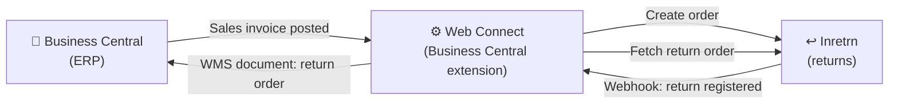
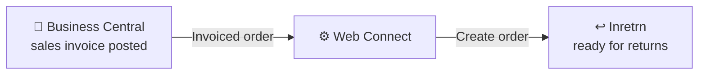
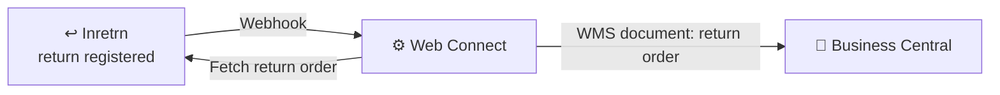

# Business Central and Inretrn integration

Web Connect by CombineIT connects Microsoft Dynamics 365 Business Central with Inretrn, the returns platform. Invoiced orders are sent to Inretrn when the sales invoice is posted, so customers can register returns against them, and the returns registered in Inretrn come back to Business Central as WMS documents. All mappings and rules live in your own Business Central, where you can see and change them yourself.

## At a glance

| | |
|---|---|
| **System** | Inretrn (returns) |
| **Integration product** | Web Connect for Microsoft Dynamics 365 Business Central |
| **Runs in** | Your own Business Central environment, as an extension. Invoiced orders are sent to Inretrn when the sales invoice is posted. Returns are pushed by Inretrn as webhooks, received by an Azure endpoint that passes them on to Web Connect, which then fetches the full return order from the Inretrn API. All processing and configuration stays in Business Central. |
| **Configured by** | You, in Business Central: mappings, conditions, triggers and flows. You can do all of it yourself. If you want, CombineIT takes part in any step, as a sounding board or by doing the work. |
| **Connection** | Inretrn REST API (JSON) with an API key, and webhooks from Inretrn |
| **Inretrn API** | [Inretrn developer documentation](https://developer.inretrn.com) |
| **Data flows** | 2: invoiced orders and return orders |
| **Business Central editions** | All editions, Essentials and Premium, including the latest version |
| **Available from** | [Web Connect on Microsoft AppSource](https://marketplace.microsoft.com/sv-se/product/PUBID.martitab1633951001710%7CAID.webconnect%7CPAPPID.9f3a7223-19db-4ac7-832f-cf8e4699186f?tab=Overview). The Inretrn integration is not part of the Web Connect Ready Integrations app. It is set up as a configuration in Web Connect |

## What can be synchronized

Web Connect has two data flows between Business Central and Inretrn.

| Data | Direction | What happens |
|---|---|---|
| [Invoiced orders](flows/invoiced-orders.md) | Business Central → Inretrn | When a sales invoice is posted, the order is created in Inretrn with buyer, rows, prices, customs data and tracking number, so the customer can return it |
| [Return orders](flows/return-orders.md) | Inretrn → Business Central | When a return is registered in Inretrn, Web Connect fetches the return order and creates a WMS document of the type return order with the returned rows |

Both flows are part of every Inretrn integration. Inretrn needs the invoiced orders to know what the customer can return, and the return orders bring the result back to Business Central. See [Choose your setup](#choose-your-setup).

## How it works

Web Connect sends each posted sales invoice that matches the filter to Inretrn, one invoice per message, with `POST` to `/v2/salesorder/create`. When a customer registers a return, Inretrn sends a webhook with the ID of the return order. Web Connect answers the webhook, fetches the return order with `GET` on `/v2/returnOrder/` and creates a [WMS document](../../general/wms-documents.md) of the type return order, with the Inretrn return order number as the key and a line per returned row. Every message is logged in Web Connect [Entries](../../general/entries.md), where it can be inspected and resent.

## Choose your setup

Each flow has to fit how your business works: which system owns the data, where people do their work, and what the accounting needs. That is why the flows are decided together when a new integration is set up. The options below are the ones Web Connect customers use today. **Common setup** marks the option most Web Connect customers with Inretrn use. **Recommended** marks CombineIT's best practice, where there is one.

Inretrn is used by two Web Connect customers today, and both use the same setup. The options below are marked as common setup for that reason.

### Orders to Inretrn

| Option | How it works | When it fits |
|---|---|---|
| **Sent when the sales invoice is posted** (common setup) | The posted sales invoice is sent to Inretrn with the order number, buyer, rows and tracking number. A filter on the posted invoice decides which invoices are sent | The goods have left the warehouse and been invoiced before the customer can return them |

#### Orders sent to Inretrn when the sales invoice is posted

### Returns to Business Central

| Option | How it works | When it fits |
|---|---|---|
| **WMS document from the webhook** (common setup) | Inretrn sends a webhook when a return is registered. Web Connect fetches the return order and creates a WMS document of the type return order, with item, variant, returned quantity and refund value per row | Returns are registered by the customer in Inretrn and handled in Business Central |

#### Returns to Business Central as a WMS document from the webhook

The return portal, the customer's choice of return, exchange or compensation, and the return shipment are always handled in Inretrn.

## What you need

- Microsoft Dynamics 365 Business Central, any edition (Essentials or Premium), including the latest version
- Web Connect installed from Microsoft AppSource, with an activated Web Connect license
- Your approval for Web Connect to be installed and to act in your Business Central environment
- An API key for the Inretrn API, created in Inretrn
- A webhook in Inretrn for new return orders, pointing to the Web Connect endpoint. [ATT FYLLA I: is the webhook registered by Inretrn, by the customer in Inretrn or by CombineIT?]
- A seller reference in Inretrn that the orders from Business Central are sent with

## Setting it up

1. Decide which invoices to send to Inretrn and how returns should be handled in Business Central, see [Choose your setup](#choose-your-setup).
2. Install Web Connect in Business Central, activate the license and give your approval.
3. Store the Inretrn API key in Web Connect [Secret Value Storage](../../general/secret-value-storage.md) and set up the authentication.
4. Set the seller reference in the Web Connect integration variable, and the filter that decides which posted invoices are sent.
5. Set up [Logistics Setup](../../general/logistics-setup.md) for Inretrn, which decides how return orders are created from the WMS documents.
6. Set up the webhook in Inretrn.
7. Test with a few invoices and returns against an Inretrn test account before going live.

## Configure it yourself in Business Central

All configuration and logic in the integration is visible and editable in Business Central. There is no external integration platform where the logic is hidden. The Azure endpoint that receives webhooks only passes the call on to Web Connect.

| What you can change | Where in Web Connect | Example |
|---|---|---|
| What triggers sending | [Outgoing Sync Triggers](../../general/outgoing-mapping/outgoing-sync-triggers.md) | Send the invoice when it is posted |
| Which invoices are sent | [Outgoing Data](../../general/outgoing-mapping/outgoing-data-web.md), the table filter on the object | Send only invoices for the web shop customer, and leave out invoices with a specific external document number |
| Field mapping to Inretrn | [Outgoing Data](../../general/outgoing-mapping/outgoing-data-web.md) | Send another field as transport service, or a brand field from your own extension on each row |
| Calculated values | [Dynamic Flow Fields](../../general/dynamic-flow-fields.md) | Send the net price per unit including and excluding VAT, or the unit cost in the invoice currency |
| Conditions | [Condition List](../../general/condition-list.md) | Use the unit cost in the invoice currency only when the invoice has a currency code |
| Value mapping | [Text Mapping](../../general/text-mapping.md) | Send freight and gift card rows with another line type than item rows |
| Field mapping on incoming returns | [Incoming Data mapping](../../general/incoming-data/mapping.md) | Store another field from the Inretrn return order on the WMS document |
| Return orders in Business Central | [Logistics Setup](../../general/logistics-setup.md) and [WMS Documents](../../general/wms-documents.md) | Release the created return order automatically, or require a reference to the original sales document |
| Monitoring and resending | [Entries](../../general/entries.md) | See every order sent and every return received, and [resend a message](../../../../how-to/web-connect/resend-outgoing-message.md) |

## Configuration choices

- **Which invoices are sent:** a filter on the posted sales invoice, for example on the sell-to customer and the external document number.
- **Seller reference:** the value sent as `ExternalSellerReference`, set in a Web Connect integration variable per Business Central company.
- **Prices on the rows:** the net and gross price per unit are calculated from the line amount excluding and including VAT. The unit cost is sent in the invoice currency when the invoice has one.
- **Line type:** which item or account numbers, for example freight and gift cards, are sent with another line type than ordinary item rows.
- **Currency:** the currency code sent when the invoice is in local currency.
- **Brand and other row data:** fields from your own extensions, such as brand, can be added to the rows.
- **Return order handling:** how the WMS document becomes a return order in Business Central, set in [Logistics Setup](../../general/logistics-setup.md).

## Limitations

- **Only posted sales invoices are sent.** An order is not in Inretrn until it has been invoiced in Business Central, so a customer cannot register a return before that.
- **One invoice per message.** Each posted invoice is sent to Inretrn as its own order.
- **Return reasons are not mapped.** Inretrn sends a reason code per row, but the standard setup does not map it to a Business Central return reason code.
- **Exchange details are not read.** The exchange information on a return row is not processed in the standard setup. [ATT FYLLA I: how exchanges and replacement orders from Inretrn are handled in Business Central]
- **Refunds are made outside the integration.** Web Connect stores the refund value per row on the WMS document but does not refund the customer. [ATT FYLLA I: confirm where the refund to the customer is made]

## Frequently asked questions

### Can Business Central be integrated with Inretrn?

Yes. Web Connect connects Business Central with Inretrn through the Inretrn REST API. Invoiced orders are sent to Inretrn when the sales invoice is posted, and returns registered in Inretrn come back to Business Central by webhook as WMS documents of the type return order.

### Why does Inretrn need the orders from Business Central?

A customer can only register a return against an order that Inretrn knows about. Web Connect sends each posted sales invoice to Inretrn with its order number, rows, prices, customs data and tracking number, so the order is ready in Inretrn when the customer starts a return.

### When is an order sent to Inretrn?

When the sales invoice is posted in Business Central. A filter on the posted invoice decides which invoices are sent, for example only the invoices for web shop orders.

### How does Business Central learn about a new return?

Inretrn sends a webhook when a return order is registered. Web Connect answers the webhook, fetches the full return order from the Inretrn API and creates a WMS document of the type return order with the returned rows.

### How does Web Connect log in to Inretrn?

With an API key that is created in Inretrn. Web Connect sends it in the Authorization header. The key is kept in Web Connect Secret Value Storage.

## Related

- Flows: [Invoiced orders](flows/invoiced-orders.md) · [Return orders](flows/return-orders.md)
- [WMS Documents](../../general/wms-documents.md) · [Logistics Setup](../../general/logistics-setup.md) · [WMS/Return Reason Codes](../../general/wms-return-reason-codes.md)
- How-to: [Resend an outgoing message](../../../../how-to/web-connect/resend-outgoing-message.md) · [Nothing downloads to Business Central](../../../../how-to/web-connect/nothing-downloads-to-business-central.md)
- [Web Connect general documentation](../../general/README.md)
- [Inretrn developer documentation](https://developer.inretrn.com)

## About Web Connect

Web Connect is an integration platform for Microsoft Dynamics 365 Business Central, developed by CombineIT. It is installed in your own Business Central and connects it with e-commerce platforms, warehouse systems, POS, returns, marketplaces and EDI. Every flow, mapping and rule is configured in Business Central, where you can see and change it yourself, without custom code for each integration. [Web Connect on Microsoft AppSource](https://marketplace.microsoft.com/sv-se/product/PUBID.martitab1633951001710%7CAID.webconnect%7CPAPPID.9f3a7223-19db-4ac7-832f-cf8e4699186f?tab=Overview) · [Contact CombineIT](https://www.combineit.se/contact/)
