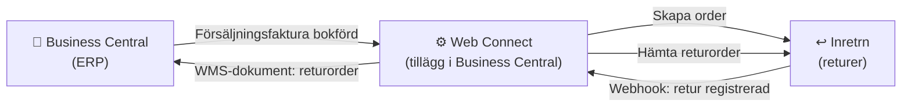
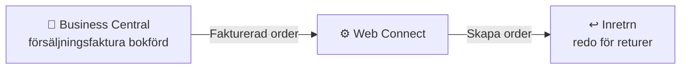
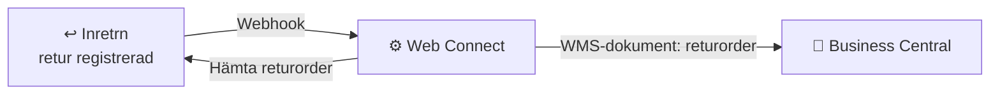

# Business Central och Inretrn: integration

Web Connect från CombineIT kopplar ihop Microsoft Dynamics 365 Business Central med returplattformen Inretrn. Fakturerade order skickas till Inretrn när försäljningsfakturan bokförs, så att kunderna kan registrera returer mot dem, och returerna som registreras i Inretrn kommer tillbaka till Business Central som WMS-dokument. Alla mappningar och regler finns i ditt eget Business Central, där du själv kan se och ändra dem.

## I korthet

| | |
|---|---|
| **System** | Inretrn (returer) |
| **Integrationsprodukt** | Web Connect för Microsoft Dynamics 365 Business Central |
| **Körs i** | Din egen Business Central-miljö, som ett tillägg. Fakturerade order skickas till Inretrn när försäljningsfakturan bokförs. Returer skickas av Inretrn som webhooks och tas emot av en Azure-endpoint som skickar dem vidare till Web Connect, som sedan hämtar hela returordern från Inretrns API. All bearbetning och konfiguration ligger kvar i Business Central. |
| **Konfigureras av** | Dig, i Business Central: mappningar, villkor, triggers och flöden. Du kan göra allt själv. Vill du kan CombineIT vara med i vilket steg som helst, som bollplank eller genom att göra jobbet. |
| **Koppling** | Inretrn REST API (JSON) med en API-nyckel, och webhooks från Inretrn |
| **Inretrn API** | [Inretrn developer documentation](https://developer.inretrn.com) |
| **Dataflöden** | 2: fakturerade order och returorder |
| **Business Central-utgåvor** | Alla utgåvor, Essentials och Premium, även den senaste versionen |
| **Finns på** | [Web Connect på Microsoft AppSource](https://marketplace.microsoft.com/sv-se/product/PUBID.martitab1633951001710%7CAID.webconnect%7CPAPPID.9f3a7223-19db-4ac7-832f-cf8e4699186f?tab=Overview). Integrationen med Inretrn ingår inte i appen Web Connect Ready Integrations. Den sätts upp som en konfiguration i Web Connect |

## Det här kan synkas

Web Connect har två dataflöden mellan Business Central och Inretrn.

| Data | Riktning | Vad som händer |
|---|---|---|
| [Fakturerade order](flows/invoiced-orders.md) | Business Central → Inretrn | När en försäljningsfaktura bokförs skapas ordern i Inretrn med köpare, rader, priser, tulluppgifter och spårningsnummer, så att kunden kan returnera den |
| [Returorder](flows/return-orders.md) | Inretrn → Business Central | När en retur registreras i Inretrn hämtar Web Connect returordern och skapar ett WMS-dokument av typen returorder med de returnerade raderna |

Båda flödena ingår i varje integration med Inretrn. Inretrn behöver de fakturerade orderna för att veta vad kunden kan returnera, och returorderna för tillbaka resultatet till Business Central. Se [Välj upplägg](#choose-your-setup).

## Så fungerar det

Web Connect skickar varje bokförd försäljningsfaktura som matchar filtret till Inretrn, en faktura per meddelande, med `POST` till `/v2/salesorder/create`. När en kund registrerar en retur skickar Inretrn en webhook med returorderns ID. Web Connect svarar på webhooken, hämtar returordern med `GET` på `/v2/returnOrder/` och skapar ett [WMS-dokument](../../general/wms-documents.md) av typen returorder, med Inretrns returordernummer som nyckel och en rad per returnerad rad. [Logistikinställningarna](../../general/logistics-setup.md) för Inretrn skapar sedan en försäljningsreturorder, skickar den vidare till lagret som en förväntad inleverans när lagret också är kopplat via Web Connect, och avgör om returinleveransen bokförs automatiskt när lagret rapporterar den. Varje meddelande loggas i Web Connect [Entries](../../general/entries.md), där det går att granska och skicka igen.

## Välj upplägg

Varje flöde måste passa hur ditt företag arbetar: vilket system som äger datan, var personalen gör sitt arbete och vad bokföringen behöver. Därför bestäms flödena tillsammans när en ny integration sätts upp. Alternativen nedan är de som Web Connect-kunder använder i dag. **Vanligt upplägg** markerar det alternativ som flest Web Connect-kunder med Inretrn använder. **Rekommenderas** markerar CombineIT:s bästa praxis, där det finns en.

Inretrn används i dag av två Web Connect-kunder, och båda har samma upplägg. Därför är alternativen nedan markerade som vanligt upplägg.

### Order till Inretrn

| Alternativ | Så fungerar det | När det passar |
|---|---|---|
| **Skickas när försäljningsfakturan bokförs** (vanligt upplägg) | Den bokförda försäljningsfakturan skickas till Inretrn med ordernummer, köpare, rader och spårningsnummer. Ett filter på den bokförda fakturan avgör vilka fakturor som skickas | Varorna har lämnat lagret och fakturerats innan kunden kan returnera dem |

#### Order skickas till Inretrn när försäljningsfakturan bokförs

### Returer till Business Central

| Alternativ | Så fungerar det | När det passar |
|---|---|---|
| **WMS-dokument från webhooken** (vanligt upplägg) | Inretrn skickar en webhook när en retur registreras. Web Connect hämtar returordern och skapar ett WMS-dokument av typen returorder, med artikel, variant, returnerat antal och återbetalningsvärde per rad | Returerna registreras av kunden i Inretrn och hanteras i Business Central |

#### Returer till Business Central som WMS-dokument från webhooken

Returportalen, kundens val mellan retur, byte eller ersättning, och returfrakten hanteras alltid i Inretrn.

## Det här behöver du

- Microsoft Dynamics 365 Business Central, valfri utgåva (Essentials eller Premium), även den senaste versionen
- Web Connect installerat från Microsoft AppSource, med en aktiverad Web Connect-licens
- Ditt godkännande av att Web Connect installeras och får agera i din Business Central-miljö
- En API-nyckel för Inretrns API, skapad i Inretrn
- En webhook i Inretrn för nya returorder, som pekar på endpointen i Web Connect. Webhooken registreras i Inretrn, av Inretrn eller av dig
- En säljarreferens i Inretrn som orderna från Business Central skickas med

## Så kommer du igång

1. Bestäm vilka fakturor som ska skickas till Inretrn och hur returer ska hanteras i Business Central, se [Välj upplägg](#choose-your-setup).
2. Installera Web Connect i Business Central, aktivera licensen och lämna ditt godkännande. Integrationen med Inretrn ingår inte i appen Ready Integrations, så den sätts upp som en konfiguration i Web Connect.
3. Spara Inretrns API-nyckel i Web Connect [Secret Value Storage](../../general/secret-value-storage.md) och sätt upp autentiseringen.
4. Ange säljarreferensen i integrationsvariabeln i Web Connect, och filtret som avgör vilka bokförda fakturor som skickas.
5. Sätt upp [Logistics Setup](../../general/logistics-setup.md) för Inretrn, som avgör hur returorder skapas från WMS-dokumenten.
6. Sätt upp webhooken i Inretrn.
7. Testa med några fakturor och returer mot ett testkonto i Inretrn innan ni går live.

## Konfigurera själv i Business Central

All konfiguration och logik i integrationen går att se och ändra i Business Central. Det finns ingen extern integrationsplattform där logiken är dold. Azure-endpointen som tar emot webhooks skickar bara anropet vidare till Web Connect.

| Det här kan du ändra | Var i Web Connect | Exempel |
|---|---|---|
| Vad som startar utskicket | [Outgoing Sync Triggers](../../general/outgoing-mapping/outgoing-sync-triggers.md) | Skicka fakturan när den bokförs |
| Vilka fakturor som skickas | [Outgoing Data](../../general/outgoing-mapping/outgoing-data-web.md), tabellfiltret på objektet | Skicka bara fakturor för webbshopskunden, och hoppa över fakturor med ett visst externt dokumentnummer |
| Fältmappning till Inretrn | [Outgoing Data](../../general/outgoing-mapping/outgoing-data-web.md) | Skicka ett annat fält som transporttjänst, eller ett varumärkesfält från ditt eget tillägg på varje rad |
| Beräknade värden | [Dynamic Flow Fields](../../general/dynamic-flow-fields.md) | Skicka nettopriset per enhet med och utan moms, eller enhetskostnaden i fakturans valuta |
| Villkor | [Condition List](../../general/condition-list.md) | Använd enhetskostnaden i fakturans valuta bara när fakturan har en valutakod |
| Värdemappning | [Text Mapping](../../general/text-mapping.md) | Skicka frakt- och presentkortsrader med en annan radtyp än artikelrader |
| Fältmappning för inkommande returer | [Incoming Data mapping](../../general/incoming-data/mapping.md) | Spara ett annat fält från Inretrns returorder på WMS-dokumentet |
| Vad som händer med en retur | [Logistics Setup](../../general/logistics-setup.md) och [WMS Documents](../../general/wms-documents.md) | Skicka returordern till lagret, och bokför returinleveransen automatiskt när lagret rapporterar den |
| Övervakning och omsändning | [Entries](../../general/entries.md) | Se varje order som skickats och varje retur som tagits emot, och [skicka ett meddelande igen](../../../../how-to/web-connect/resend-outgoing-message.md) |

## Val i konfigurationen

- **Vilka fakturor som skickas:** ett filter på den bokförda försäljningsfakturan, till exempel på kunden (sell-to customer) och det externa dokumentnumret.
- **Säljarreferens:** värdet som skickas som `ExternalSellerReference`, satt i en integrationsvariabel i Web Connect per företag i Business Central.
- **Priser på raderna:** netto- och bruttopriset per enhet räknas fram från radbeloppet utan och med moms. Enhetskostnaden skickas i fakturans valuta när fakturan har en.
- **Radtyp:** vilka artikel- eller kontonummer, till exempel frakt och presentkort, som skickas med en annan radtyp än vanliga artikelrader.
- **Valuta:** valutakoden som skickas när fakturan är i lokal valuta.
- **Varumärke och andra raduppgifter:** fält från dina egna tillägg, som varumärke, kan läggas till på raderna.
- **Hantering av returorder:** försäljningsreturordern skapas från WMS-dokumentet av [Logistics Setup](../../general/logistics-setup.md), som också avgör om den skickas till lagret och om returinleveransen bokförs automatiskt.
- **Returordernummer:** om returordern i Business Central får Inretrns nummer eller ett nummer från din nummerserie.

## Begränsningar

- **Bara bokförda försäljningsfakturor skickas.** En order finns inte i Inretrn förrän den fakturerats i Business Central, så kunden kan inte registrera en retur innan dess.
- **En faktura per meddelande.** Varje bokförd faktura skickas till Inretrn som en egen order.
- **Returorsaker mappas inte.** Inretrn skickar en orsakskod per rad, men standardupplägget mappar den inte till en returorsakskod i Business Central.
- **Byten skapas inte av den här integrationen.** Uppgifterna om byte på en returrad hanteras inte. En ersättningsorder skapas normalt av Inretrn i e-handelsplattformen och kommer till Business Central som en försäljningsorder via integrationen med den plattformen.
- **Återbetalningen görs där betalningen drogs.** Web Connect sparar återbetalningsvärdet per rad på WMS-dokumentet men återbetalar inte kunden via Inretrn. Standard är att betalningar dras i Business Central via en betaltjänstleverantör, och då görs återbetalningen i Business Central. Dras betalningen i ett annat system, till exempel e-handelsplattformen, görs återbetalningen där.

## Vanliga frågor

### Går det att integrera Business Central med Inretrn?

Ja. Web Connect kopplar ihop Business Central med Inretrn via Inretrns REST API. Fakturerade order skickas till Inretrn när försäljningsfakturan bokförs, och returer som registreras i Inretrn kommer tillbaka till Business Central via webhook som WMS-dokument av typen returorder.

### Varför behöver Inretrn orderna från Business Central?

En kund kan bara registrera en retur mot en order som Inretrn känner till. Web Connect skickar varje bokförd försäljningsfaktura till Inretrn med ordernummer, rader, priser, tulluppgifter och spårningsnummer, så att ordern finns i Inretrn när kunden påbörjar en retur.

### När skickas en order till Inretrn?

När försäljningsfakturan bokförs i Business Central. Ett filter på den bokförda fakturan avgör vilka fakturor som skickas, till exempel bara fakturor för order från webbshopen.

### Hur får Business Central veta att det finns en ny retur?

Inretrn skickar en webhook när en returorder registreras. Web Connect svarar på webhooken, hämtar hela returordern från Inretrns API och skapar ett WMS-dokument av typen returorder med de returnerade raderna.

### Hur loggar Web Connect in i Inretrn?

Med en API-nyckel som skapas i Inretrn. Web Connect skickar den i Authorization-headern. Nyckeln sparas i Web Connect Secret Value Storage.

## Relaterat

- Flöden: [Fakturerade order](flows/invoiced-orders.md) · [Returorder](flows/return-orders.md)
- [WMS Documents](../../general/wms-documents.md) · [Logistics Setup](../../general/logistics-setup.md) · [WMS/Return Reason Codes](../../general/wms-return-reason-codes.md)
- Instruktioner: [Skicka ett utgående meddelande igen](../../../../how-to/web-connect/resend-outgoing-message.md) · [Inget laddas ner till Business Central](../../../../how-to/web-connect/nothing-downloads-to-business-central.md)
- [Allmän dokumentation för Web Connect](../../general/README.md)
- [Inretrn developer documentation](https://developer.inretrn.com)

## Om Web Connect

Web Connect är en integrationsplattform för Microsoft Dynamics 365 Business Central, utvecklad av CombineIT. Den installeras i ditt eget Business Central och kopplar ihop det med e-handelsplattformar, lagersystem, kassasystem, returer, marknadsplatser och EDI. Varje flöde, mappning och regel konfigureras i Business Central, där du själv kan se och ändra den, utan specialkod för varje integration. [Web Connect på Microsoft AppSource](https://marketplace.microsoft.com/sv-se/product/PUBID.martitab1633951001710%7CAID.webconnect%7CPAPPID.9f3a7223-19db-4ac7-832f-cf8e4699186f?tab=Overview) · [Kontakta CombineIT](https://www.combineit.se/contact/)
