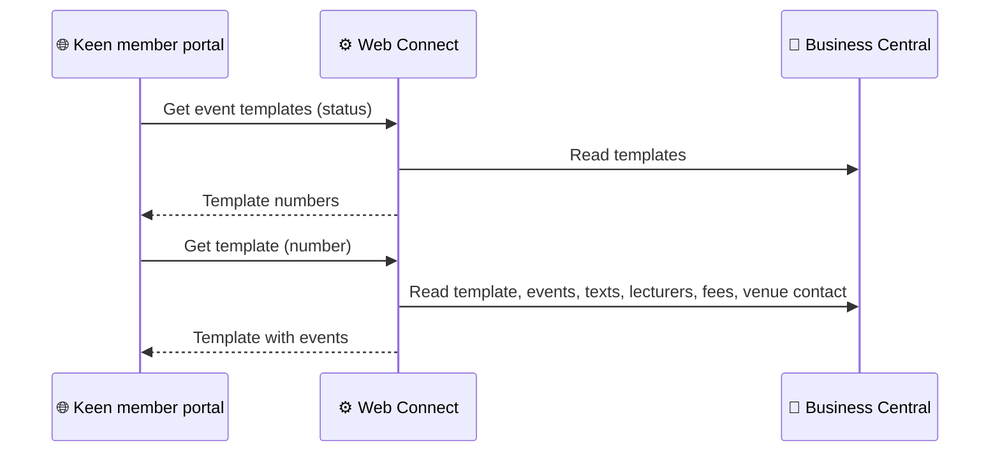

# Business Central to Keen member portal: event catalogue

The Keen member portal shows events that are planned in Business Central. The portal asks Web Connect for the event templates, and then for one template with its events. Web Connect answers in the same call with dates, venue, web visibility, registration period, texts, lecturers and fees.

| | |
|---|---|
| **Direction** | Business Central → Keen member portal |
| **Trigger** | Webhook from the portal (find record and respond), received by the Azure endpoint and passed on to Web Connect |
| **Result** | The portal gets the event data in the answer. Nothing changes in Business Central |
| **Part of** | [Business Central and Keen member portal integration](../overview.md) |

## Step by step

1. The portal asks for event templates with a status. Web Connect answers with the numbers of the matching templates.
2. The portal asks for one template by number.
3. Web Connect reads the template and builds the answer: the template's description, its events, the HTML texts, the lecturers and the fees.
4. For each event the venue name and address are read from the venue contact on the event.
5. The answer is returned in the same call.

## Data mapping

| Keen member portal field | Business Central source | Note |
|---|---|---|
| `no`, `eventTypeCode`, `description`, `description2` | Event template | |
| `events` | Events created from the template | Array |
| `startDate`, `endDate`, `startTime`, `endTime` | Event | |
| `status` | Event | |
| `showOnline`, `showinWebfrom`, `showinWebuntil` | Event | Web visibility |
| `onlineRegistrationfrom`, `onlineRegistrationuntil` | Event | Registration period |
| `venueName`, `venueAddress`, `venueAddress2`, `venuePostCode`, `venueCity` | Venue contact on the event | Read from the contact |
| `texts`: `typeCode`, `typeDescription`, `htmlText` | Event template HTML texts | `htmlText` is base64 encoded |
| `lecturers`: `contactNo`, `contactName`, `startDate` | Template lines with a contact | |
| `fees`: `serviceItemNo`, `customerPriceGroupCode`, `description`, `quantity`, `price`, `priceinclVAT`, `earlyBirdPrice`, `unitofMeasureCode` | Template lines without a contact | |

The event tables come from an event management extension in Business Central. [ATT FYLLA I: which extension, and the Business Central names of the event tables]

## Web Connect objects

| Object | Role |
|---|---|
| `MP_GET_ALL_EVENT_TEMPLATES` | Answers with the templates that match the status |
| `MP_GET_ALL_EVENTS_FROM_TEMPLATE` | Answers with one template and everything under it |
| `MP_EVENT_LINES` | Builds the events array |
| `MP_EVENT_VENUE_CONTACT` | Reads the venue address from the venue contact |
| `MP_EVENT_TEXT` | Builds the texts array |
| `MP_EVENT_LECTURE` | Builds the lecturers array |
| `MP_EVENT_TEMPLATESERVICE` | Builds the fees array |

## Error handling

| Situation | What happens | What to do |
|---|---|---|
| The template number does not exist | The answer has no template | Check the number the portal sends |
| An event or text is missing | It is not linked to the template in Business Central | Check the event's template and the text type |
| The answer is slow | Every answer is built in the same call | Keep the answering objects small, see [Web Connect webhooks](../../../general/webhooks.md) |

## Frequently asked questions

### Are events copied to the portal?

Web Connect does not push events. The portal asks for them, and Web Connect answers with what is in Business Central at that moment.

### Where are the event texts maintained?

In Business Central, as HTML texts on the event template. Web Connect sends them base64 encoded.

## Related

- [Business Central and Keen member portal integration](../overview.md)
- [A member's events](member-events.md)
