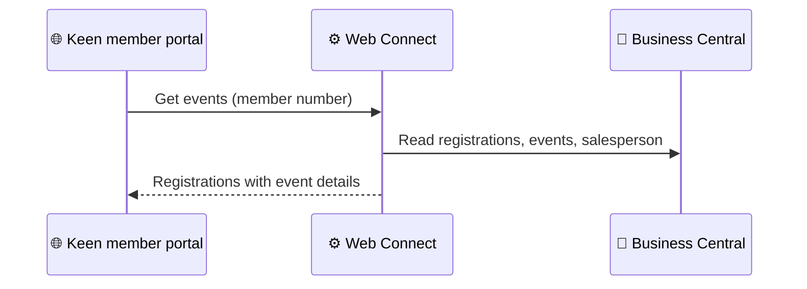

# Business Central to Keen member portal: a member's events

The Keen member portal can show a member's own events. The portal asks Web Connect with the member number, and Web Connect answers in the same call with the member's registrations, each with the event's dates, venue, status and contact person. There is one call for all registrations and one for upcoming ones.

| | |
|---|---|
| **Direction** | Business Central → Keen member portal |
| **Trigger** | Webhook from the portal (find record and respond), received by the Azure endpoint and passed on to Web Connect |
| **Result** | The portal gets the registrations in the answer. Nothing changes in Business Central |
| **Part of** | [Business Central and Keen member portal integration](../overview.md) |

## Step by step

1. The portal asks for a member's events, or only the upcoming ones, with the member number.
2. Web Connect finds the member's event registrations. For upcoming events it filters on the registration status. [ATT FYLLA I: which status counts as upcoming]
3. For each registration Web Connect adds the event and the event's contact person (salesperson).
4. The answer is returned in the same call, with up to 100 registrations.

## Data mapping

| Keen member portal field | Business Central source | Note |
|---|---|---|
| Member number | Registration: contact number | Key in the request |
| `typeofAssignment`, `status`, `lecturerStatus`, `participationType` | Registration | Upcoming call only |
| `eventNo` | Registration: event number | Holds the event below |
| `no`, `eventTypeCode`, `description` | Event | |
| `startDate`, `endDate`, `startTime`, `endTime` | Event | |
| `venueCity`, `venueContName` | Event | |
| `status` | Event | |
| `salesPersonCode`: `code`, `name`, `eMail` | Salesperson/Purchaser | The event's contact person |

## Web Connect objects

| Object | Role |
|---|---|
| `MP_EVENTS_FROM_CONTACT` | Answers with all of a member's registrations |
| `MP_UPCOMING_EVENTS_FROM_CONTACT` | Answers with a member's upcoming registrations |
| `MP_EVENT` | Builds the event under each registration |
| `MP_SALESPERSON` | Adds the event's contact person |

## Error handling

| Situation | What happens | What to do |
|---|---|---|
| No events for a member | The member has no registrations with that contact number | Check the registration's contact in Business Central |
| A member has more than 100 registrations | Only 100 are returned | Raise the record limit on the object |

## Frequently asked questions

### How many registrations does the portal get in one call?

Up to 100. The limit is set on the Web Connect object and can be changed in Business Central.

## Related

- [Business Central and Keen member portal integration](../overview.md)
- [Event catalogue](event-catalogue.md)
