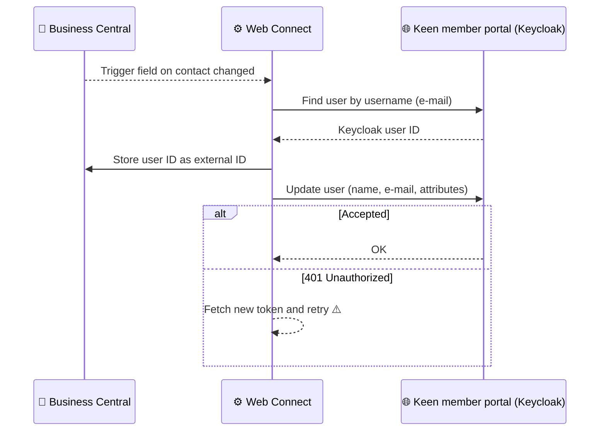

# Business Central to Keen member portal: members

When a member contact changes in Business Central, Web Connect sends the change to the Keen member portal. It finds the member's Keycloak user by e-mail and updates name, e-mail, address, phone, member number and portal access. Business Central stays the master for member data.

| | |
|---|---|
| **Direction** | Business Central → Keen member portal |
| **Trigger** | Change in Business Central: a trigger field on a contact is modified (by default name, address, post code, phone number and e-mail) |
| **Result** | The Keycloak user has the contact's details and attributes. The Keycloak user ID is stored on the contact as external ID |
| **Part of** | [Business Central and Keen member portal integration](../overview.md) |

## Step by step

1. A user changes a trigger field on a contact in Business Central. The outgoing sync trigger in Web Connect registers the change.
2. Web Connect looks up the Keycloak user with the contact's e-mail as username, and stores the Keycloak user ID on the contact as external ID.
3. Web Connect builds the user payload from the outgoing mapping: e-mail, first name, last name and the user attributes.
4. The portal access attribute is read from the contact's company and translated with a text mapping.
5. Web Connect updates the Keycloak user with the stored user ID.
6. The call and the answer are logged in Web Connect Entries. If Keycloak answers 401 Unauthorized, Web Connect fetches a new token at once.

## Data mapping

| Keen member portal field | Business Central field | Note |
|---|---|---|
| `email` | Contact: E-Mail | Also used as username to find the user |
| `firstName` | Contact: First Name | |
| `lastName` | Contact: Surname | |
| `emailVerified` | Fixed value | Sent as false |
| `requiredActions` | None | Sent as an empty array |
| Attribute: member number | Contact: No. | The key the portal uses in all calls to Web Connect |
| Attribute: portal access | Company contact: member status | Text mapping: values that start with a given letter give `1`, all others `0` |
| Attribute: `city` | Contact: City | |
| Attribute: `zip` | Contact: Post Code | |
| Attribute: `address` | Contact: Address | |
| Attribute: `telephone` | Contact: Phone No. | |

Keycloak needs every user attribute as an array of strings, for example `"city": ["Berlin"]`. The attributes are built with child objects that produce that shape.

## Web Connect objects

| Object | Role |
|---|---|
| `MP_USER` | Updates the Keycloak user. Has the outgoing sync trigger and its trigger fields |
| `MP_USER_ATTRIBUTES` | Builds the user attributes object |
| `MP_USER_ACTION` | Builds the `requiredActions` array |
| `MP_GET_USER` | Finds the Keycloak user by username and stores the user ID as external ID |
| `MP_USER_URL` | Puts the user ID or e-mail into the URL |
| `MP_SEND_VERIFY` | Asks Keycloak to send a verify e-mail to the user. [ATT FYLLA I: when this object is used] |
| `OAUTH` | Fetches the access token from Keycloak with client credentials |

## Error handling

| Situation | What happens | What to do |
|---|---|---|
| The token job queue entry has stopped | Calls fail with 401 Unauthorized | Restart the job queue entry, see [401 after job queue stopped](../../../../../how-to/web-connect/unauthorized-after-job-queue-stopped.md) |
| No Keycloak user with the contact's e-mail | The user cannot be updated | Check that the person has registered in the portal with the same e-mail |
| An attribute is sent as a plain value | Keycloak rejects the update | Map the attribute as an array of strings |
| A mapped field changes but is not a trigger field | Nothing is sent until a trigger field changes | Add the field to the trigger fields |

## Frequently asked questions

### Why does a member change not reach the portal?

Only changes to the trigger fields start a sync, and the member needs a Keycloak user with the same e-mail address. Check the trigger fields, the e-mail address and the error in Web Connect Entries.

### How does the portal know if a person is a member or a guest?

Web Connect sends a portal access flag. It is derived from a value on the member's company contact with a text mapping, so a person without a member company is a guest in the portal.

## Related

- [Business Central and Keen member portal integration](../overview.md)
- [Profile updates](profile-update.md)
- [Outgoing Sync Triggers](../../../general/outgoing-mapping/outgoing-sync-triggers.md) · [Text Mapping](../../../general/text-mapping.md)
