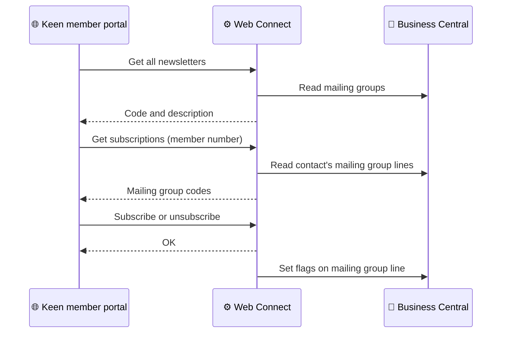

# Keen member portal and Business Central: newsletter subscriptions

Newsletters in the Keen member portal are mailing groups in Business Central. The portal asks Web Connect for the newsletters and for a member's subscriptions and gets the answer in the same call. When the member subscribes or unsubscribes, the contact's mailing group line is updated in Business Central.

| | |
|---|---|
| **Direction** | Both: Business Central → Keen member portal for lists, Keen member portal → Business Central for choices |
| **Trigger** | Webhooks from the portal, received by the Azure endpoint and passed on to Web Connect |
| **Result** | The portal shows the newsletters and the member's subscriptions. Choices are stored on the contact's mailing group lines |
| **Part of** | [Business Central and Keen member portal integration](../overview.md) |

## Step by step

1. The portal asks for all newsletters. Web Connect reads the mailing groups that match the object's table filter and answers with code and description.
2. The portal asks for a member's subscriptions with the member number. Web Connect reads the contact's mailing group lines that are not marked as unsubscribed and answers with the mailing group codes.
3. The member subscribes or unsubscribes in the portal. The portal sends the member number and the mailing group code.
4. Web Connect answers OK, stores the call as incoming data, and the job queue sets the subscribed and unsubscribed flags on the contact's mailing group line. [ATT FYLLA I: confirm that a missing line is created on subscribe, and the names of the two flag fields]

## Data mapping

| Keen member portal field | Business Central field | Note |
|---|---|---|
| Newsletter code | Mailing Group: Code | Answer to "get all newsletters" |
| Newsletter description | Mailing Group: Description | Answer to "get all newsletters" |
| Member number | Contact Mailing Group: Contact No. | Key in the subscription calls |
| Newsletter code | Contact Mailing Group: Mailing Group Code | Key in the subscription calls |
| Subscribed | Contact Mailing Group: subscribed flag | Set by Web Connect: true on subscribe, false on unsubscribe |
| Unsubscribed | Contact Mailing Group: unsubscribed flag | Set by Web Connect: false on subscribe, true on unsubscribe |

## Web Connect objects

| Object | Role |
|---|---|
| `MP_GET_ALL_NEWSLETTERS` | Answers with the mailing groups that match the table filter |
| `MP_GET_NEWSLETTER_REG` | Answers with a member's active subscriptions |
| `MP_REGISTER_TO_NEWSLETTER` | Receives a subscribe and updates the mailing group line |
| `MP_UNREGISTER_FROM_NEWSLETTER` | Receives an unsubscribe and updates the mailing group line |

## Error handling

| Situation | What happens | What to do |
|---|---|---|
| A newsletter is missing in the portal | The mailing group does not match the table filter on the object | Check the Outgoing Sync Table View on `MP_GET_ALL_NEWSLETTERS` |
| A subscribe or unsubscribe fails | The incoming data is retried and the monitor e-mail list is notified | Fix the cause and process the entry again from Web Connect Entries |

## Frequently asked questions

### Is the mailing group line deleted when a member unsubscribes?

No. Web Connect sets the subscribed and unsubscribed flags on the contact's mailing group line, so the history stays in Business Central.

## Related

- [Business Central and Keen member portal integration](../overview.md)
- [Web Connect webhooks](../../../general/webhooks.md)
