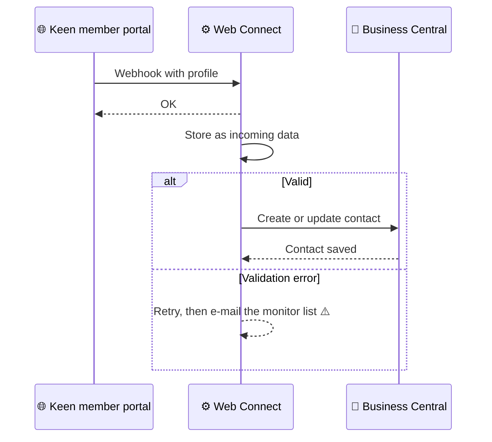

# Keen member portal to Business Central: profile updates

When a member registers or changes the profile in the Keen member portal, the portal sends the details to Web Connect as a webhook. Web Connect finds the contact by member number and writes name, e-mail, address and phone to it. Blank values do not overwrite what is in Business Central.

| | |
|---|---|
| **Direction** | Keen member portal → Business Central |
| **Trigger** | Webhook from the portal, received by the Azure endpoint and passed on to Web Connect |
| **Result** | The contact in Business Central is created or updated as a person. The portal gets an OK answer |
| **Part of** | [Business Central and Keen member portal integration](../overview.md) |

## Step by step

1. The member registers or saves the profile in the portal.
2. The portal calls the Web Connect webhook with the profile and the member number.
3. Web Connect answers OK and stores the payload as incoming data.
4. The job queue processes the incoming data: the contact with the member number is updated, or created if it does not exist. [ATT FYLLA I: confirm how the member number is assigned when a new contact is created]
5. If a trigger field changed, the [member flow](member-to-portal.md) sends the result back to Keycloak.

## Data mapping

| Keen member portal field | Business Central field | Note |
|---|---|---|
| Member number | Contact: No. | Unique identifier. Finds the contact to update |
| First name | Contact: First Name | Ignored if blank |
| Last name | Contact: Surname | Ignored if blank |
| E-mail | Contact: E-Mail | Ignored if blank |
| Street | Contact: Address | Ignored if blank |
| Post code | Contact: Post Code | Ignored if blank |
| City | Contact: City | Ignored if blank |
| Phone | Contact: Phone No. | Ignored if blank |
| Gender | [ATT FYLLA I: Business Central field] | Ignored if blank |
| Fixed value | Contact: Type | Set to Person |

The JSON key names are agreed with Keen in each project.

## Web Connect objects

| Object | Role |
|---|---|
| `MP_UPDATE_OR_CREATE_USER_IN_BC` | Receives the webhook, answers OK and creates or updates the contact |

## Error handling

| Situation | What happens | What to do |
|---|---|---|
| The contact cannot be saved, for example an invalid value | The incoming data is retried | Limit the retries, see [Limit content creation retries](../../../../../how-to/web-connect/limit-content-creation-retries.md) |
| The record fails its last retry | The monitor e-mail list is notified | Fix the data and process the entry again from Web Connect Entries |

## Frequently asked questions

### Can a member clear a field in Business Central from the portal?

No. The incoming fields are set to ignore blank values, so an empty field in the portal leaves the value in Business Central as it is.

## Related

- [Business Central and Keen member portal integration](../overview.md)
- [Members](member-to-portal.md)
- [Web Connect webhooks](../../../general/webhooks.md) · [Incoming Data mapping](../../../general/incoming-data/mapping.md)
