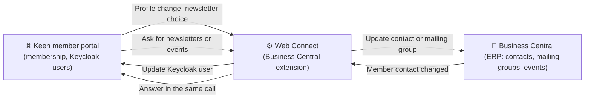
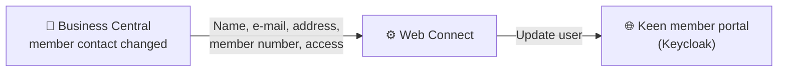
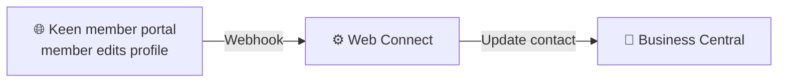
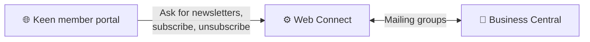
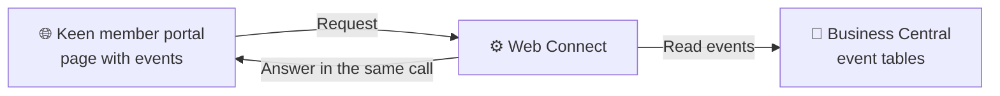

# Business Central and Keen member portal integration

Web Connect by CombineIT connects Microsoft Dynamics 365 Business Central with the Keen member portal, a membership platform with Keycloak user accounts. Member contacts are sent to the portal, and the portal reads newsletters and events from Business Central and sends profile changes and newsletter choices back. All mappings and rules live in your own Business Central, where you can see and change them yourself.

## At a glance

| | |
|---|---|
| **System** | Keen member portal (membership) |
| **Integration product** | Web Connect for Microsoft Dynamics 365 Business Central |
| **Runs in** | Your own Business Central environment, as an extension. Web Connect sends member changes to the portal's Keycloak when trigger fields on a contact change. The portal calls Web Connect as webhooks when it needs data from Business Central or has changes to write back. The webhooks are received by an Azure endpoint that only passes them on to Web Connect. All processing and configuration stays in Business Central. |
| **Configured by** | You, in Business Central: mappings, conditions, triggers and flows. You can do all of it yourself. If you want, CombineIT takes part in any step, as a sounding board or by doing the work. |
| **Connection** | REST: Keycloak Admin REST API with OAuth 2.0 client credentials, and incoming webhooks from the portal |
| **Keen member portal API** | [Keycloak Admin REST API](https://www.keycloak.org/docs-api/latest/rest-api/index.html). [ATT FYLLA I: link to Keen's own website or API documentation for the portal] |
| **Data flows** | 5: members, profile updates, newsletter subscriptions, event catalogue and a member's events |
| **Business Central editions** | [ATT FYLLA I: Essentials and Premium? The event flows need the event tables from an event management extension, confirm which] |
| **Available from** | [Web Connect on Microsoft AppSource](https://marketplace.microsoft.com/sv-se/product/PUBID.martitab1633951001710%7CAID.webconnect%7CPAPPID.9f3a7223-19db-4ac7-832f-cf8e4699186f?tab=Overview). [ATT FYLLA I: is the Keen integration part of the Web Connect Ready Integrations app?] |

## What can be synchronized

Web Connect has five data flows between Business Central and the Keen member portal.

| Data | Direction | What happens |
|---|---|---|
| [Members](flows/member-to-portal.md) | Business Central → Keen member portal | When a member contact changes, the matching Keycloak user is updated with name, e-mail, address, phone, member number and portal access |
| [Profile updates](flows/profile-update.md) | Keen member portal → Business Central | Changes a member makes in the portal are written to the contact in Business Central |
| [Newsletter subscriptions](flows/newsletter-subscriptions.md) | Both directions | The portal reads the newsletters and a member's subscriptions from Business Central, and subscribes or unsubscribes the member |
| [Event catalogue](flows/event-catalogue.md) | Business Central → Keen member portal | The portal asks for event templates and gets the events, dates, venue, texts, lecturers and fees |
| [A member's events](flows/member-events.md) | Business Central → Keen member portal | The portal asks for a member's event registrations, all or only upcoming ones |

The member flow is what links a person in the portal to a contact in Business Central. The other flows are chosen when the integration is set up. See [Choose your setup](#choose-your-setup).

## How it works

Business Central is the master for members, newsletters and events. When a trigger field on a contact changes, an outgoing sync trigger in Web Connect sends the member to the portal. Web Connect first looks up the Keycloak user by the contact's e-mail and stores the Keycloak user ID on the contact, then updates that user. Calls to Keycloak use an access token that Web Connect fetches with OAuth 2.0 client credentials and renews from the job queue. If Keycloak answers 401 Unauthorized, Web Connect asks for a new token at once. In the other direction the portal calls Web Connect as webhooks. Requests for newsletters and events are answered in the same call with data built from the outgoing mapping. Profile changes and newsletter choices are stored as incoming data and written to Business Central by the job queue. Every message in both directions is logged in Web Connect Entries, where it can be inspected and resent.

## Choose your setup

Each flow has to fit how your business works: which system owns the data, where people do their work, and what the accounting needs. That is why the flows are decided together when a new integration is set up. The options below are the ones Web Connect customers use today. So far one Web Connect customer uses the Keen member portal integration, so no option is marked **common setup** yet.

### Members

| Option | How it works | When it fits |
|---|---|---|
| **Maintained in Business Central** | Members are contacts in Business Central. Changes to the trigger fields are sent to the matching Keycloak user. Portal access is derived from a value on the member's company contact | Business Central is the member register |

#### Members maintained in Business Central

### Profile updates

| Option | How it works | When it fits |
|---|---|---|
| **Written back to Business Central** | The portal sends the changed profile to Web Connect, and the contact is updated. Blank values do not overwrite what is in Business Central | Members keep their own contact details up to date in the portal |

#### Profile updates written back to Business Central

### Newsletters

| Option | How it works | When it fits |
|---|---|---|
| **Mailing groups in Business Central** | Newsletters are mailing groups. The portal reads the newsletters and the member's subscriptions, and subscribes or unsubscribes on the contact's mailing group line | Newsletter lists are kept in Business Central |

#### Newsletters as mailing groups in Business Central

### Events

| Option | How it works | When it fits |
|---|---|---|
| **Read from Business Central on request** | The portal asks Web Connect for event templates, the events of a template, and a member's registrations. Nothing is stored in the portal by Web Connect; each answer is built from Business Central when it is asked for | Events are planned in Business Central and shown in the portal |

#### Events read from Business Central on request

Passwords, login and multi factor authentication are always handled in Keycloak and never stored in Business Central.

## What you need

- Microsoft Dynamics 365 Business Central [ATT FYLLA I: edition and version]
- Web Connect installed from Microsoft AppSource, with an activated Web Connect license
- Your approval for Web Connect to be installed and to act in your Business Central environment
- A Keycloak client for Web Connect in the portal's realm, with client credentials and permission to read and update users [ATT FYLLA I: the exact Keycloak roles the client needs]
- For the event flows: the event tables in Business Central from an event management extension [ATT FYLLA I: which extension]
- The portal set up by Keen to call the Web Connect webhooks for profile updates, newsletters and events

## Setting it up

1. Decide which flows to use, see [Choose your setup](#choose-your-setup).
2. Install Web Connect in Business Central, activate the license and give your approval. [ATT FYLLA I: is the Keen integration installed from Ready Integrations or imported as a configuration package?]
3. Create the Keycloak client with Keen, and store the client secret in Web Connect [Secret Value Storage](../../general/secret-value-storage.md). Set up OAuth 2.0 client credentials against Keycloak's token endpoint.
4. Make sure the job queue entry that renews the Keycloak token is running. Install [Job Queue Monitor](../../../job-queue-monitor/README.md) in production.
5. Set up the configuration choices below, and give Keen the webhook addresses for the incoming objects.
6. Test against the portal's test environment and a Business Central sandbox before going live.

## Configure it yourself in Business Central

All configuration and logic in the integration is visible and editable in Business Central. There is no external integration platform where the logic is hidden. The Azure endpoint that receives webhooks only passes the call on to Web Connect.

| What you can change | Where in Web Connect | Example |
|---|---|---|
| Which contact changes start a sync | [Outgoing Sync Triggers](../../general/outgoing-mapping/outgoing-sync-triggers.md) | Also send the member when the city changes |
| Which fields are sent to Keycloak | [Outgoing Mapping](../../general/outgoing-mapping/README.md) | Add a new Keycloak user attribute from a contact field |
| Who gets portal access | [Text Mapping](../../general/text-mapping.md) | Give access when the company's member status starts with a given letter |
| Which portal fields update the contact | [Incoming Data mapping](../../general/incoming-data/mapping.md) | Stop the portal from changing the e-mail address |
| Which newsletters and events the portal sees | Outgoing Sync Table View on the [object](../../general/objects.md) | Only show mailing groups with a given prefix |
| Monitoring and resending | [Entries](../../general/entries.md) and **Monitor E-Mail List** | Send errors on the member flow to the member service team |

## Configuration choices

- **Member identifier:** the contact number is sent to Keycloak as a user attribute and is the key the portal uses in every call to Web Connect.
- **Keycloak user lookup:** the Keycloak user is found by username, which is the contact's e-mail address. The Keycloak user ID is stored on the contact as external ID.
- **Portal access:** a value on the member's company contact is translated to a portal access flag with a text mapping.
- **Trigger fields:** which contact fields start a sync to the portal.
- **User attributes:** which contact fields are sent as Keycloak user attributes. Keycloak needs every attribute as an array of strings.
- **Newsletter selection:** which mailing groups are offered in the portal, set with a table filter.
- **Event selection:** which events count as upcoming, and which template lines are lecturers and which are fees.

## Limitations

- **Users are created in the portal, not by Web Connect.** A person registers in the portal first. The profile flow creates or updates the contact in Business Central, and the member flow then looks up the Keycloak user by e-mail and updates it. A contact whose e-mail has no Keycloak user is not sent.
- **Only the trigger fields start a sync.** A change to a contact field that is mapped but not a trigger field, for example the city, is sent first when a trigger field changes.
- **Keycloak user attributes must be arrays.** A flat value is rejected by Keycloak, so new attributes have to be mapped as arrays of strings.
- **Content creation retries are unlimited by default.** Set a limit on the incoming objects, for example five, so a failing record does not loop. See [Limit content creation retries](../../../../how-to/web-connect/limit-content-creation-retries.md).
- **The Keycloak token has its own job queue entry.** If it stops, every call to the portal fails with 401 Unauthorized until it is restarted.
- **The event flows depend on the event tables** from an event management extension in Business Central.
- **Answers to the portal are built in the same call.** Large requests make the portal wait, so keep the answering objects small and use the record limits per call.

## Frequently asked questions

### Can Business Central be integrated with the Keen member portal?

Yes. Web Connect connects Business Central with the Keen member portal. Member contacts are sent to the portal's Keycloak user accounts, the portal reads newsletters, event templates and a member's events from Business Central, and profile changes and newsletter choices are written back to Business Central.

### Which Business Central records does the portal work with?

Members are contacts in Business Central. Newsletters are mailing groups, and a member's subscriptions are the contact's mailing group lines. Events come from the event tables in Business Central.

### Why do calls to the portal suddenly fail with 401 Unauthorized?

Web Connect fetches an access token from Keycloak in its own job queue entry. If that job queue entry stops, the token expires and every call is rejected. Restart the job queue entry. Job Queue Monitor restarts it automatically in production. See [401 after job queue stopped](../../../../how-to/web-connect/unauthorized-after-job-queue-stopped.md).

### Can we change which member data is sent to the portal ourselves?

Yes. The fields sent to the portal, the fields that start a sync and the rule for portal access are configured in Web Connect inside your own Business Central, where you can see and change them.

## Related

- Flows: [Members](flows/member-to-portal.md) · [Profile updates](flows/profile-update.md) · [Newsletter subscriptions](flows/newsletter-subscriptions.md) · [Event catalogue](flows/event-catalogue.md) · [A member's events](flows/member-events.md)
- How-to: [401 after job queue stopped](../../../../how-to/web-connect/unauthorized-after-job-queue-stopped.md) · [Limit content creation retries](../../../../how-to/web-connect/limit-content-creation-retries.md) · [Resend an outgoing message](../../../../how-to/web-connect/resend-outgoing-message.md)
- [Web Connect webhooks](../../general/webhooks.md)
- [Web Connect general documentation](../../general/README.md)
- [Keycloak Admin REST API](https://www.keycloak.org/docs-api/latest/rest-api/index.html)

## About Web Connect

Web Connect is an integration platform for Microsoft Dynamics 365 Business Central, developed by CombineIT. It is installed in your own Business Central and connects it with e-commerce platforms, warehouse systems, POS, returns, marketplaces and EDI. Every flow, mapping and rule is configured in Business Central, where you can see and change it yourself, without custom code for each integration. [ATT FYLLA I: statement on MartIT and CombineIT, wording decided in docs-internal#59.] [Web Connect on Microsoft AppSource](https://marketplace.microsoft.com/sv-se/product/PUBID.martitab1633951001710%7CAID.webconnect%7CPAPPID.9f3a7223-19db-4ac7-832f-cf8e4699186f?tab=Overview) · [Contact CombineIT](https://www.combineit.se/contact/)
