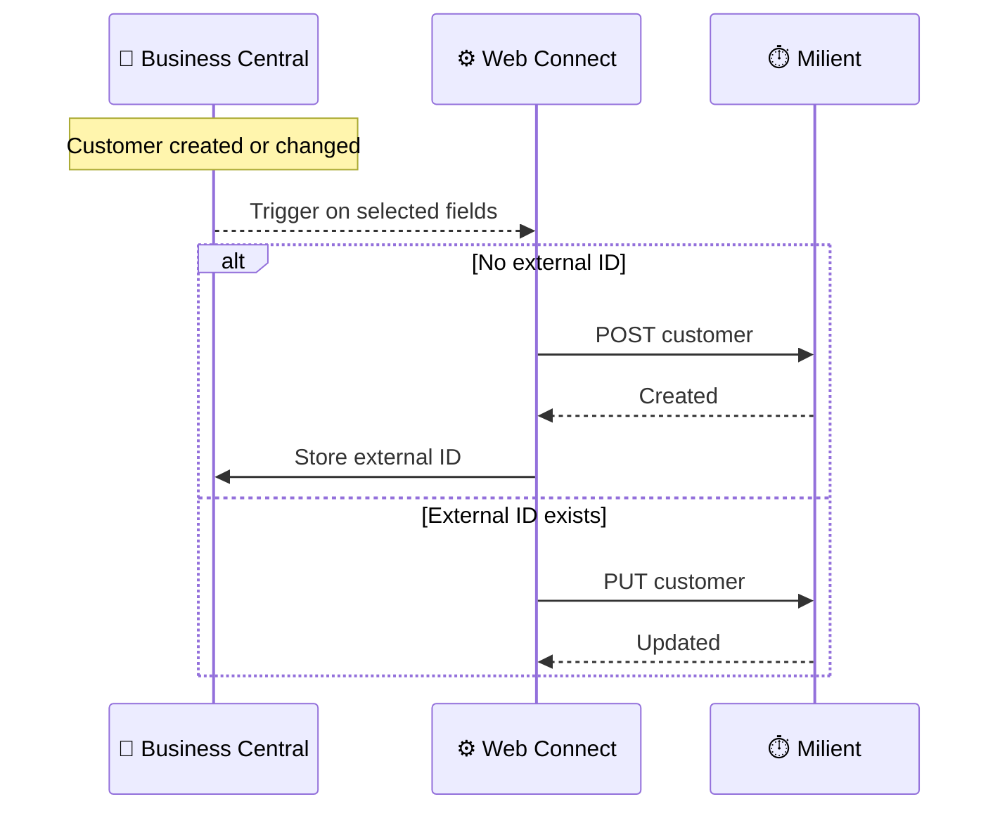

# Business Central to Milient: customers

When a customer is created or a selected field changes in Business Central, Web Connect creates or updates the customer in Milient (formerly Milltime). New customers are created, and customers already linked to Milient are updated with their Milient ID in the address of the call.

| | |
|---|---|
| **Direction** | Business Central → Milient |
| **Trigger** | A customer is created, or one of the selected fields changes, in Business Central. Only customers that meet the filter on the object are sent. The upload runs from the job queue |
| **Result** | The customer exists in Milient with the same customer number, and the Milient ID is stored as external ID in Business Central |
| **Part of** | [Business Central and Milient integration](../overview.md) |

## Step by step

1. A customer is created or changed in Business Central.
2. The outgoing sync trigger checks whether one of the selected fields changed and whether the customer meets the filter. A typical filter is that the invoice method is set.
3. Web Connect builds the customer with addresses, payment terms, invoice method, VAT type, currency and language.
4. If the customer has no external ID, Web Connect creates it in Milient with `POST`. If it has one, Web Connect updates it with `PUT` to the customer's address in Milient.
5. The Milient ID is stored as external ID on the customer.

## Data mapping

| Business Central field | Milient field | Note |
|---|---|---|
| No. | `CustomerNumber` | |
| Name | `CustomerName` | |
| Registration number | `OrganizationNumber` | |
| VAT registration no. | `VatNumber` | |
| VAT business posting group | `VatMode` | Text mapping to Milient's numeric codes, for example domestic, EU and export |
| Phone no. | `PhoneNumber1` and `MobileNumber` | |
| Fax no. | `FaxNumber` | |
| E-mail | `Email` | |
| GLN | `GLN` | |
| Country/region code | `CountryCode2`, and `CountryCode` in the addresses | Two letters as is, three letters through a text mapping |
| Currency code | `CurrencyCode` | Local currency through a text mapping |
| Language code | `LanguageCode` | Text mapping |
| Payment terms code | `BillingTerms` | Name of the payment terms |
| Invoice method | `InvoiceMethod` | Text mapping to Milient's numeric codes for letter, e-mail and e-invoice |
| Name, address, post code, city | `BillingAddress` and `ShippingAddress` | |

## Web Connect objects

| Object | Role |
|---|---|
| `MILN-CUSTOMER` | Sends the customer to Milient |
| `MILN-CUSTOMER-URL-UPDATE` | Adds the Milient ID to the address on update, and leaves it out on create |
| `MILN-BILLINGADDRESS1`, `MILN-SHIPPINGADDRESS1` | Billing and shipping address |
| `MILN-BILLINGTERMS`, `MILN-SHIPPINGTERMS`, `MILN-COMMONTERMS` | Terms |
| `MILN-CUSTOMERCONTACTS` | Customer contacts |

## Error handling

| Situation | What happens | What to do |
|---|---|---|
| The customer already exists in Milient but is not linked | Milient rejects the create as a duplicate | Set the external ID on the customer and send it again. See [Entity already exists](../../../../../how-to/web-connect/entity-already-exists-update-with-external-id.md) |
| The customer is sent before the card is complete | The next trigger runs before the external ID is stored, and Milient answers that the customer does not exist | Set the field that releases the customer for Milient as the last step on a new customer, and keep it out of customer templates |
| Any other error | The message gets an error in Web Connect Entries | Check the error and [resend the message](../../../../../how-to/web-connect/resend-outgoing-message.md), or use Send to external system on the customer |

## Frequently asked questions

### Why does Milient say the customer already exists?

The customer exists in Milient but is not linked to the Business Central customer, so Web Connect tries to create it. Link the customer by setting its external ID, then send it again.

### Why is the country not shown on the customer in Milient?

Milient needs both the three letter and the two letter country code. Web Connect sends both, and translates the Business Central country code to three letters with a text mapping.

### Can we send a single customer again?

Yes. Select the customer in the customer list in Business Central and use Send to external system.

## Related

- [Business Central and Milient integration](../overview.md)
- [Customer invoices and credit notes](invoice-inbound.md)
- [Outgoing Sync Triggers](../../../general/outgoing-mapping/outgoing-sync-triggers.md) · [Text Mapping](../../../general/text-mapping.md)
