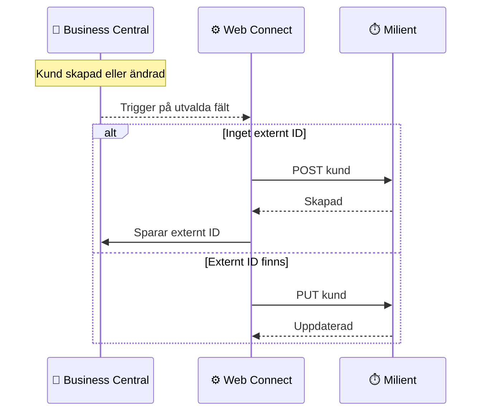

# Från Business Central till Milient: kunder

När en kund skapas eller ett utvalt fält ändras i Business Central skapar eller uppdaterar Web Connect kunden i Milient (tidigare Milltime). Nya kunder skapas, och kunder som redan är kopplade till Milient uppdateras med sitt Milient-ID i anropets adress.

| | |
|---|---|
| **Riktning** | Business Central → Milient |
| **Startas av** | En kund skapas, eller något av de utvalda fälten ändras, i Business Central. Bara kunder som uppfyller filtret på objektet skickas. Uppladdningen körs från jobbkön |
| **Resultat** | Kunden finns i Milient med samma kundnummer, och Milient-ID:t sparas som externt ID i Business Central |
| **Del av** | [Business Central och Milient (tidigare Milltime): integration](../overview.md) |

## Steg för steg

1. En kund skapas eller ändras i Business Central.
2. Den utgående synktriggern kontrollerar om något av de utvalda fälten ändrats och om kunden uppfyller filtret. Ett vanligt filter är att faktureringsmetoden är ifylld.
3. Web Connect bygger kunden med adresser, betalningsvillkor, faktureringsmetod, momstyp, valuta och språk.
4. Saknar kunden externt ID skapar Web Connect den i Milient med `POST`. Har den ett uppdaterar Web Connect den med `PUT` till kundens adress i Milient.
5. Milient-ID:t sparas som externt ID på kunden.

## Mappning av data

| Fält i Business Central | Fält i Milient | Kommentar |
|---|---|---|
| No. | `CustomerNumber` | |
| Name | `CustomerName` | |
| Registration number | `OrganizationNumber` | |
| VAT registration no. | `VatNumber` | |
| VAT business posting group | `VatMode` | Textmappning till Milients sifferkoder, till exempel inrikes, EU och export |
| Phone no. | `PhoneNumber1` och `MobileNumber` | |
| Fax no. | `FaxNumber` | |
| E-mail | `Email` | |
| GLN | `GLN` | |
| Country/region code | `CountryCode2`, och `CountryCode` i adresserna | Två bokstäver som de är, tre bokstäver via en textmappning |
| Currency code | `CurrencyCode` | Lokal valuta via en textmappning |
| Language code | `LanguageCode` | Textmappning |
| Payment terms code | `BillingTerms` | Betalningsvillkorets namn |
| Invoice method | `InvoiceMethod` | Textmappning till Milients sifferkoder för brev, mejl och e-faktura |
| Name, address, post code, city | `BillingAddress` och `ShippingAddress` | |

## Objekt i Web Connect

| Objekt | Roll |
|---|---|
| `MILN-CUSTOMER` | Skickar kunden till Milient |
| `MILN-CUSTOMER-URL-UPDATE` | Lägger till Milient-ID:t i adressen vid uppdatering och utelämnar det när kunden skapas |
| `MILN-BILLINGADDRESS1`, `MILN-SHIPPINGADDRESS1` | Faktura- och leveransadress |
| `MILN-BILLINGTERMS`, `MILN-SHIPPINGTERMS`, `MILN-COMMONTERMS` | Villkor |
| `MILN-CUSTOMERCONTACTS` | Kundens kontaktpersoner |

## Felhantering

| Situation | Vad som händer | Gör så här |
|---|---|---|
| Kunden finns redan i Milient men är inte kopplad | Milient avvisar skapandet som en dubblett | Sätt det externa ID:t på kunden och skicka den igen. Se [Entity already exists](../../../../../how-to/web-connect/entity-already-exists-update-with-external-id.md) |
| Kunden skickas innan kortet är komplett | Nästa trigger körs innan det externa ID:t sparats, och Milient svarar att kunden inte finns | Sätt fältet som släpper kunden till Milient som sista steg på en ny kund, och håll det utanför kundmallarna |
| Något annat fel | Meddelandet får ett fel i Web Connect Entries | Kontrollera felet och [skicka om meddelandet](../../../../../how-to/web-connect/resend-outgoing-message.md), eller använd Send to external system på kunden |

## Vanliga frågor

### Varför säger Milient att kunden redan finns?

Kunden finns i Milient men är inte kopplad till kunden i Business Central, så Web Connect försöker skapa den. Koppla kunden genom att sätta dess externa ID och skicka den sedan igen.

### Varför syns inte landet på kunden i Milient?

Milient behöver landskoden både med tre bokstäver och med två. Web Connect skickar båda och översätter landskoden i Business Central till tre bokstäver med en textmappning.

### Kan vi skicka om en enskild kund?

Ja. Markera kunden i kundlistan i Business Central och använd Send to external system.

## Relaterat

- [Business Central och Milient (tidigare Milltime): integration](../overview.md)
- [Kundfakturor och kreditnotor](invoice-inbound.md)
- [Outgoing Sync Triggers](../../../general/outgoing-mapping/outgoing-sync-triggers.md) · [Text Mapping](../../../general/text-mapping.md)
