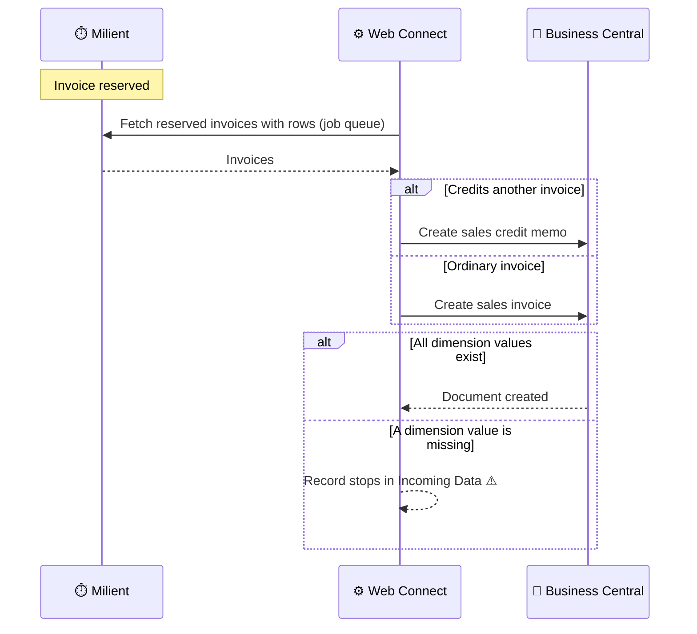

# Milient to Business Central: customer invoices and credit notes

When an invoice is reserved in Milient Time Flow (formerly Milltime), Web Connect fetches it on the next scheduled run and creates a sales invoice in Business Central. Invoices that credit another invoice become sales credit memos. The lines get their dimensions from the project and its attributes in Milient.

| | |
|---|---|
| **Direction** | Milient → Business Central |
| **Trigger** | Schedule in the Business Central job queue. Each run asks Milient for reserved invoices with their rows |
| **Result** | An unposted sales invoice or sales credit memo in Business Central, linked to the Milient invoice number. Nothing changes in Milient until the document is posted, see [Posted invoice numbers](posted-invoice-number.md) |
| **Part of** | [Business Central and Milient integration](../overview.md) |

## Step by step

1. An invoice is prepared and reserved in Milient. The invoice date is set there.
2. The job queue in Business Central starts the invoice fetch. Web Connect asks the Milient REST API for detailed invoices with the status Reserved, including rows.
3. Web Connect checks whether the invoice credits another invoice. If it does, a sales credit memo is created. Otherwise a sales invoice is created.
4. The header gets the customer number, invoice date, posting date, due date, payment terms, invoice notes and the project dimension. The Milient invoice number is stored as the external ID and as the external document number.
5. The rows become sales lines. Row types are translated with a text mapping, units with a unit mapping, and amounts or distances are used as quantity. On credit memos the sign is reversed.
6. Each line gets the project dimension and the dimensions set by the project's attributes.
7. The document waits in Business Central to be checked and posted.

## Data mapping

| Milient field | Business Central field | Note |
|---|---|---|
| `InvoiceNr` | External document number and external ID | Links the document to the Milient invoice. Used again when the posted number is written back |
| `CreditForInvoiceNr` | Document type | Invoice or credit memo, decided by a condition |
| `CreditForExtInvoiceNr` | Applies-to document on the credit memo | Only on credit memos |
| `Customer.Nr` | Sell-to customer no. | The customer must exist in Business Central |
| `Dates.InvoiceDate` | Document date and posting date | Set in Milient |
| `Dates.DueDate` | Due date | |
| `Terms.BillTermsName` | Payment terms code | |
| `Notes.InvoiceNotes` | Your reference | |
| `Project.Nr` | Project dimension on the header | |
| `InvoiceRows.RowType` | Line type | Text mapping: articles become lines with a number, text, headers and subtotals become comment lines |
| `InvoiceRows.ArticleNr` | No. | |
| `InvoiceRows.ArticleDesc` | Description | |
| `InvoiceRows.Amount` or `InvoiceRows.Distance` | Quantity | Conditions choose amount or distance, and reverse the sign on credit memos |
| `InvoiceRows.UnitDesc` | Unit of measure | Text mapping |
| `InvoiceRows.UnitPrice` | Unit price | |
| Project attributes on `InvoiceRows.ProjectId` | Dimensions on the line | One mapping line per dimension |

## Web Connect objects

| Object | Role |
|---|---|
| `MILN-INVOICE` | Fetches reserved invoices from Milient and creates the sales header |
| `MILN-INVOICEROWS` | Creates the sales lines and sets their dimensions |
| `MILN-ROWS` and `MILN-ROWS-COMMENT` | Rows that are imported as lines or as comment lines, depending on how the invoice is grouped and whether the note should be printed |
| `MILN-SHIPPINGADDRESS` | Sets text from the invoice notes on the document |
| `OAUTH-MILLNET` | OAuth 2.0 authentication against Milient |

## Error handling

| Situation | What happens | What to do |
|---|---|---|
| A dimension value from the project does not exist in Business Central | The record stops in Incoming Data with an error | Create the dimension value and process the record again |
| An invoice was reserved with the wrong invoice date | The invoice is fetched like any other | Credit it. During month end, pause the job that fetches invoices while the reserved invoices are reviewed |
| Milient's API returns an error | The run fails and is retried on the next scheduled run | Check the error in Web Connect Entries. Contact Milient if the error is on their side |
| The access token cannot be renewed | Calls fail with 401 | [401 after job queue stopped](../../../../../how-to/web-connect/unauthorized-after-job-queue-stopped.md) |

## Frequently asked questions

### Which invoices does Web Connect fetch from Milient?

Invoices with the status Reserved, for the company and from the start date set on the invoice object in Web Connect. The invoice rows are included in the same call.

### What happens if an invoice is reserved in Milient with the wrong invoice date?

It is fetched like any other reserved invoice and has to be credited. During month end, pause the job that fetches invoices while the reserved invoices are reviewed in Milient.

## Related

- [Business Central and Milient integration](../overview.md)
- [Posted invoice numbers](posted-invoice-number.md) · [Projects](projects.md)
- [Incoming Data mapping](../../../general/incoming-data/mapping.md) · [Condition List](../../../general/condition-list.md) · [Text Mapping](../../../general/text-mapping.md)
