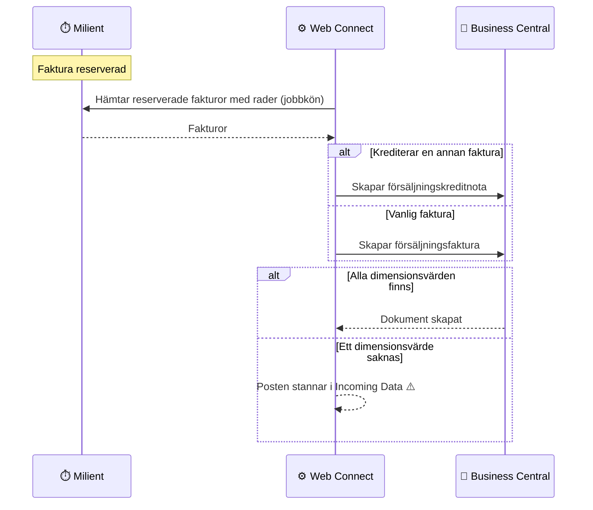

# Från Milient till Business Central: kundfakturor och kreditnotor

När en faktura reserveras i Milient (tidigare Milltime) hämtar Web Connect den vid nästa schemalagda körning och skapar en försäljningsfaktura i Business Central. Fakturor som krediterar en annan faktura blir försäljningskreditnotor. Raderna får sina dimensioner från projektet och dess attribut i Milient.

| | |
|---|---|
| **Riktning** | Milient → Business Central |
| **Startas av** | Schema i jobbkön i Business Central. Varje körning frågar Milient efter reserverade fakturor med deras rader |
| **Resultat** | En obokförd försäljningsfaktura eller försäljningskreditnota i Business Central, kopplad till fakturanumret i Milient. Inget ändras i Milient förrän dokumentet bokförs, se [Bokförda fakturanummer](posted-invoice-number.md) |
| **Del av** | [Business Central och Milient (tidigare Milltime): integration](../overview.md) |

## Steg för steg

1. En faktura förbereds och reserveras i Milient. Fakturadatumet sätts där.
2. Jobbkön i Business Central startar hämtningen av fakturor. Web Connect frågar Milients REST API efter detaljerade fakturor med statusen Reserverad, inklusive rader.
3. Web Connect kontrollerar om fakturan krediterar en annan faktura. Gör den det skapas en försäljningskreditnota. Annars skapas en försäljningsfaktura.
4. Huvudet får kundnummer, fakturadatum, bokföringsdatum, förfallodatum, betalningsvillkor, fakturanoteringar och projektdimensionen. Fakturanumret i Milient sparas som externt ID och som externt dokumentnummer.
5. Raderna blir försäljningsrader. Radtyperna översätts med en textmappning, enheterna med en enhetsmappning, och antal eller sträcka används som kvantitet. På kreditnotor vänds tecknet.
6. Varje rad får projektdimensionen och de dimensioner som projektets attribut sätter.
7. Dokumentet väntar i Business Central på att kontrolleras och bokföras.

## Mappning av data

| Fält i Milient | Fält i Business Central | Kommentar |
|---|---|---|
| `InvoiceNr` | External document number och externt ID | Kopplar dokumentet till fakturan i Milient. Används igen när det bokförda numret skrivs tillbaka |
| `CreditForInvoiceNr` | Document type | Faktura eller kreditnota, avgörs av ett villkor |
| `CreditForExtInvoiceNr` | Applies-to document på kreditnotan | Bara på kreditnotor |
| `Customer.Nr` | Sell-to customer no. | Kunden måste finnas i Business Central |
| `Dates.InvoiceDate` | Document date och posting date | Sätts i Milient |
| `Dates.DueDate` | Due date | |
| `Terms.BillTermsName` | Payment terms code | |
| `Notes.InvoiceNotes` | Your reference | |
| `Project.Nr` | Projektdimension på huvudet | |
| `InvoiceRows.RowType` | Line type | Textmappning: artiklar blir rader med ett nummer, medan text, rubriker och delsummor blir kommentarsrader |
| `InvoiceRows.ArticleNr` | No. | |
| `InvoiceRows.ArticleDesc` | Description | |
| `InvoiceRows.Amount` eller `InvoiceRows.Distance` | Quantity | Villkor väljer antal eller sträcka och vänder tecknet på kreditnotor |
| `InvoiceRows.UnitDesc` | Unit of measure | Textmappning |
| `InvoiceRows.UnitPrice` | Unit price | |
| Projektattribut på `InvoiceRows.ProjectId` | Dimensioner på raden | En mappningsrad per dimension |

## Objekt i Web Connect

| Objekt | Roll |
|---|---|
| `MILN-INVOICE` | Hämtar reserverade fakturor från Milient och skapar försäljningshuvudet |
| `MILN-INVOICEROWS` | Skapar försäljningsraderna och sätter deras dimensioner |
| `MILN-ROWS` och `MILN-ROWS-COMMENT` | Rader som importeras som vanliga rader eller som kommentarsrader, beroende på hur fakturan är grupperad och om noteringen ska skrivas ut |
| `MILN-SHIPPINGADDRESS` | Sätter text från fakturanoteringarna på dokumentet |
| `OAUTH-MILLNET` | Autentisering med OAuth 2.0 mot Milient |

## Felhantering

| Situation | Vad som händer | Gör så här |
|---|---|---|
| Ett dimensionsvärde från projektet finns inte i Business Central | Posten stannar i Incoming Data med ett fel | Skapa dimensionsvärdet och bearbeta posten igen |
| En faktura reserverades med fel fakturadatum | Fakturan hämtas som alla andra | Kreditera den. Pausa jobbet som hämtar fakturor vid månadsskiftet medan de reserverade fakturorna granskas |
| Milients API svarar med ett fel | Körningen misslyckas och görs om vid nästa schemalagda körning | Kontrollera felet i Web Connect Entries. Kontakta Milient om felet ligger hos dem |
| Åtkomsttoken kan inte förnyas | Anropen misslyckas med 401 | [401 efter att jobbkön stoppats](../../../../../how-to/web-connect/unauthorized-after-job-queue-stopped.md) |

## Vanliga frågor

### Vilka fakturor hämtar Web Connect från Milient?

Fakturor med statusen Reserverad, för det bolag och från det startdatum som är inställt på fakturaobjektet i Web Connect. Fakturaraderna följer med i samma anrop.

### Vad händer om en faktura reserveras i Milient med fel fakturadatum?

Den hämtas som vilken annan reserverad faktura som helst och måste krediteras. Pausa jobbet som hämtar fakturor vid månadsskiftet medan de reserverade fakturorna granskas i Milient.

## Relaterat

- [Business Central och Milient (tidigare Milltime): integration](../overview.md)
- [Bokförda fakturanummer](posted-invoice-number.md) · [Projekt](projects.md)
- [Mappning i Incoming Data](../../../general/incoming-data/mapping.md) · [Condition List](../../../general/condition-list.md) · [Text Mapping](../../../general/text-mapping.md)
