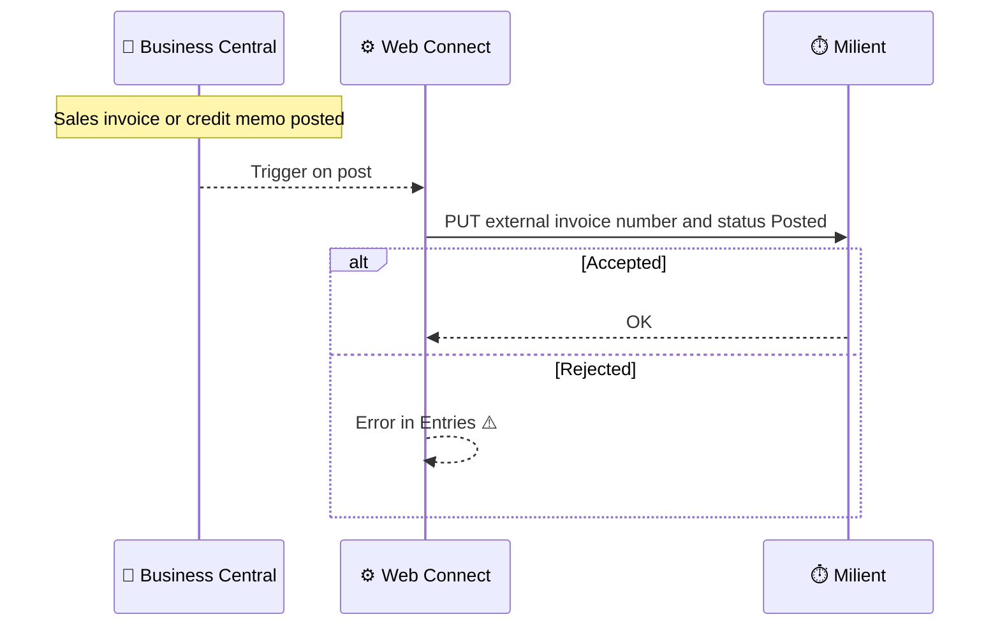

# Business Central to Milient: posted invoice numbers

When a sales invoice or credit memo that came from Milient (formerly Milltime) is posted in Business Central, Web Connect writes the posted document number back to the invoice in Milient, together with the status Posted. Milient then shows which Business Central document the invoice became.

| | |
|---|---|
| **Direction** | Business Central → Milient |
| **Trigger** | Posting of a sales invoice or sales credit memo in Business Central |
| **Result** | The invoice in Milient has the posted Business Central number as external invoice number and the status Posted |
| **Part of** | [Business Central and Milient integration](../overview.md) |

## Step by step

1. A sales invoice or credit memo created by the [invoice flow](invoice-inbound.md) is posted in Business Central.
2. The outgoing sync trigger on the posted document starts. Only documents marked as coming from Milient are included.
3. Web Connect builds the address to the invoice in Milient from the Milient invoice number stored on the document.
4. Web Connect sends the posted number and the status Posted to Milient with a `PUT`.

## Data mapping

| Business Central field | Milient field | Note |
|---|---|---|
| Posted document no. | `ExternalInvoiceNumber` | |
| Fixed value `Posted` | `ExternalInvoiceStatus` | |
| Milient invoice number (external ID) | Invoice in the URL | `/api/v3/invoices/{invoice}/external-invoice-number` |

## Web Connect objects

| Object | Role |
|---|---|
| `MILN-POSTED-INVOICE` | Sends the posted sales invoice number |
| `MILN-POSTED-CREDIT-INVOICE` | Sends the posted sales credit memo number |
| `MILN-URL` | Builds the invoice address from the stored Milient invoice number |

## Error handling

| Situation | What happens | What to do |
|---|---|---|
| Milient rejects the call | The message gets an error in Web Connect Entries. The posting in Business Central is not affected | Check the error and [resend the message](../../../../../how-to/web-connect/resend-outgoing-message.md) |
| The document was not created from Milient | Nothing is sent | No action needed |

## Frequently asked questions

### Are all posted invoices sent to Milient?

No. Only posted sales invoices and credit memos that were created from a Milient invoice are sent. Web Connect marks those documents when they are imported and filters on the mark.

## Related

- [Business Central and Milient integration](../overview.md)
- [Customer invoices and credit notes](invoice-inbound.md)
- [Outgoing Sync Triggers](../../../general/outgoing-mapping/outgoing-sync-triggers.md) · [Entries](../../../general/entries.md)
