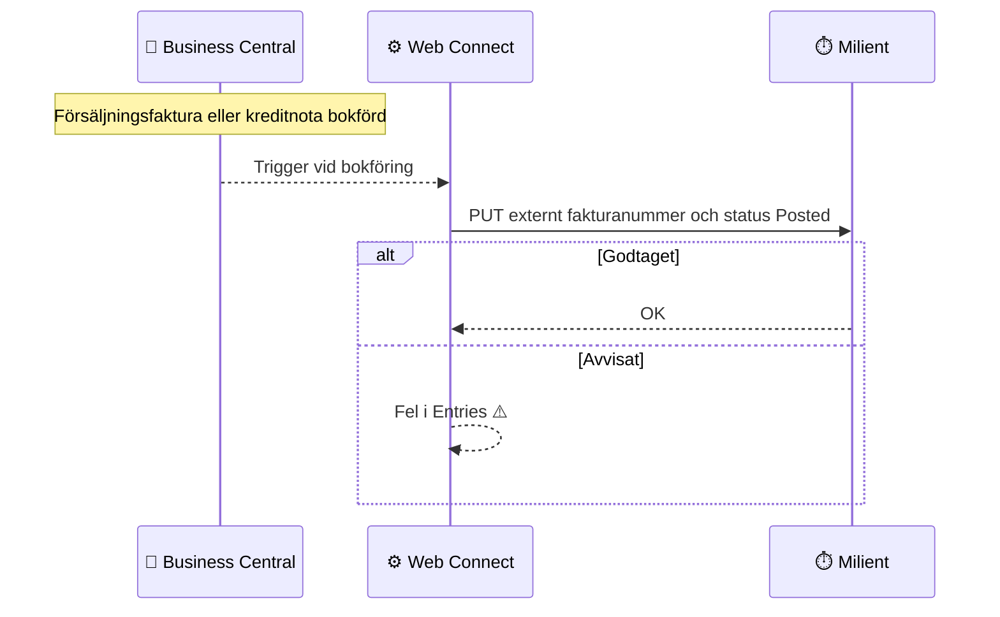

# Från Business Central till Milient: bokförda fakturanummer

När en försäljningsfaktura eller kreditnota som kom från Milient Time Flow (tidigare Milltime) bokförs i Business Central skriver Web Connect tillbaka det bokförda dokumentnumret till fakturan i Milient, tillsammans med statusen Posted. Milient visar då vilket dokument i Business Central fakturan blev.

| | |
|---|---|
| **Riktning** | Business Central → Milient |
| **Startas av** | Bokföring av en försäljningsfaktura eller försäljningskreditnota i Business Central |
| **Resultat** | Fakturan i Milient har det bokförda numret från Business Central som externt fakturanummer och statusen Posted |
| **Del av** | [Business Central och Milient Time Flow (tidigare Milltime): integration](../overview.md) |

## Steg för steg

1. En försäljningsfaktura eller kreditnota som skapats av [fakturaflödet](invoice-inbound.md) bokförs i Business Central.
2. Den utgående synktriggern på det bokförda dokumentet startar. Bara dokument som är märkta som att de kommer från Milient tas med.
3. Web Connect bygger adressen till fakturan i Milient utifrån fakturanumret från Milient som är sparat på dokumentet.
4. Web Connect skickar det bokförda numret och statusen Posted till Milient med en `PUT`.

## Mappning av data

| Fält i Business Central | Fält i Milient | Kommentar |
|---|---|---|
| Posted document no. | `ExternalInvoiceNumber` | |
| Fast värde `Posted` | `ExternalInvoiceStatus` | |
| Fakturanummer i Milient (externt ID) | Fakturan i URL:en | `/api/v3/invoices/{invoice}/external-invoice-number` |

## Objekt i Web Connect

| Objekt | Roll |
|---|---|
| `MILN-POSTED-INVOICE` | Skickar numret på den bokförda försäljningsfakturan |
| `MILN-POSTED-CREDIT-INVOICE` | Skickar numret på den bokförda försäljningskreditnotan |
| `MILN-URL` | Bygger fakturans adress utifrån det sparade fakturanumret från Milient |

## Felhantering

| Situation | Vad som händer | Gör så här |
|---|---|---|
| Milient avvisar anropet | Meddelandet får ett fel i Web Connect Entries. Bokföringen i Business Central påverkas inte | Kontrollera felet och [skicka om meddelandet](../../../../../how-to/web-connect/resend-outgoing-message.md) |
| Dokumentet skapades inte från Milient | Inget skickas | Ingen åtgärd behövs |

## Vanliga frågor

### Skickas alla bokförda fakturor till Milient?

Nej. Bara bokförda försäljningsfakturor och kreditnotor som skapats från en faktura i Milient skickas. Web Connect märker de dokumenten när de importeras och filtrerar på märkningen.

## Relaterat

- [Business Central och Milient Time Flow (tidigare Milltime): integration](../overview.md)
- [Kundfakturor och kreditnotor](invoice-inbound.md)
- [Outgoing Sync Triggers](../../../general/outgoing-mapping/outgoing-sync-triggers.md) · [Entries](../../../general/entries.md)
