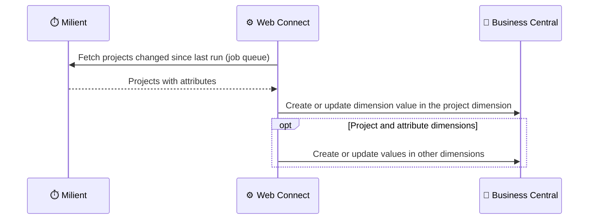

# Milient to Business Central: projects

Web Connect fetches new and changed projects from Milient (formerly Milltime) on a schedule and creates each project as a dimension value in Business Central. If you choose, selected project attributes also create values in other dimensions. Invoice lines then get the right dimensions when invoices are imported.

| | |
|---|---|
| **Direction** | Milient → Business Central |
| **Trigger** | Schedule in the Business Central job queue. Each run asks Milient for projects changed since the last run |
| **Result** | A dimension value per project in the project dimension, with the project number as code and the project name as name |
| **Part of** | [Business Central and Milient integration](../overview.md) |

## Step by step

1. A project is created or changed in Milient.
2. The job queue starts the project fetch. Web Connect asks Milient for projects changed since the time stored in an integration variable. Milient works in UTC, so the time is sent in UTC.
3. Web Connect creates or updates the dimension value in the project dimension.
4. With project and attribute dimensions: each project attribute is translated to a dimension with a text mapping, and a condition skips attributes that are not dimensions, such as dates or budget.
5. The time of the run is stored for the next fetch.

## Data mapping

| Milient field | Business Central field | Note |
|---|---|---|
| Fixed value | Dimension code | The project dimension |
| `ProjectNumber` | Dimension value code | Unique key together with the dimension code |
| `ProjectName` | Name | |
| `Attributes.Name` | Dimension code | Only with project and attribute dimensions. Text mapping from attribute name to dimension |
| `Attributes.Value` | Dimension value code | Read as is, not as a filter |

## Web Connect objects

| Object | Role |
|---|---|
| `MILN-PROJECT` | Fetches changed projects and creates the dimension value |
| `MILN-ATTRIBUTES` | Creates values in other dimensions from project attributes. Ignored when only the project dimension is used |
| `MILN-URL-CUSTOMER` | Adds the time of the last change to the call |

## Error handling

| Situation | What happens | What to do |
|---|---|---|
| A code contains a character Business Central reads as a filter, such as `&` | The value is not found, and creating it fails as a duplicate | Avoid special characters in codes. The mapping line can be set to read the value as is |
| A record stopped with an error | The project is not created | Correct the cause and process the record again in Incoming Data |
| Nothing is fetched | No new dimension values | See [Nothing downloads to Business Central](../../../../../how-to/web-connect/nothing-downloads-to-business-central.md) |

## Frequently asked questions

### Why did a project from Milient not come into Business Central?

Usually because the record stopped with an error in Incoming Data, for example a code with a special character that Business Central reads as a filter. Check the record, correct the cause and process it again.

## Related

- [Business Central and Milient integration](../overview.md)
- [Customer invoices and credit notes](invoice-inbound.md)
- [Incoming Data mapping](../../../general/incoming-data/mapping.md) · [Condition List](../../../general/condition-list.md) · [Text Mapping](../../../general/text-mapping.md)
