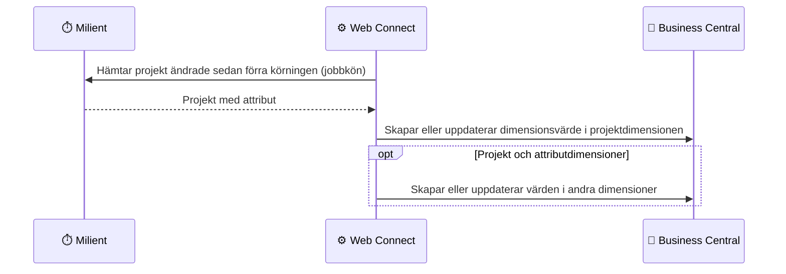

# Från Milient till Business Central: projekt

Web Connect hämtar nya och ändrade projekt från Milient (tidigare Milltime) enligt schema och skapar varje projekt som ett dimensionsvärde i Business Central. Om du vill skapar utvalda projektattribut också värden i andra dimensioner. Fakturaraderna får då rätt dimensioner när fakturorna importeras.

| | |
|---|---|
| **Riktning** | Milient → Business Central |
| **Startas av** | Schema i jobbkön i Business Central. Varje körning frågar Milient efter projekt som ändrats sedan förra körningen |
| **Resultat** | Ett dimensionsvärde per projekt i projektdimensionen, med projektnumret som kod och projektnamnet som namn |
| **Del av** | [Business Central och Milient (tidigare Milltime): integration](../overview.md) |

## Steg för steg

1. Ett projekt skapas eller ändras i Milient.
2. Jobbkön startar hämtningen av projekt. Web Connect frågar Milient efter projekt som ändrats sedan tidpunkten som är sparad i en integrationsvariabel. Milient arbetar i UTC, så tidpunkten skickas i UTC.
3. Web Connect skapar eller uppdaterar dimensionsvärdet i projektdimensionen.
4. Med projekt och attributdimensioner: varje projektattribut översätts till en dimension med en textmappning, och ett villkor hoppar över attribut som inte är dimensioner, som datum eller budget.
5. Tidpunkten för körningen sparas till nästa hämtning.

## Mappning av data

| Fält i Milient | Fält i Business Central | Kommentar |
|---|---|---|
| Fast värde | Dimension code | Projektdimensionen |
| `ProjectNumber` | Dimension value code | Unik nyckel tillsammans med dimensionskoden |
| `ProjectName` | Name | |
| `Attributes.Name` | Dimension code | Bara med projekt och attributdimensioner. Textmappning från attributnamn till dimension |
| `Attributes.Value` | Dimension value code | Läses som det är, inte som ett filter |

## Objekt i Web Connect

| Objekt | Roll |
|---|---|
| `MILN-PROJECT` | Hämtar ändrade projekt och skapar dimensionsvärdet |
| `MILN-ATTRIBUTES` | Skapar värden i andra dimensioner från projektattribut. Ignoreras när bara projektdimensionen används |
| `MILN-URL-CUSTOMER` | Lägger till tidpunkten för den senaste ändringen i anropet |

## Felhantering

| Situation | Vad som händer | Gör så här |
|---|---|---|
| En kod innehåller ett tecken som Business Central läser som ett filter, till exempel `&` | Värdet hittas inte, och det går inte att skapa eftersom det blir en dubblett | Undvik specialtecken i koder. Mappningsraden kan ställas in så att värdet läses som det är |
| En post stannade med ett fel | Projektet skapas inte | Åtgärda orsaken och bearbeta posten igen i Incoming Data |
| Inget hämtas | Inga nya dimensionsvärden | Se [Inget laddas ner till Business Central](../../../../../how-to/web-connect/nothing-downloads-to-business-central.md) |

## Vanliga frågor

### Varför kom inte ett projekt från Milient in i Business Central?

Oftast för att posten stannade med ett fel i Incoming Data, till exempel en kod med ett specialtecken som Business Central läser som ett filter. Kontrollera posten, åtgärda orsaken och bearbeta den igen.

## Relaterat

- [Business Central och Milient (tidigare Milltime): integration](../overview.md)
- [Kundfakturor och kreditnotor](invoice-inbound.md)
- [Mappning i Incoming Data](../../../general/incoming-data/mapping.md) · [Condition List](../../../general/condition-list.md) · [Text Mapping](../../../general/text-mapping.md)
