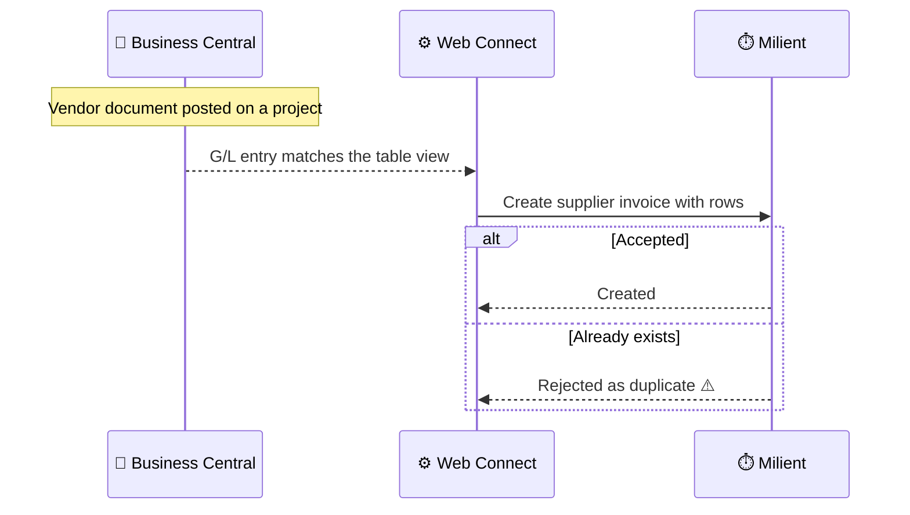

# Business Central to Milient: supplier costs on projects

When a vendor invoice or credit memo is posted in Business Central with a project, Web Connect sends the entries on selected G/L accounts to Milient Time Flow (formerly Milltime) as a supplier invoice. The project manager can then pass the cost on to the end customer in Milient.

| | |
|---|---|
| **Direction** | Business Central → Milient |
| **Trigger** | A G/L entry is created when a vendor document is posted. Only entries that meet the table view on the object are sent |
| **Result** | A supplier invoice in Milient with one row per entry, on the project |
| **Part of** | [Business Central and Milient integration](../overview.md) |

## Step by step

1. A vendor invoice or credit memo is posted in Business Central with a project dimension.
2. The outgoing sync trigger on G/L entries checks the table view: source type Vendor, one of the selected G/L accounts, and a project.
3. Web Connect builds the supplier invoice from the entry, with the vendor's number and name.
4. The rows are the G/L entries with the same document number, posting date and document type on the selected accounts.
5. Web Connect sends the supplier invoice to Milient.

## Data mapping

| Business Central field | Milient field | Note |
|---|---|---|
| Posting date | `InvoiceDate` | |
| Document no. | `ExternalInvoiceNumber` | |
| External document no. | `SupplierInvoiceNumber` | The vendor's invoice number |
| Source no. | `SupplierNumber` | |
| Vendor name | `SupplierName` | Looked up from the vendor |
| Description | `Description` and `RowText` | |
| Amount | `ItemCost` | Quantity is always 1 |
| Project dimension | `ProjectNumber` | |
| Entry no. | `RowNumber` | |

## Web Connect objects

| Object | Role |
|---|---|
| `MILN-SUPPLIER-INVOICE` | Sends the supplier invoice. The table view sets which entries are included |
| `MILN-SUPPLIER-INVOICE-ROWS` | One row per G/L entry on the same document |
| `MILN-GLENTRY_SOURCE` | Looks up the vendor name |

## Error handling

| Situation | What happens | What to do |
|---|---|---|
| The supplier invoice already exists in Milient | Milient rejects it as a duplicate | No action needed if it was sent before |
| Wrong entries reached Milient | They show up as supplier invoices in Milient | Narrow the account selection in the table view, and delete the wrong supplier invoices in Milient |
| Any other error | The message gets an error in Web Connect Entries | Check the error and [resend the message](../../../../../how-to/web-connect/resend-outgoing-message.md) |

## Frequently asked questions

### Which costs are sent to Milient?

G/L entries on the accounts you select, posted from a vendor and with a project dimension. Vendor credit memos are included. Expenses reported by employees are handled in Milient and are not sent.

### Can we send costs for a period again?

Yes, but Milient rejects a supplier invoice it already has as a duplicate. Check the selection before sending, so that no other entries are included.

## Related

- [Business Central and Milient integration](../overview.md)
- [Projects](projects.md)
- [Outgoing Sync Triggers](../../../general/outgoing-mapping/outgoing-sync-triggers.md) · [Entries](../../../general/entries.md)
