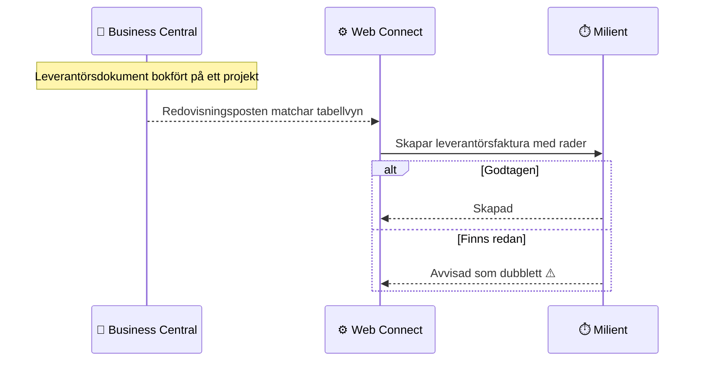

# Från Business Central till Milient: leverantörskostnader på projekt

När en leverantörsfaktura eller leverantörskreditnota bokförs i Business Central med ett projekt skickar Web Connect posterna på utvalda konton till Milient (tidigare Milltime) som en leverantörsfaktura. Projektledaren kan sedan vidarefakturera kostnaden till slutkunden i Milient.

| | |
|---|---|
| **Riktning** | Business Central → Milient |
| **Startas av** | En redovisningspost skapas när ett leverantörsdokument bokförs. Bara poster som uppfyller tabellvyn på objektet skickas |
| **Resultat** | En leverantörsfaktura i Milient med en rad per post, på projektet |
| **Del av** | [Business Central och Milient (tidigare Milltime): integration](../overview.md) |

## Steg för steg

1. En leverantörsfaktura eller leverantörskreditnota bokförs i Business Central med en projektdimension.
2. Den utgående synktriggern på redovisningsposter kontrollerar tabellvyn: källtypen Vendor, ett av de utvalda kontona och ett projekt.
3. Web Connect bygger leverantörsfakturan utifrån posten, med leverantörens nummer och namn.
4. Raderna är redovisningsposterna med samma dokumentnummer, bokföringsdatum och dokumenttyp på de utvalda kontona.
5. Web Connect skickar leverantörsfakturan till Milient.

## Mappning av data

| Fält i Business Central | Fält i Milient | Kommentar |
|---|---|---|
| Posting date | `InvoiceDate` | |
| Document no. | `ExternalInvoiceNumber` | |
| External document no. | `SupplierInvoiceNumber` | Leverantörens fakturanummer |
| Source no. | `SupplierNumber` | |
| Leverantörens namn | `SupplierName` | Slås upp från leverantören |
| Description | `Description` och `RowText` | |
| Amount | `ItemCost` | Antalet är alltid 1 |
| Projektdimension | `ProjectNumber` | |
| Entry no. | `RowNumber` | |

## Objekt i Web Connect

| Objekt | Roll |
|---|---|
| `MILN-SUPPLIER-INVOICE` | Skickar leverantörsfakturan. Tabellvyn styr vilka poster som tas med |
| `MILN-SUPPLIER-INVOICE-ROWS` | En rad per redovisningspost på samma dokument |
| `MILN-GLENTRY_SOURCE` | Slår upp leverantörens namn |

## Felhantering

| Situation | Vad som händer | Gör så här |
|---|---|---|
| Leverantörsfakturan finns redan i Milient | Milient avvisar den som en dubblett | Ingen åtgärd behövs om den skickats tidigare |
| Fel poster kom till Milient | De syns som leverantörsfakturor i Milient | Snäva in urvalet av konton i tabellvyn och ta bort de felaktiga leverantörsfakturorna i Milient |
| Något annat fel | Meddelandet får ett fel i Web Connect Entries | Kontrollera felet och [skicka om meddelandet](../../../../../how-to/web-connect/resend-outgoing-message.md) |

## Vanliga frågor

### Vilka kostnader skickas till Milient?

Redovisningsposter på de konton du väljer, bokförda från en leverantör och med en projektdimension. Leverantörskreditnotor tas med. Utlägg som rapporteras av anställda hanteras i Milient och skickas inte.

### Kan vi skicka kostnaderna för en period igen?

Ja, men Milient avvisar en leverantörsfaktura som redan finns där som en dubblett. Kontrollera urvalet innan du skickar, så att inga andra poster kommer med.

## Relaterat

- [Business Central och Milient (tidigare Milltime): integration](../overview.md)
- [Projekt](projects.md)
- [Outgoing Sync Triggers](../../../general/outgoing-mapping/outgoing-sync-triggers.md) · [Entries](../../../general/entries.md)
