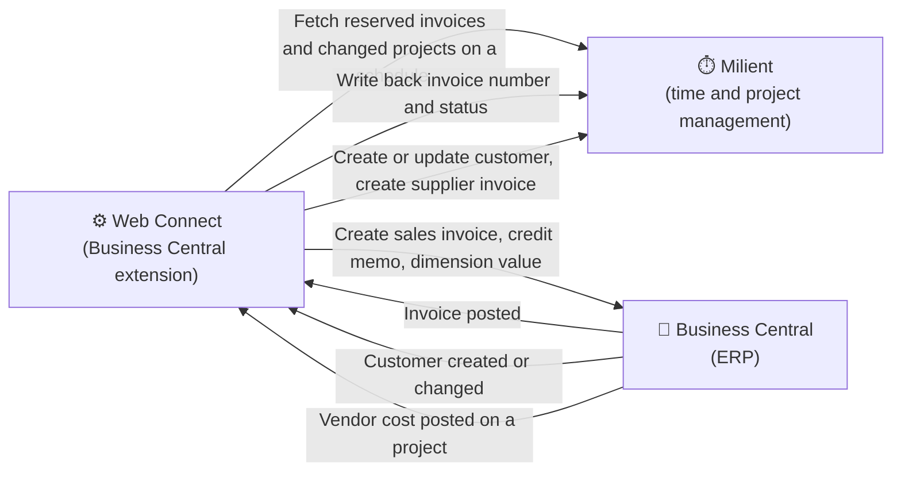
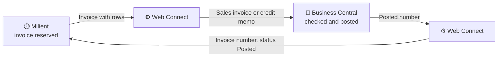
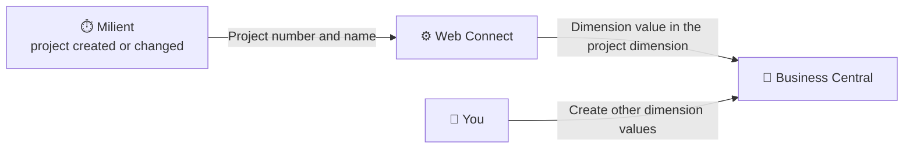
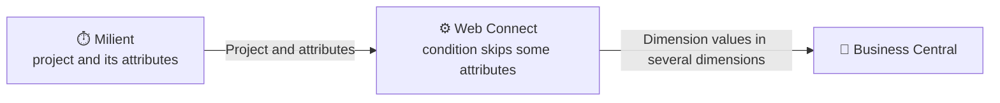
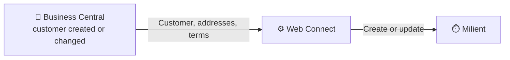
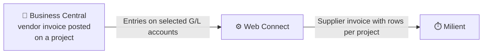

# Business Central and Milient (formerly Milltime) integration

Web Connect by CombineIT connects Microsoft Dynamics 365 Business Central with Milient (formerly Milltime), the time and project management system. Invoices and projects are fetched from Milient into Business Central, and customers, posted invoice numbers and supplier costs on projects are sent to Milient. All mappings and rules live in your own Business Central, where you can see and change them yourself.

## At a glance

| | |
|---|---|
| **System** | Milient, formerly Milltime (time and project management) |
| **Integration product** | Web Connect for Microsoft Dynamics 365 Business Central |
| **Runs in** | Your own Business Central environment, as an extension. Web Connect fetches reserved invoices and changed projects from Milient on a schedule in the Business Central job queue, and sends customers, posted invoice numbers and supplier costs to Milient when they change or are posted in Business Central. No webhooks and no external integration platform are involved. |
| **Configured by** | You, in Business Central: mappings, conditions, triggers and flows. You can do all of it yourself. If you want, CombineIT takes part in any step, as a sounding board or by doing the work. |
| **Connection** | Milient REST API (version 3), with OAuth 2.0 |
| **Milient API** | [ATT FYLLA I: name and link to Milient's API documentation] |
| **Data flows** | 5: customer invoices and credit notes, posted invoice numbers, customers, projects and supplier costs on projects |
| **Business Central editions** | All editions, Essentials and Premium, including the latest version |
| **Available from** | [Web Connect on Microsoft AppSource](https://marketplace.microsoft.com/sv-se/product/PUBID.martitab1633951001710%7CAID.webconnect%7CPAPPID.9f3a7223-19db-4ac7-832f-cf8e4699186f?tab=Overview). [ATT FYLLA I: whether the Milient integration is included in the Web Connect Ready Integrations app] |

## What can be synchronized

Web Connect has five data flows between Business Central and Milient.

| Data | Direction | What happens |
|---|---|---|
| [Customer invoices and credit notes](flows/invoice-inbound.md) | Milient → Business Central | Reserved invoices are fetched and created as sales invoices or sales credit memos, with project dimensions on the lines |
| [Posted invoice numbers](flows/posted-invoice-number.md) | Business Central → Milient | When the invoice or credit memo is posted, its number and the status Posted are written back on the invoice in Milient |
| [Customers](flows/customers.md) | Business Central → Milient | New and changed customers are created or updated in Milient |
| [Projects](flows/projects.md) | Milient → Business Central | New and changed projects are created as dimension values in Business Central |
| [Supplier costs on projects](flows/supplier-costs.md) | Business Central → Milient | Posted vendor costs on selected G/L accounts with a project are sent to Milient as supplier invoices |

Invoices and posted invoice numbers belong together: one brings the invoice into Business Central, the other tells Milient it has been posted. The other flows are chosen when the integration is set up. See [Choose your setup](#choose-your-setup).

## How it works

Milient is where time is reported and invoices are prepared. When an invoice is reserved in Milient, Web Connect fetches it on the next scheduled run, creates a sales invoice or a sales credit memo in Business Central and sets the dimensions from the project. Changed projects are fetched on a schedule as well, based on the time of the last change. In the other direction, outgoing sync triggers in Web Connect react when a customer is created or changed, when an invoice is posted and when a vendor cost is posted on a project. Every message in both directions is logged in Web Connect Entries, where it can be inspected and resent.

## Choose your setup

Each flow has to fit how your business works: which system owns the data, where people do their work, and what the accounting needs. That is why the flows are decided together when a new integration is set up. The options below are the ones in use with Web Connect customers today. Web Connect has one Milient integration in production, so no option is marked as **common setup** yet.

### Invoices

| Option | How it works | When it fits |
|---|---|---|
| **Invoices from Milient, posted in Business Central** | Invoices are prepared and reserved in Milient, fetched into Business Central, checked and posted there. The posted number goes back to Milient | Time and invoicing are handled in Milient, and the accounting in Business Central |

#### Invoices from Milient, posted in Business Central

### Projects and dimensions

| Option | How it works | When it fits |
|---|---|---|
| **Project dimension only** | Each project in Milient becomes a dimension value in the project dimension in Business Central. Other dimension values, such as department or team, are created in Business Central by you | Several people can add project attributes in Milient, and you want to control which dimension values exist in Business Central |
| **Project and attribute dimensions** | Besides the project dimension value, selected project attributes in Milient create values in other dimensions in Business Central. A condition decides which attributes are skipped | The project attributes in Milient are kept in line with the dimensions in Business Central |

In both options, the invoice lines get their dimension values from the project and its attributes in Milient.

#### Projects and dimensions: project dimension only

#### Projects and dimensions: project and attribute dimensions

### Customers

| Option | How it works | When it fits |
|---|---|---|
| **Maintained in Business Central** | Customers are created and changed in Business Central and sent to Milient when selected fields change | Business Central is the customer register, and Milient needs the customers to invoice them |

#### Customers maintained in Business Central

### Supplier costs on projects

| Option | How it works | When it fits |
|---|---|---|
| **Posted in Business Central, sent to Milient** | Vendor invoices are posted in Business Central with a project dimension. Entries on selected G/L accounts are sent to Milient as supplier invoices on the project | Supplier costs are passed on to the end customer through Milient |

#### Supplier costs posted in Business Central, sent to Milient

Time reporting, invoice preparation and the invoice date are always handled in Milient.

## What you need

- Microsoft Dynamics 365 Business Central, any edition (Essentials or Premium), including the latest version
- Web Connect installed from Microsoft AppSource, with an activated Web Connect license
- Your approval for Web Connect to be installed and to act in your Business Central environment
- API access to your Milient environment: a client ID and client secret for OAuth 2.0. [ATT FYLLA I: where the API client is created in Milient, or whether Milient support creates it]
- A dimension in Business Central for projects, and dimension values for any other dimensions the invoice lines should get
- For the customer flow: every customer that already exists in both systems linked to its Milient customer before the flow is started

## Setting it up

1. Decide which flows to use and which option to choose for each, see [Choose your setup](#choose-your-setup).
2. Install Web Connect in Business Central, activate the license and give your approval. [ATT FYLLA I: how the ready Milient integration is installed]
3. Store the Milient client secret in Web Connect [Secret Value Storage](../../general/secret-value-storage.md). Web Connect fetches a temporary access token with it and renews the token automatically.
4. Set up the configuration choices below.
5. Link existing customers to Milient before the customer flow is started, so that no duplicates are created.
6. Test the whole invoice flow in a Business Central sandbox before going live.

## Configure it yourself in Business Central

All configuration and logic in the integration is visible and editable in Business Central. There is no external integration platform where the logic is hidden.

| What you can change | Where in Web Connect | Example |
|---|---|---|
| Which invoices are fetched | The path on the invoice object | Fetch only reserved invoices for one company in Milient, from a given start date |
| Field mapping on invoices | [Incoming Data mapping](../../general/incoming-data/mapping.md) | Map a project attribute in Milient to a dimension on the invoice line |
| Value translation | [Text Mapping](../../general/text-mapping.md) | Translate Milient row types to line types, units to units of measure, and Business Central invoice methods and VAT types to Milient's codes |
| Which lines and attributes are used | [Condition List](../../general/condition-list.md) | Skip project attributes that are not dimensions, or import text rows only when they should be printed on the invoice |
| What triggers customer updates | [Outgoing Sync Triggers](../../general/outgoing-mapping/outgoing-sync-triggers.md) | Send the customer when the name, address, phone, organization number or e-mail changes |
| Which supplier costs are sent | Outgoing sync table view on the supplier cost object | Send only vendor entries on selected G/L accounts that have a project |
| Monitoring and resending | [Entries](../../general/entries.md) | See every invoice and update, and [resend a message](../../../../how-to/web-connect/resend-outgoing-message.md) |

## Configuration choices

- **Invoice selection:** which invoice status, company and start date in Milient the invoices are fetched from. Reserved is the status used today.
- **Invoice and credit memo:** an invoice in Milient that credits another invoice becomes a sales credit memo in Business Central, with the original invoice number as reference. The sign of the amounts is reversed for the credit memo.
- **Line types:** how Milient row types (articles, time, text, headers, subtotals) become lines in Business Central, and which text rows are imported.
- **Dimensions:** which dimension holds the projects, and which project attributes in Milient set other dimensions on the invoice lines.
- **Customer fields:** which Business Central fields are sent to Milient, including invoice method, VAT type, payment terms, currency, language, country and addresses. Milient expects some of them as numeric codes, which is handled with text mappings.
- **Supplier costs:** which G/L accounts are included and which entries count as vendor costs on a project.
- **Schedule:** how often the job queue fetches invoices and projects and sends updates.

## Limitations

- **Every reserved invoice is fetched.** Milient has no later status than Reserved to wait for, and the invoice date is set in Milient. An invoice reserved with the wrong date reaches Business Central and has to be credited. During month end, pause the job that fetches invoices while the reserved invoices are reviewed.
- **Dimension values must exist in Business Central.** If an invoice line refers to a project attribute value that does not exist as a dimension value, the invoice stops in Incoming Data until the value is created and the record is processed again.
- **Special characters in codes.** Characters such as `&`, `[`, `<` and `>` in project or attribute codes can be read as filters in Business Central. Avoid them in code fields.
- **Existing customers must be linked first.** Without the link to the Milient customer, Web Connect creates a new customer in Milient instead of updating the existing one.
- **Fill in the customer card before the field that releases it.** Field based triggers run while the customer card is being filled in. Set the field that marks the customer for Milient as the last step, so the customer is sent once it is complete.
- **Articles and exchange rates are not synchronized** in the current setup. Articles are maintained in each system.
- **Expenses reported by employees** are handled in Milient and are not sent from Business Central.

## Frequently asked questions

### Can Business Central be integrated with Milient (formerly Milltime)?

Yes. Web Connect connects Business Central with Milient through the Milient REST API. Reserved invoices and projects are fetched into Business Central, and customers, posted invoice numbers and supplier costs on projects are sent to Milient.

### What happens if an invoice is reserved in Milient with the wrong invoice date?

Web Connect fetches every reserved invoice, and Milient has no later status to wait for. An invoice reserved with the wrong date reaches Business Central and has to be credited. During month end you can pause the job that fetches invoices, review the reserved invoices in Milient and start the job again.

### Why does an invoice from Milient stop with a dimension error?

The invoice lines get dimension values from the project in Milient. If a value does not exist in Business Central, the invoice stops in Incoming Data. Create the dimension value in Business Central and process the record again.

### How do we avoid duplicate customers in Milient when the integration starts?

Customers that already exist in both systems must be linked before the customer flow is started. Web Connect stores the Milient customer as an external ID on the Business Central customer, and only then sends updates instead of creating new customers.

### Can we change what is sent between Business Central and Milient ourselves?

Yes. Field mappings, text mappings, conditions and triggers are configured in Web Connect inside your own Business Central. You can see and change them without asking a supplier to change an external platform.

## Related

- Flows: [Customer invoices](flows/invoice-inbound.md) · [Posted invoice numbers](flows/posted-invoice-number.md) · [Customers](flows/customers.md) · [Projects](flows/projects.md) · [Supplier costs on projects](flows/supplier-costs.md)
- How-to: [Resend an outgoing message](../../../../how-to/web-connect/resend-outgoing-message.md) · [Entity already exists: update with external ID](../../../../how-to/web-connect/entity-already-exists-update-with-external-id.md) · [Nothing downloads to Business Central](../../../../how-to/web-connect/nothing-downloads-to-business-central.md) · [401 after job queue stopped](../../../../how-to/web-connect/unauthorized-after-job-queue-stopped.md)
- [Web Connect general documentation](../../general/README.md)
- [ATT FYLLA I: Milient API documentation link]

## About Web Connect

Web Connect is an integration platform for Microsoft Dynamics 365 Business Central, developed by CombineIT. It is installed in your own Business Central and connects it with e-commerce platforms, warehouse systems, POS, returns, marketplaces and EDI. Every flow, mapping and rule is configured in Business Central, where you can see and change it yourself, without custom code for each integration. [Web Connect on Microsoft AppSource](https://marketplace.microsoft.com/sv-se/product/PUBID.martitab1633951001710%7CAID.webconnect%7CPAPPID.9f3a7223-19db-4ac7-832f-cf8e4699186f?tab=Overview) · [Contact CombineIT](https://www.combineit.se/contact/)
