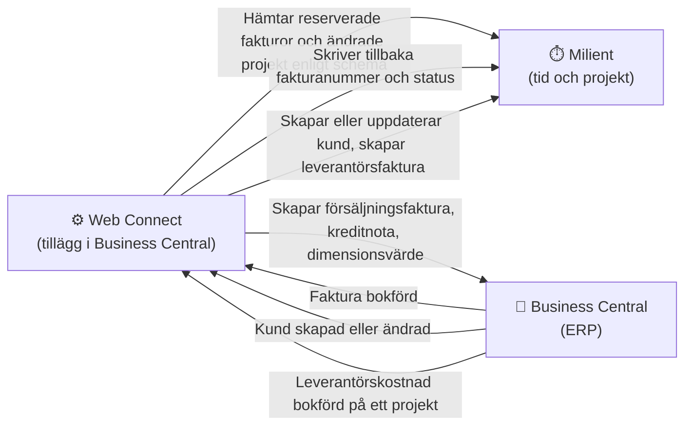
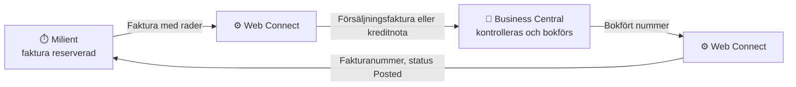
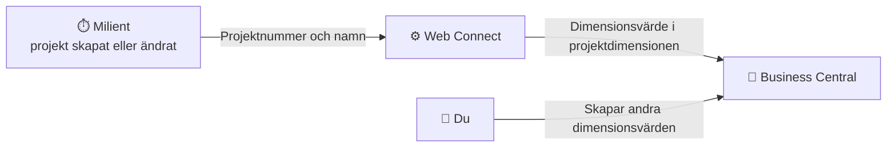
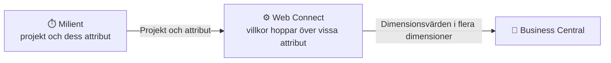
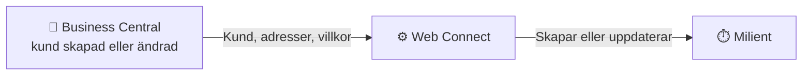
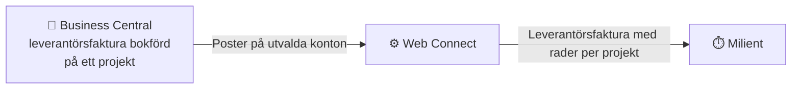

# Business Central och Milient (tidigare Milltime): integration

Web Connect från CombineIT kopplar ihop Microsoft Dynamics 365 Business Central med Milient (tidigare Milltime), systemet för tidrapportering och projektstyrning. Fakturor och projekt hämtas från Milient till Business Central, och kunder, bokförda fakturanummer och leverantörskostnader på projekt skickas till Milient. Alla mappningar och regler finns i ditt eget Business Central, där du själv kan se och ändra dem.

## I korthet

| | |
|---|---|
| **System** | Milient, tidigare Milltime (tidrapportering och projektstyrning) |
| **Integrationsprodukt** | Web Connect för Microsoft Dynamics 365 Business Central |
| **Körs i** | Din egen Business Central-miljö, som ett tillägg. Web Connect hämtar reserverade fakturor och ändrade projekt från Milient enligt schema i jobbkön i Business Central, och skickar kunder, bokförda fakturanummer och leverantörskostnader till Milient när de ändras eller bokförs i Business Central. Inga webhooks och ingen extern integrationsplattform är inblandade. |
| **Konfigureras av** | Dig, i Business Central: mappningar, villkor, triggers och flöden. Du kan göra allt själv. Om du vill är CombineIT med i vilket steg som helst, som bollplank eller genom att göra jobbet. |
| **Koppling** | Milients REST API (version 3), med OAuth 2.0 |
| **Milients API** | [Milients dokumentation](https://docs.milientsoftware.com/help/my-pages) |
| **Dataflöden** | 5: kundfakturor och kreditnotor, bokförda fakturanummer, kunder, projekt och leverantörskostnader på projekt |
| **Business Central-utgåvor** | Alla utgåvor, Essentials och Premium, även den senaste versionen |
| **Finns på** | [Web Connect på Microsoft AppSource](https://marketplace.microsoft.com/sv-se/product/PUBID.martitab1633951001710%7CAID.webconnect%7CPAPPID.9f3a7223-19db-4ac7-832f-cf8e4699186f?tab=Overview). Milient-integrationen ingår inte i appen Web Connect Ready Integrations. Den sätts upp i Web Connect, av dig eller tillsammans med CombineIT |

## Det här kan synkas

Web Connect har fem dataflöden mellan Business Central och Milient.

| Data | Riktning | Vad som händer |
|---|---|---|
| [Kundfakturor och kreditnotor](flows/invoice-inbound.md) | Milient → Business Central | Reserverade fakturor hämtas och skapas som försäljningsfakturor eller försäljningskreditnotor, med projektdimensioner på raderna |
| [Bokförda fakturanummer](flows/posted-invoice-number.md) | Business Central → Milient | När fakturan eller kreditnotan bokförs skrivs dess nummer och statusen Posted tillbaka på fakturan i Milient |
| [Kunder](flows/customers.md) | Business Central → Milient | Nya och ändrade kunder skapas eller uppdateras i Milient |
| [Projekt](flows/projects.md) | Milient → Business Central | Nya och ändrade projekt skapas som dimensionsvärden i Business Central |
| [Leverantörskostnader på projekt](flows/supplier-costs.md) | Business Central → Milient | Bokförda leverantörskostnader på utvalda konton med ett projekt skickas till Milient som leverantörsfakturor |

Fakturor och bokförda fakturanummer hör ihop: det ena flödet tar in fakturan i Business Central, det andra talar om för Milient att den är bokförd. De övriga flödena väljs när integrationen sätts upp. Se [Välj upplägg](#choose-your-setup).

## Så fungerar det

I Milient rapporteras tiden och fakturorna förbereds. När en faktura reserveras i Milient hämtar Web Connect den vid nästa schemalagda körning, skapar en försäljningsfaktura eller en försäljningskreditnota i Business Central och sätter dimensionerna utifrån projektet. Ändrade projekt hämtas också enligt schema, utifrån tidpunkten för den senaste ändringen. Åt andra hållet reagerar utgående synktriggers i Web Connect när en kund skapas eller ändras, när en faktura bokförs och när en leverantörskostnad bokförs på ett projekt. Varje meddelande i båda riktningarna loggas i Web Connect Entries, där det kan granskas och skickas om.

## Välj upplägg

Varje flöde måste passa hur ditt företag arbetar: vilket system som äger datan, var personalen gör sitt arbete och vad bokföringen behöver. Därför bestäms flödena tillsammans när en ny integration sätts upp. Alternativen nedan är de som Web Connect-kunder använder i dag. Web Connect har en Milient-integration i produktion, så inget alternativ är markerat som **vanligt upplägg** än.

### Fakturor

| Alternativ | Så fungerar det | När det passar |
|---|---|---|
| **Fakturor från Milient, bokförs i Business Central** | Fakturorna förbereds och reserveras i Milient, hämtas till Business Central och kontrolleras och bokförs där. Det bokförda numret går tillbaka till Milient | Tid och fakturering sköts i Milient, och bokföringen i Business Central |

#### Fakturor från Milient som bokförs i Business Central

### Projekt och dimensioner

| Alternativ | Så fungerar det | När det passar |
|---|---|---|
| **Bara projektdimension** | Varje projekt i Milient blir ett dimensionsvärde i projektdimensionen i Business Central. Andra dimensionsvärden, som avdelning eller team, skapar du själv i Business Central | Flera personer kan lägga till projektattribut i Milient, och du vill styra vilka dimensionsvärden som finns i Business Central |
| **Projekt och attributdimensioner** | Förutom dimensionsvärdet för projektet skapar utvalda projektattribut i Milient värden i andra dimensioner i Business Central. Ett villkor avgör vilka attribut som hoppas över | Projektattributen i Milient hålls i linje med dimensionerna i Business Central |

I båda alternativen får fakturaraderna sina dimensionsvärden från projektet och dess attribut i Milient.

#### Projekt och dimensioner: bara projektdimension

#### Projekt och dimensioner: projekt och attributdimensioner

### Kunder

| Alternativ | Så fungerar det | När det passar |
|---|---|---|
| **Underhålls i Business Central** | Kunderna skapas och ändras i Business Central och skickas till Milient när utvalda fält ändras | Business Central är kundregistret, och Milient behöver kunderna för att kunna fakturera dem |

#### Kunder som underhålls i Business Central

### Leverantörskostnader på projekt

| Alternativ | Så fungerar det | När det passar |
|---|---|---|
| **Bokförs i Business Central, skickas till Milient** | Leverantörsfakturor bokförs i Business Central med en projektdimension. Poster på utvalda konton skickas till Milient som leverantörsfakturor på projektet | Leverantörskostnaderna vidarefaktureras till slutkunden via Milient |

#### Leverantörskostnader som bokförs i Business Central och skickas till Milient

Tidrapportering, förberedelse av fakturor och fakturadatum sköts alltid i Milient.

## Det här behöver du

- Microsoft Dynamics 365 Business Central, valfri utgåva (Essentials eller Premium), även den senaste versionen
- Web Connect installerat från Microsoft AppSource, med en aktiverad Web Connect-licens
- Ditt godkännande av att Web Connect installeras och agerar i din Business Central-miljö
- API-åtkomst till din Milient-miljö: ett klient-ID och en klienthemlighet för OAuth 2.0. API-klienten skapas i Milient, antingen av Milient eller av dig.
- En dimension i Business Central för projekt, och dimensionsvärden för de andra dimensioner som fakturaraderna ska få
- För kundflödet: varje kund som redan finns i båda systemen kopplad till sin Milient-kund innan flödet startas

## Så kommer du igång

1. Bestäm vilka flöden som ska användas och vilket alternativ som ska väljas för vart och ett, se [Välj upplägg](#choose-your-setup).
2. Installera Web Connect i Business Central, aktivera licensen och ge ditt godkännande. Milient-integrationen ingår inte i appen Ready Integrations, så dess objekt, mappningar och triggers sätts upp i Web Connect.
3. Spara Milients klienthemlighet i Web Connect [Secret Value Storage](../../general/secret-value-storage.md). Web Connect hämtar en tillfällig åtkomsttoken med den och förnyar token automatiskt.
4. Gör valen i konfigurationen nedan.
5. Koppla befintliga kunder till Milient innan kundflödet startas, så att inga dubbletter skapas.
6. Testa hela fakturaflödet i en sandlåda i Business Central innan ni går live.

## Konfigurera själv i Business Central

All konfiguration och logik i integrationen syns och kan ändras i Business Central. Det finns ingen extern integrationsplattform där logiken är dold.

| Det här kan du ändra | Var i Web Connect | Exempel |
|---|---|---|
| Vilka fakturor som hämtas | Sökvägen på fakturaobjektet | Hämta bara reserverade fakturor för ett bolag i Milient, från ett visst startdatum |
| Fältmappning på fakturor | [Mappning i Incoming Data](../../general/incoming-data/mapping.md) | Mappa ett projektattribut i Milient till en dimension på fakturaraden |
| Översättning av värden | [Text Mapping](../../general/text-mapping.md) | Översätt radtyper i Milient till radtyper, enheter till måttenheter, och faktureringsmetoder och momstyper i Business Central till Milients koder |
| Vilka rader och attribut som används | [Condition List](../../general/condition-list.md) | Hoppa över projektattribut som inte är dimensioner, eller importera textrader bara när de ska skrivas ut på fakturan |
| Vad som startar kunduppdateringar | [Outgoing Sync Triggers](../../general/outgoing-mapping/outgoing-sync-triggers.md) | Skicka kunden när namn, adress, telefon, organisationsnummer eller mejl ändras |
| Vilka leverantörskostnader som skickas | Tabellvyn för utgående synk på objektet för leverantörskostnader | Skicka bara leverantörsposter på utvalda konton som har ett projekt |
| Övervakning och omsändning | [Entries](../../general/entries.md) | Se varje faktura och uppdatering, och [skicka om ett meddelande](../../../../how-to/web-connect/resend-outgoing-message.md) |

## Val i konfigurationen

- **Urval av fakturor:** vilken fakturastatus, vilket bolag och vilket startdatum i Milient fakturorna hämtas från. Reserverad är den status som används i dag.
- **Faktura och kreditnota:** en faktura i Milient som krediterar en annan faktura blir en försäljningskreditnota i Business Central, med det ursprungliga fakturanumret som referens. Beloppens tecken vänds för kreditnotan.
- **Radtyper:** hur radtyperna i Milient (artiklar, tid, text, rubriker, delsummor) blir rader i Business Central, och vilka textrader som importeras.
- **Dimensioner:** vilken dimension som håller projekten, och vilka projektattribut i Milient som sätter andra dimensioner på fakturaraderna.
- **Kundfält:** vilka fält i Business Central som skickas till Milient, bland annat faktureringsmetod, momstyp, betalningsvillkor, valuta, språk, land och adresser. Milient förväntar sig vissa av dem som sifferkoder, vilket hanteras med textmappningar.
- **Leverantörskostnader:** vilka konton som tas med och vilka poster som räknas som leverantörskostnader på ett projekt.
- **Schema:** hur ofta jobbkön hämtar fakturor och projekt och skickar uppdateringar.

## Begränsningar

- **Varje reserverad faktura hämtas.** Milient har ingen senare status än Reserverad att vänta på, och fakturadatumet sätts i Milient. En faktura som reserverats med fel datum kommer in i Business Central och måste krediteras. Pausa jobbet som hämtar fakturor vid månadsskiftet medan de reserverade fakturorna granskas.
- **Dimensionsvärdena måste finnas i Business Central.** Hänvisar en fakturarad till ett värde på ett projektattribut som inte finns som dimensionsvärde stannar fakturan i Incoming Data tills värdet skapats och posten bearbetats igen.
- **Specialtecken i koder.** Tecken som `&`, `[`, `<` och `>` i projekt- eller attributkoder kan läsas som filter i Business Central. Undvik dem i kodfält.
- **Befintliga kunder måste kopplas först.** Utan kopplingen till Milient-kunden skapar Web Connect en ny kund i Milient i stället för att uppdatera den befintliga.
- **Fyll i kundkortet innan fältet som släpper kunden.** Fältbaserade triggers körs medan kundkortet fylls i. Sätt fältet som markerar kunden för Milient som sista steg, så att kunden skickas när den är komplett.
- **Artiklar och valutakurser synkas inte** i nuvarande upplägg. Artiklar underhålls i varje system.
- **Utlägg som rapporteras av anställda** hanteras i Milient och skickas inte från Business Central.

## Vanliga frågor

### Går det att integrera Business Central med Milient (tidigare Milltime)?

Ja. Web Connect kopplar ihop Business Central med Milient via Milients REST API. Reserverade fakturor och projekt hämtas till Business Central, och kunder, bokförda fakturanummer och leverantörskostnader på projekt skickas till Milient.

### Vad händer om en faktura reserveras i Milient med fel fakturadatum?

Web Connect hämtar varje reserverad faktura, och Milient har ingen senare status att vänta på. En faktura som reserverats med fel datum kommer in i Business Central och måste krediteras. Vid månadsskiftet kan du pausa jobbet som hämtar fakturor, granska de reserverade fakturorna i Milient och starta jobbet igen.

### Varför stannar en faktura från Milient på ett dimensionsfel?

Fakturaraderna får dimensionsvärden från projektet i Milient. Finns ett värde inte i Business Central stannar fakturan i Incoming Data. Skapa dimensionsvärdet i Business Central och bearbeta posten igen.

### Hur undviker vi dubbletter av kunder i Milient när integrationen startar?

Kunder som redan finns i båda systemen måste kopplas ihop innan kundflödet startas. Web Connect sparar Milient-kunden som externt ID på kunden i Business Central och skickar först då uppdateringar i stället för att skapa nya kunder.

### Kan vi själva ändra vad som skickas mellan Business Central och Milient?

Ja. Fältmappningar, textmappningar, villkor och triggers konfigureras i Web Connect i ditt eget Business Central. Du kan se och ändra dem utan att be en leverantör ändra i en extern plattform.

## Relaterat

- Flöden: [Kundfakturor](flows/invoice-inbound.md) · [Bokförda fakturanummer](flows/posted-invoice-number.md) · [Kunder](flows/customers.md) · [Projekt](flows/projects.md) · [Leverantörskostnader på projekt](flows/supplier-costs.md)
- Instruktioner: [Skicka om ett utgående meddelande](../../../../how-to/web-connect/resend-outgoing-message.md) · [Entity already exists: uppdatera med externt ID](../../../../how-to/web-connect/entity-already-exists-update-with-external-id.md) · [Inget laddas ner till Business Central](../../../../how-to/web-connect/nothing-downloads-to-business-central.md) · [401 efter att jobbkön stoppats](../../../../how-to/web-connect/unauthorized-after-job-queue-stopped.md)
- [Allmän dokumentation för Web Connect](../../general/README.md)
- [Milients dokumentation](https://docs.milientsoftware.com/help/my-pages)

## Om Web Connect

Web Connect är en integrationsplattform för Microsoft Dynamics 365 Business Central, utvecklad av CombineIT. Den installeras i ditt eget Business Central och kopplar ihop det med e-handelsplattformar, lagersystem, kassasystem, returlösningar, marknadsplatser och EDI. Varje flöde, mappning och regel konfigureras i Business Central, där du själv kan se och ändra dem, utan specialkod för varje integration. [Web Connect på Microsoft AppSource](https://marketplace.microsoft.com/sv-se/product/PUBID.martitab1633951001710%7CAID.webconnect%7CPAPPID.9f3a7223-19db-4ac7-832f-cf8e4699186f?tab=Overview) · [Kontakta CombineIT](https://www.combineit.se/contact/)
