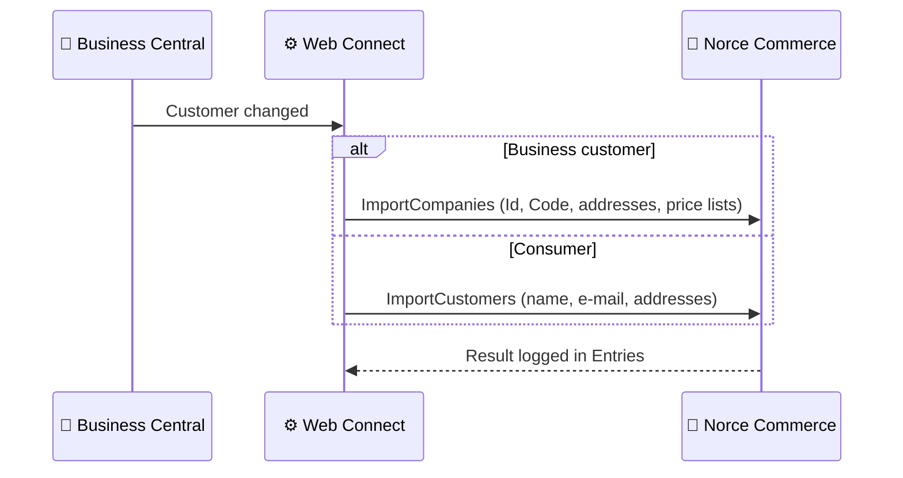

# Business Central to Norce Commerce: customers and companies

When a customer changes in Business Central, Web Connect sends it to Norce Commerce. Business customers are imported as companies and consumers as customers. A company is matched on its Norce Commerce company ID, so the Business Central customer number replaces a temporary code without creating a duplicate.

Customers are created in Business Central by the [order inbound](order-inbound.md) flow. This page covers the way back to Norce Commerce.

| | |
|---|---|
| **Direction** | Business Central → Norce Commerce |
| **Trigger** | Outgoing sync trigger on the customer, when selected fields change (for example name, address, phone, e-mail, VAT number, customer category) |
| **Result** | The company or customer in Norce Commerce has the Business Central data and customer number |
| **Part of** | [Business Central and Norce Commerce integration](../overview.md) |

## Step by step

1. A customer is created from an order, or changed in Business Central.
2. The trigger checks which customer type it is. Business customers go to `Customer/ImportCompanies`, consumers to `Customer/ImportCustomers`.
3. For a company, Web Connect sends the Norce Commerce company ID stored on the customer, and the Business Central customer number as the code. Norce Commerce updates the company with that ID. A customer without a stored ID is matched on the code.
4. The header lists which fields Norce Commerce may update, for example name, addresses, contacts, price lists and VAT number.

## Data mapping

| Business Central field | Norce Commerce field | Note |
|---|---|---|
| Norce Commerce company ID (stored on the customer) | Company `Id` | Left out when blank, then the code is used |
| Customer no. | `Code` | |
| Name | `Name`, or `FirstName` and `LastName` | |
| VAT registration no. | `VatNo`, `OrganizationNo` | |
| E-mail, phone | `EmailAddress`, `PhoneNumber` | |
| Address | `InvoiceAddress`, `DeliveryAddresses` | |
| Price lists for the customer | `PriceLists[]` | |

## Web Connect objects

| Object | Role |
|---|---|
| `NORCE_COMPANY` | Sends business customers as companies |
| `NORCE_CUSTOMER` | Sends consumers as customers |

## Error handling

| Situation | What happens | What to do |
|---|---|---|
| A field is cleared in Norce Commerce | The field was listed in the header and sent empty | Remove the field from the header, or fill it in Business Central |
| A flag is not set | Flags are only set when flags are listed in the header | Add flags to the header |
| A long Norce Commerce customer code does not fit the Business Central customer number | The code is cut, which can create duplicates | Let Business Central give the customer number and send it back with the company ID |

## Frequently asked questions

### Does changing the customer number in Business Central create a new company in Norce Commerce?

No. Web Connect sends the Norce Commerce company ID that is stored on the customer, so Norce Commerce updates the same company and takes the new number as its code.

### Can duplicate customers be merged in Business Central?

Merge duplicates in Norce Commerce. Then update the company ID on the remaining Business Central customer and send it again.

## Related

- [Business Central and Norce Commerce integration](../overview.md)
- [Order inbound](order-inbound.md)
- [Outgoing Sync Triggers](../../../general/outgoing-mapping/outgoing-sync-triggers.md)
- [Norce Commerce Connect customer import](https://docs.norce.io/api-reference/schemas/connectcustomer)
