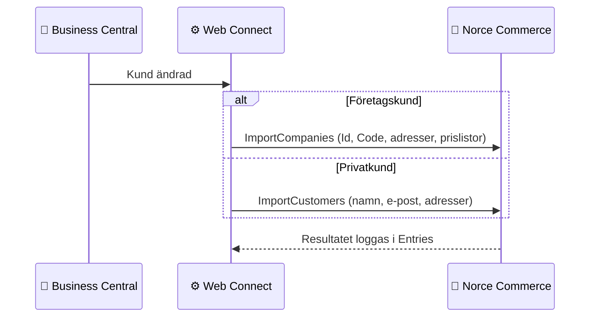

# Från Business Central till Norce Commerce: kunder och företag

När en kund ändras i Business Central skickar Web Connect den till Norce Commerce. Företagskunder importeras som företag och privatkunder som kunder. Ett företag matchas på sitt företags-ID i Norce Commerce, så kundnumret från Business Central ersätter en tillfällig kod utan att en dubblett skapas.

Kunder skapas i Business Central av flödet för [order in](order-inbound.md). Den här sidan beskriver vägen tillbaka till Norce Commerce.

| | |
|---|---|
| **Riktning** | Business Central → Norce Commerce |
| **Startas av** | Utgående synktrigger på kunden, när utvalda fält ändras (till exempel namn, adress, telefon, e-post, momsregistreringsnummer, kundkategori) |
| **Resultat** | Företaget eller kunden i Norce Commerce har uppgifterna och kundnumret från Business Central |
| **Del av** | [Business Central och Norce Commerce: integration](../overview.md) |

## Steg för steg

1. En kund skapas från en order eller ändras i Business Central.
2. Triggern kontrollerar vilken kundtyp det är. Företagskunder går till `Customer/ImportCompanies` och privatkunder till `Customer/ImportCustomers`.
3. För ett företag skickar Web Connect det företags-ID från Norce Commerce som är sparat på kunden, och kundnumret från Business Central som kod. Norce Commerce uppdaterar företaget med det ID:t. En kund utan sparat ID matchas på koden.
4. Headern listar vilka fält Norce Commerce får uppdatera, till exempel namn, adresser, kontakter, prislistor och momsregistreringsnummer.

## Mappning av data

| Fält i Business Central | Fält i Norce Commerce | Kommentar |
|---|---|---|
| Företags-ID i Norce Commerce (sparat på kunden) | Företagets `Id` | Utelämnas när det är tomt, och då används koden |
| Kundnr | `Code` | |
| Namn | `Name`, eller `FirstName` och `LastName` | |
| Momsregistreringsnr | `VatNo`, `OrganizationNo` | |
| E-post, telefon | `EmailAddress`, `PhoneNumber` | |
| Adress | `InvoiceAddress`, `DeliveryAddresses` | |
| Kundens prislistor | `PriceLists[]` | |

## Objekt i Web Connect

| Objekt | Roll |
|---|---|
| `NORCE_COMPANY` | Skickar företagskunder som företag |
| `NORCE_CUSTOMER` | Skickar privatkunder som kunder |

## Felhantering

| Situation | Vad som händer | Vad du gör |
|---|---|---|
| Ett fält töms i Norce Commerce | Fältet stod i headern och skickades tomt | Ta bort fältet från headern, eller fyll i det i Business Central |
| En flagga sätts inte | Flaggor sätts bara när flaggor står i headern | Lägg till flaggor i headern |
| En lång kundkod från Norce Commerce får inte plats i kundnumret i Business Central | Koden kortas, vilket kan skapa dubbletter | Låt Business Central ge kundnumret och skicka tillbaka det med företags-ID:t |

## Vanliga frågor

### Skapas ett nytt företag i Norce Commerce om vi ändrar kundnumret i Business Central?

Nej. Web Connect skickar det företags-ID från Norce Commerce som är sparat på kunden, så Norce Commerce uppdaterar samma företag och tar det nya numret som kod.

### Kan dubbletter av kunder slås ihop i Business Central?

Slå ihop dubbletterna i Norce Commerce. Uppdatera sedan företags-ID:t på den kund som blir kvar i Business Central och skicka den igen.

## Relaterat

- [Business Central och Norce Commerce: integration](../overview.md)
- [Order in](order-inbound.md)
- [Outgoing Sync Triggers](../../../general/outgoing-mapping/outgoing-sync-triggers.md)
- [Kundimport i Norce Commerce Connect](https://docs.norce.io/api-reference/schemas/connectcustomer)
