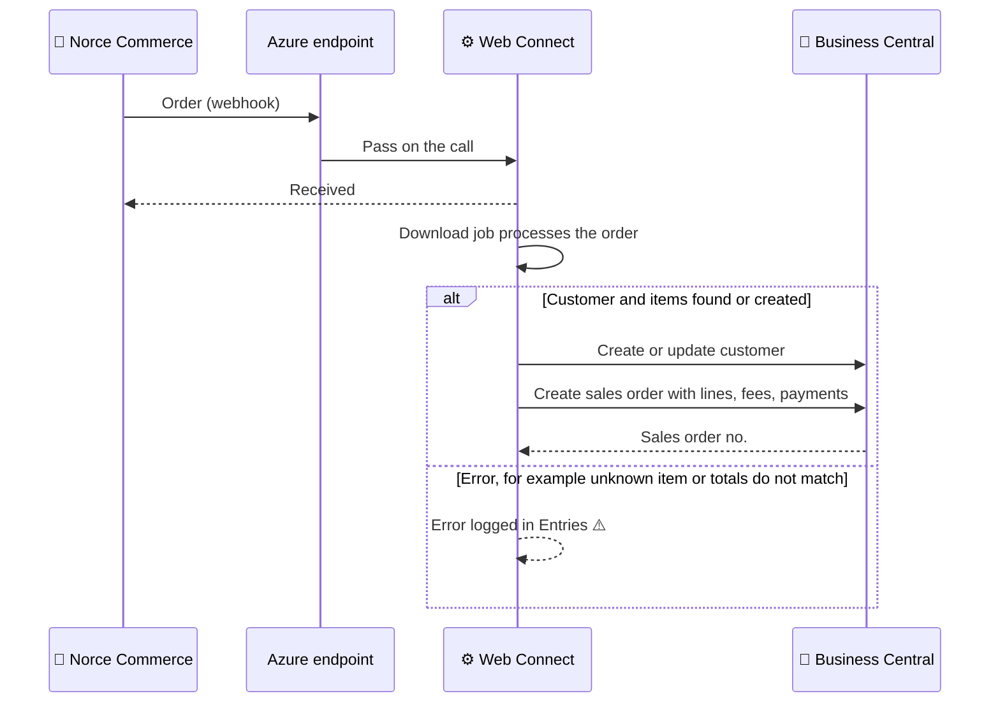

# Norce Commerce to Business Central: orders

When a customer places an order in Norce Commerce, Norce Commerce sends it to Web Connect as a webhook. Web Connect answers at once, then creates or updates the customer and creates the sales order in Business Central from the job queue.

| | |
|---|---|
| **Direction** | Norce Commerce → Business Central |
| **Trigger** | Webhook from Norce Commerce, received by an Azure endpoint and passed on to Web Connect |
| **Result** | A customer and a sales order in Business Central, with lines, fees, payments, ship-to address and delivery method |
| **Part of** | [Business Central and Norce Commerce integration](../overview.md) |

## Step by step

1. The customer places an order in Norce Commerce.
2. Norce Commerce sends the order to the Web Connect webhook address. The Azure endpoint passes it on to Web Connect, which creates an incoming data record and answers Norce Commerce that the order was received.
3. The download job in the Business Central job queue processes the order.
4. Web Connect reads the customer type on the order with a condition and creates or updates the customer with the object for that type. A new customer gets its settings from a customer template chosen by country.
5. Web Connect creates the sales order: the Norce Commerce order reference is stored as the external order ID, and the order lines are matched to items on the part number.
6. Fees such as freight are added as lines. A text mapping can translate a fee to a specific item number.
7. Payments are stored with the order, and the payment method is set from the currency and the Norce Commerce payment method. Web Connect checks that the sum of the payments matches the order total including VAT.
8. The delivery method is translated to a shipping agent, and a dimension can be set per market from the country.
9. If the release condition is met, the order is released.
10. Creating the order starts the [order status](order-status.md) flow, which confirms the order in Norce Commerce.

## Data mapping

| Norce Commerce field | Business Central field | Note |
|---|---|---|
| `ClientOrderRef` | External order ID on the sales header | Used to find the order again for status and shipments |
| `ErpOrderNo` | Sales order number | |
| `SubmitDate` | Order date, posting date and document date | |
| `SellTo`, `BillTo` | Sell-to and bill-to customer | Customer object chosen by the customer type on the order |
| `ShipTo` | Ship-to name and address | |
| `ShippingAdvice.DeliveryMethodCode` | Shipping agent | Translated with a text mapping |
| `Items[].PartNo` | Item no. on the sales line | Fees can be translated to a specific item |
| `Items[].Quantity` | Quantity | |
| `Items[].UnitPriceOriginal` | Unit price | VAT is added or removed depending on whether the order prices include VAT |
| `Items[].Discount` | Line discount | Same VAT rule as the unit price |
| `Payments[]` | Payment lines | Payment method from currency and payment method code |
| `CustomerOrderComment` | Comment on the order | |
| `AdditionalInfo` | Fields on the sales header | Values such as customer reference can be mapped with a JSON path |

## Web Connect objects

| Object | Role |
|---|---|
| `NORCE_ORDERREQUEST` | Receives the order webhook and creates the sales header |
| `NORCE_ITEMS` | Sales lines |
| `NORCE_PAYMENTS` | Payment lines |
| `NORCE_SHIPTO`, `NORCE_SHIPPINGADVICE` | Ship-to address and delivery method |
| `NORCE_PERSON_CUSTOMER`, `NORCE_COMPANY_CUSTOMER` | Create or update the customer, one object per customer type |

## Error handling

| Situation | What happens | What to do |
|---|---|---|
| An item on the order is not found | The order is not created, and the error is logged in Entries | Create or correct the item, then process the incoming record again |
| The payments do not add up to the order total | The order is not created | Check the payments on the order in Norce Commerce |
| The customer is not matched and a duplicate is created | A new customer is created | Fill in the matching fields on the existing customer. Merge duplicates in Norce Commerce, not in Business Central |
| The job queue is stopped | Orders are received but not created | See [Integrations not running](../../../../../how-to/web-connect/integration-not-running.md) |

## Frequently asked questions

### How fast do Norce Commerce orders reach Business Central?

Norce Commerce sends the order as soon as it is placed. Web Connect stores it at once and creates the sales order on the next run of the download job in the Business Central job queue.

### Which customer does the order get in Business Central?

Web Connect reads the customer type on the order and finds the customer with the matching fields, for example customer code and e-mail. If no customer matches, a new customer is created from a template for the type and country.

## Related

- [Business Central and Norce Commerce integration](../overview.md)
- [Order status](order-status.md) · [Customers and companies](customers.md)
- [Web Connect webhooks](../../../general/webhooks.md) · [Incoming Data mapping](../../../general/incoming-data/mapping.md)
