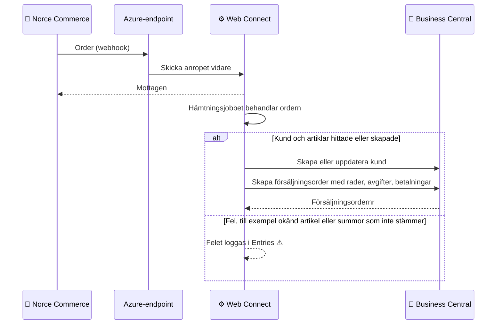

# Från Norce Commerce till Business Central: order

När en kund lägger en order i Norce Commerce skickar Norce Commerce den till Web Connect som en webhook. Web Connect svarar direkt och skapar eller uppdaterar sedan kunden och skapar försäljningsordern i Business Central från jobbkön.

| | |
|---|---|
| **Riktning** | Norce Commerce → Business Central |
| **Startas av** | Webhook från Norce Commerce, som tas emot av en Azure-endpoint och skickas vidare till Web Connect |
| **Resultat** | En kund och en försäljningsorder i Business Central, med rader, avgifter, betalningar, leveransadress och leveranssätt |
| **Del av** | [Business Central och Norce Commerce: integration](../overview.md) |

## Steg för steg

1. Kunden lägger en order i Norce Commerce.
2. Norce Commerce skickar ordern till webhookadressen i Web Connect. Azure-endpointen skickar den vidare till Web Connect, som skapar en post med inkommande data och svarar Norce Commerce att ordern har tagits emot.
3. Hämtningsjobbet i jobbkön i Business Central behandlar ordern.
4. Web Connect läser kundtypen på ordern med ett villkor och skapar eller uppdaterar kunden med objektet för den typen. En ny kund får sina inställningar från en kundmall som väljs utifrån land.
5. Web Connect skapar försäljningsordern: orderreferensen från Norce Commerce sparas som externt order-ID, och orderraderna matchas mot artiklar på artikelnumret (part number).
6. Avgifter som frakt läggs till som rader. En textmappning kan översätta en avgift till ett bestämt artikelnummer.
7. Betalningarna sparas med ordern, och betalsättet sätts utifrån valutan och betalsättet i Norce Commerce. Web Connect kontrollerar att summan av betalningarna stämmer med orderns totalbelopp inklusive moms.
8. Leveranssättet översätts till en speditör, och en dimension kan sättas per marknad utifrån landet.
9. Om villkoret för släppning är uppfyllt släpps ordern.
10. När ordern skapas startar flödet för [orderstatus](order-status.md), som bekräftar ordern i Norce Commerce.

## Mappning av data

| Fält i Norce Commerce | Fält i Business Central | Kommentar |
|---|---|---|
| `ClientOrderRef` | Externt order-ID på försäljningshuvudet | Används för att hitta ordern igen för status och leveranser |
| `ErpOrderNo` | Försäljningsordernummer | |
| `SubmitDate` | Orderdatum, bokföringsdatum och dokumentdatum | |
| `SellTo`, `BillTo` | Kund och fakturakund | Kundobjektet väljs utifrån kundtypen på ordern |
| `ShipTo` | Leveransnamn och leveransadress | |
| `ShippingAdvice.DeliveryMethodCode` | Speditör | Översätts med en textmappning |
| `Items[].PartNo` | Artikelnr på försäljningsraden | Avgifter kan översättas till en bestämd artikel |
| `Items[].Quantity` | Antal | |
| `Items[].UnitPriceOriginal` | Á-pris | Moms läggs till eller dras av beroende på om priserna på ordern är inklusive moms |
| `Items[].Discount` | Radrabatt | Samma momsregel som för á-priset |
| `Payments[]` | Betalningsrader | Betalsätt utifrån valuta och betalsättskod |
| `CustomerOrderComment` | Kommentar på ordern | |
| `AdditionalInfo` | Fält på försäljningshuvudet | Värden som kundreferens kan mappas med en JSON-sökväg |

## Objekt i Web Connect

| Objekt | Roll |
|---|---|
| `NORCE_ORDERREQUEST` | Tar emot webhooken med ordern och skapar försäljningshuvudet |
| `NORCE_ITEMS` | Försäljningsrader |
| `NORCE_PAYMENTS` | Betalningsrader |
| `NORCE_SHIPTO`, `NORCE_SHIPPINGADVICE` | Leveransadress och leveranssätt |
| `NORCE_PERSON_CUSTOMER`, `NORCE_COMPANY_CUSTOMER` | Skapar eller uppdaterar kunden, ett objekt per kundtyp |

## Felhantering

| Situation | Vad som händer | Vad du gör |
|---|---|---|
| En artikel på ordern hittas inte | Ordern skapas inte, och felet loggas i Entries | Skapa eller rätta artikeln och behandla sedan den inkommande posten igen |
| Betalningarna stämmer inte med orderns totalbelopp | Ordern skapas inte | Kontrollera betalningarna på ordern i Norce Commerce |
| Kunden matchas inte och en dubblett skapas | En ny kund skapas | Fyll i matchningsfälten på den befintliga kunden. Slå ihop dubbletter i Norce Commerce, inte i Business Central |
| Jobbkön har stannat | Order tas emot men skapas inte | Se [Integrationer som inte körs](../../../../../how-to/web-connect/integration-not-running.md) |

## Vanliga frågor

### Hur snabbt kommer order från Norce Commerce in i Business Central?

Norce Commerce skickar ordern så snart den läggs. Web Connect sparar den direkt och skapar försäljningsordern nästa gång hämtningsjobbet körs i jobbkön i Business Central.

### Vilken kund får ordern i Business Central?

Web Connect läser kundtypen på ordern och letar upp kunden med matchningsfälten, till exempel kundkod och e-post. Om ingen kund matchar skapas en ny kund från en mall för typen och landet.

## Relaterat

- [Business Central och Norce Commerce: integration](../overview.md)
- [Orderstatus](order-status.md) · [Kunder och företag](customers.md)
- [Webhooks i Web Connect](../../../general/webhooks.md) · [Incoming Data mapping](../../../general/incoming-data/mapping.md)
