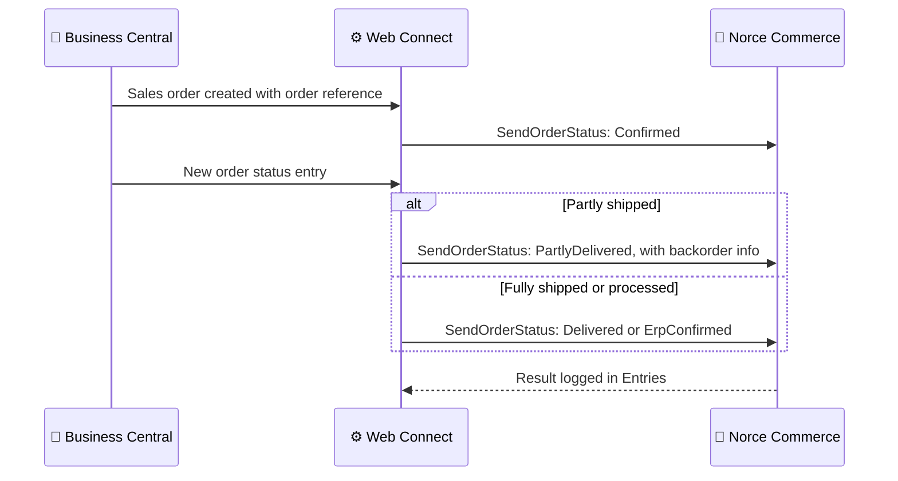

# Business Central to Norce Commerce: order status

When the sales order is created in Business Central, Web Connect confirms the order in Norce Commerce. When the Web Connect order status changes in Business Central, the new status is sent, so Norce Commerce shows whether the order is processed, partly delivered or delivered.

| | |
|---|---|
| **Direction** | Business Central → Norce Commerce |
| **Trigger** | Outgoing sync triggers: the external order ID is set on the sales order (confirmation), and a new Web Connect order status entry is created (status updates) |
| **Result** | The order in Norce Commerce has the status Confirmed, ErpConfirmed, PartlyDelivered or Delivered |
| **Part of** | [Business Central and Norce Commerce integration](../overview.md) |

## Step by step

1. The [order inbound](order-inbound.md) flow creates the sales order and sets the Norce Commerce order reference on it.
2. The trigger sends the order reference, the Business Central order number and the status `Confirmed` to Norce Commerce (`Order/SendOrderStatus`).
3. When the order moves on in Business Central, Web Connect writes a new order status entry.
4. The trigger sends the matching Norce Commerce status. For a partly shipped order, an info field says whether the rest is backordered.

## Data mapping

| Business Central order status | Norce Commerce status | Note |
|---|---|---|
| Order confirmed | `Confirmed` | Sent when the sales order is created |
| Order processing | `ErpConfirmed` | |
| Partly shipped, no backorder | `PartlyDelivered` | Info field says no backorder |
| Partly shipped, with backorder | `PartlyDelivered` | Info field says with backorder |
| Shipped | `Delivered` | |

The translation is a text mapping in Web Connect and can be changed.

## Web Connect objects

| Object | Role |
|---|---|
| `NORCE_CONFIRM_ORDER` | Confirms the order when the order reference is set |
| `NORCE_ORDERSTATUSUPDATE` | Sends each new order status |
| `NORCE_ORDERSTATUSUPDATE_INFOS` | Backorder info for partly shipped orders |

## Error handling

| Situation | What happens | What to do |
|---|---|---|
| Norce Commerce rejects the status | The error is logged in Entries | Check the error text, correct the cause and [resend the message](../../../../../how-to/web-connect/resend-outgoing-message.md) |
| The order shows a different status in Norce Commerce than expected | Web Connect always sends a status in each message, so the latest message decides the status | Check the latest order status message in Entries, and that the status mapping is correct |

## Frequently asked questions

### Does Norce Commerce know if the rest of a partly delivered order is backordered?

Yes. When an order is partly shipped, Web Connect sends the status partly delivered together with an info field that says whether the remaining lines are backordered or not.

## Related

- [Business Central and Norce Commerce integration](../overview.md)
- [Order inbound](order-inbound.md) · [Shipment](shipment.md)
- [Outgoing Sync Triggers](../../../general/outgoing-mapping/outgoing-sync-triggers.md)
