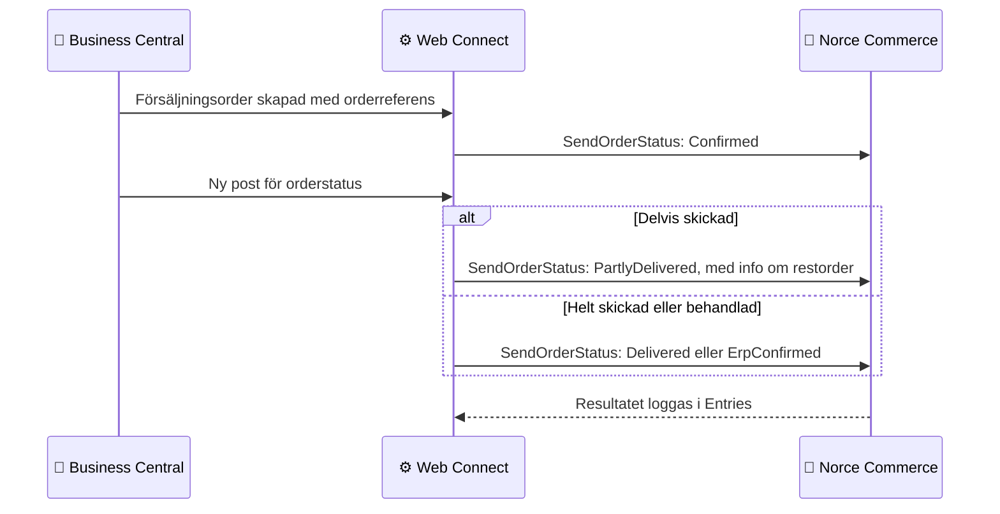

# Från Business Central till Norce Commerce: orderstatus

När försäljningsordern skapas i Business Central bekräftar Web Connect ordern i Norce Commerce. När orderstatusen i Web Connect ändras i Business Central skickas den nya statusen, så att Norce Commerce visar om ordern är behandlad, dellevererad eller levererad.

| | |
|---|---|
| **Riktning** | Business Central → Norce Commerce |
| **Startas av** | Utgående synktriggers: det externa order-ID:t sätts på försäljningsordern (bekräftelse), och en ny post för orderstatus skapas i Web Connect (statusuppdateringar) |
| **Resultat** | Ordern i Norce Commerce har statusen Confirmed, ErpConfirmed, PartlyDelivered eller Delivered |
| **Del av** | [Business Central och Norce Commerce: integration](../overview.md) |

## Steg för steg

1. Flödet för [order in](order-inbound.md) skapar försäljningsordern och sätter orderreferensen från Norce Commerce på den.
2. Triggern skickar orderreferensen, ordernumret i Business Central och statusen `Confirmed` till Norce Commerce (`Order/SendOrderStatus`).
3. När ordern går vidare i Business Central skriver Web Connect en ny post för orderstatus.
4. Triggern skickar motsvarande status i Norce Commerce. För en delvis skickad order säger ett informationsfält om resten ligger i restorder.

## Mappning av data

| Orderstatus i Business Central | Status i Norce Commerce | Kommentar |
|---|---|---|
| Order bekräftad | `Confirmed` | Skickas när försäljningsordern skapas |
| Order under behandling | `ErpConfirmed` | |
| Delvis skickad, ingen restorder | `PartlyDelivered` | Informationsfältet säger ingen restorder |
| Delvis skickad, med restorder | `PartlyDelivered` | Informationsfältet säger med restorder |
| Skickad | `Delivered` | |

Översättningen är en textmappning i Web Connect och går att ändra.

## Objekt i Web Connect

| Objekt | Roll |
|---|---|
| `NORCE_CONFIRM_ORDER` | Bekräftar ordern när orderreferensen sätts |
| `NORCE_ORDERSTATUSUPDATE` | Skickar varje ny orderstatus |
| `NORCE_ORDERSTATUSUPDATE_INFOS` | Info om restorder för delvis skickade order |

## Felhantering

| Situation | Vad som händer | Vad du gör |
|---|---|---|
| Norce Commerce avvisar statusen | Felet loggas i Entries | Läs feltexten, rätta orsaken och [skicka om meddelandet](../../../../../how-to/web-connect/resend-outgoing-message.md) |
| Ordern har en annan status i Norce Commerce än väntat | Web Connect skickar alltid en status i varje meddelande, så det senaste meddelandet avgör statusen | Kontrollera det senaste meddelandet om orderstatus i Entries, och att statusmappningen stämmer |

## Vanliga frågor

### Vet Norce Commerce om resten av en dellevererad order ligger i restorder?

Ja. När en order skickas delvis skickar Web Connect statusen dellevererad tillsammans med ett informationsfält som säger om de återstående raderna ligger i restorder eller inte.

## Relaterat

- [Business Central och Norce Commerce: integration](../overview.md)
- [Order in](order-inbound.md) · [Leveranser](shipment.md)
- [Outgoing Sync Triggers](../../../general/outgoing-mapping/outgoing-sync-triggers.md)
