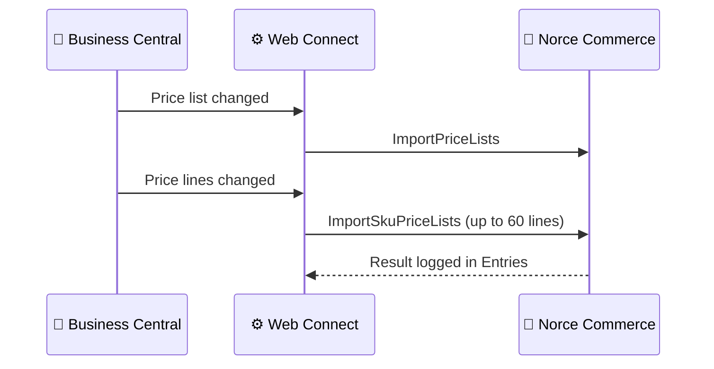

# Business Central to Norce Commerce: price lists and prices

Price lists and prices are maintained in Business Central. Web Connect creates or updates the price lists in Norce Commerce with currency, dates, price rules and warehouses, and sets the SKU prices on the matching price lists.

This page covers two data flows: price lists and prices.

| | |
|---|---|
| **Direction** | Business Central → Norce Commerce |
| **Trigger** | Outgoing sync triggers, set per integration. Usually the fields that are sent to Norce Commerce are the trigger fields, so a change in one of them sends the record again |
| **Result** | Price lists and SKU prices in Norce Commerce |
| **Part of** | [Business Central and Norce Commerce integration](../overview.md) |

## Step by step

### Price lists

1. A price list in Business Central that is marked for export is created or changed.
2. Web Connect sends it to Norce Commerce, one price list per call (`Product/ImportPriceLists`), with currency, dates, default price rule, parent price list, population, price rules and warehouses.

### Prices

3. Price lines in Business Central are sent as SKU prices to the matching Norce Commerce price list (`Product/ImportSkuPriceLists`), up to 60 lines per call.
4. Discount lines can be sent the same way, as prices with a price rule.
5. The header lists which price fields Norce Commerce may update.

## Data mapping

| Business Central data | Norce Commerce field | Note |
|---|---|---|
| Price list code | `Code`, `PriceListCode` | |
| Currency | `CurrencyCode` | |
| Starting and ending date | `StartDate`, `EndDate` | |
| Price list settings | `IsPrimary`, `IsPublic`, `DefaultPriceRule`, `ParentPriceListCode`, `SalesArea` | Some values are translated with text mappings |
| Item no. | `PartNo` | |
| Unit price | `PriceCatalog` or `PriceRuleValue` | Depends on the price rule |
| Unit cost | `CostUnit`, `CostPurchase` | From the item |
| Minimum quantity | `QuantityBreak` | |

## Web Connect objects

| Object | Role |
|---|---|
| `NORCE_PRICELIST` | Sends price lists |
| `NORCE_PRICELISTLINE` | Sends price lines as SKU prices |
| `NORCE_PRICELISTLINE_DISCOUNT` | Sends discount lines as SKU prices |

## Error handling

| Situation | What happens | What to do |
|---|---|---|
| The price list does not exist in Norce Commerce | The SKU prices are rejected | Send the price list first |
| Norce Commerce rejects a price | The error is logged in Entries | Correct the price and [resend the message](../../../../../how-to/web-connect/resend-outgoing-message.md) |

## Frequently asked questions

### Can discounts be sent as prices to Norce Commerce?

Yes. Web Connect can send discount lines from Business Central as SKU prices with a price rule on a Norce Commerce price list. Which discounts are sent is decided with a table filter on the object.

## Related

- [Business Central and Norce Commerce integration](../overview.md)
- [Product data](product-data.md)
- [Item price](../../../general/outgoing-mapping/item-price.md)
