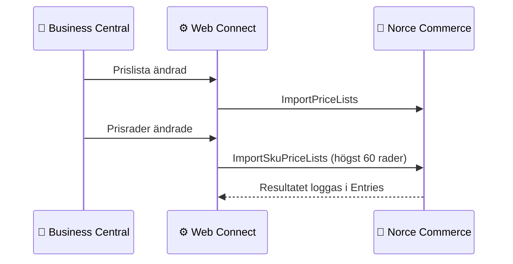

# Från Business Central till Norce Commerce: prislistor och priser

Prislistor och priser underhålls i Business Central. Web Connect skapar eller uppdaterar prislistorna i Norce Commerce med valuta, datum, prisregler och lager, och sätter SKU-priserna på de matchande prislistorna.

Sidan beskriver två dataflöden: prislistor och priser.

| | |
|---|---|
| **Riktning** | Business Central → Norce Commerce |
| **Startas av** | Utgående synktriggers, som ställs in per integration. Oftast är fälten som skickas till Norce Commerce också triggerfält, så en ändring i något av dem skickar posten igen |
| **Resultat** | Prislistor och SKU-priser i Norce Commerce |
| **Del av** | [Business Central och Norce Commerce: integration](../overview.md) |

## Steg för steg

### Prislistor

1. En prislista i Business Central som är markerad för export skapas eller ändras.
2. Web Connect skickar den till Norce Commerce, en prislista per anrop (`Product/ImportPriceLists`), med valuta, datum, standardprisregel, överordnad prislista, urval (population), prisregler och lager.

### Priser

3. Prisrader i Business Central skickas som SKU-priser till motsvarande prislista i Norce Commerce (`Product/ImportSkuPriceLists`), högst 60 rader per anrop.
4. Rabattrader kan skickas på samma sätt, som priser med en prisregel.
5. Headern listar vilka prisfält Norce Commerce får uppdatera.

## Mappning av data

| Data i Business Central | Fält i Norce Commerce | Kommentar |
|---|---|---|
| Prislistekod | `Code`, `PriceListCode` | |
| Valuta | `CurrencyCode` | |
| Start- och slutdatum | `StartDate`, `EndDate` | |
| Inställningar för prislistan | `IsPrimary`, `IsPublic`, `DefaultPriceRule`, `ParentPriceListCode`, `SalesArea` | Vissa värden översätts med textmappningar |
| Artikelnr | `PartNo` | |
| Á-pris | `PriceCatalog` eller `PriceRuleValue` | Beror på prisregeln |
| Styckkostnad | `CostUnit`, `CostPurchase` | Från artikeln |
| Minsta antal | `QuantityBreak` | |

## Objekt i Web Connect

| Objekt | Roll |
|---|---|
| `NORCE_PRICELIST` | Skickar prislistor |
| `NORCE_PRICELISTLINE` | Skickar prisrader som SKU-priser |
| `NORCE_PRICELISTLINE_DISCOUNT` | Skickar rabattrader som SKU-priser |

## Felhantering

| Situation | Vad som händer | Vad du gör |
|---|---|---|
| Prislistan finns inte i Norce Commerce | SKU-priserna avvisas | Skicka prislistan först |
| Norce Commerce avvisar ett pris | Felet loggas i Entries | Rätta priset och [skicka om meddelandet](../../../../../how-to/web-connect/resend-outgoing-message.md) |

## Vanliga frågor

### Kan rabatter skickas som priser till Norce Commerce?

Ja. Web Connect kan skicka rabattrader från Business Central som SKU-priser med en prisregel på en prislista i Norce Commerce. Vilka rabatter som skickas styrs med ett tabellfilter på objektet.

## Relaterat

- [Business Central och Norce Commerce: integration](../overview.md)
- [Produktdata](product-data.md)
- [Item price](../../../general/outgoing-mapping/item-price.md)
