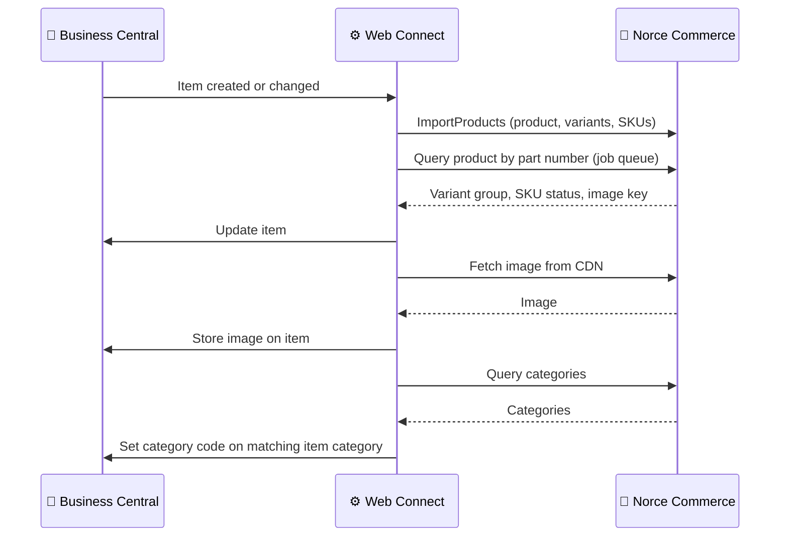

# Business Central to Norce Commerce: products

Products are created in Business Central and sent to Norce Commerce with variants, SKUs, texts, categories and attributes. Web Connect then reads the Norce Commerce references back to the item, fetches the product image, and reads category codes from Norce Commerce.

This page covers three data flows: products (Business Central → Norce Commerce), product images (Norce Commerce → Business Central) and categories (Norce Commerce → Business Central).

| | |
|---|---|
| **Direction** | Business Central → Norce Commerce, with references, images and categories read back |
| **Trigger** | Products: [ATT FYLLA I: what starts the product export; the configuration export has no outgoing sync trigger on the product object]. References: job queue, for items that have no Norce Commerce reference yet. Images: a change of the image reference on the item. Categories: [ATT FYLLA I: what starts the category read] |
| **Result** | The product exists in Norce Commerce, and the item in Business Central has the Norce Commerce variant group, SKU status, image reference and image |
| **Part of** | [Business Central and Norce Commerce integration](../overview.md) |

## Step by step

### Products to Norce Commerce

1. An item is created or changed in Business Central. Items of type inventory with a Norce Commerce status are included.
2. Web Connect builds the product with variants and SKUs, one product per call (`Product/ImportProducts`).
3. The product header lists which fields Norce Commerce may update. Fields outside the list are ignored.

### Norce Commerce references back to the item

4. A job queue entry looks for items that have no Norce Commerce reference yet.
5. Web Connect reads the product from the Norce Commerce Query API by part number.
6. The variant group, the SKU status and the image key are written to the item.

### Product images from Norce Commerce

7. When the image reference on the item changes, Web Connect fetches the image from the Norce Commerce image CDN and stores it on the item.

### Categories from Norce Commerce

8. Web Connect reads the categories from the Norce Commerce Query API and sets the Norce Commerce category code on the item category with the same name. No new item categories are created.

## Data mapping

### Products

| Business Central data | Norce Commerce field | Note |
|---|---|---|
| Item no. | `Code`, SKU `PartNo` | |
| Manufacturer | `ManufacturerCode`, `ManufacturerName` | |
| Item category | `Categories[].Code` | Uses the code read from Norce Commerce |
| Item texts | `Cultures[]` | Name, description, meta data and URL name per language |
| Variant data | `Variants[]`, `VariantDefinitionGroup` | With variant flags and variant attributes |
| EAN | SKU `EanCode` | |
| Tariff number | SKU `CommodityCode` | |
| Dimensions and weight | SKU `LogisticWidth`, `LogisticHeight`, `LogisticDepth`, `ActualWeight` | From the item unit of measure |
| Standard price | SKU `StandardPrice` | |
| Status | SKU `Status` | |
| Attributes | `ProductParametrics`, `ProductFlags` | Mapped per attribute |

### Read back to the item

| Norce Commerce field | Business Central field | Note |
|---|---|---|
| `ManufacturerPartNo` | Item no. | Used to find the item |
| `Variant.Code` | Norce Commerce variant group | |
| `Skus[].StatusId` | Norce Commerce status | |
| `ImageKey` | Image reference | Starts the image import |
| Category `Code` | Category code on the item category | Matched on the category name |

## Web Connect objects

| Object | Role |
|---|---|
| `NORCE_PRODUCT` | Sends products with variants and SKUs |
| `NORCE_GET-PRODUCT` | Reads the product back by part number |
| `NORCE-ITEM-IMAGE-IMPORT` | Fetches the product image |
| `NORCE_GET_CATEGORY` | Reads categories |

## Error handling

| Situation | What happens | What to do |
|---|---|---|
| Norce Commerce rejects the product | The error is logged in Entries | Correct the item and [resend the message](../../../../../how-to/web-connect/resend-outgoing-message.md) |
| The product is not found when reading back | The item gets no Norce Commerce reference, and the job tries again on the next run | Check that the product was imported with the same part number |
| The image changed in Norce Commerce | The new image is not fetched by itself | Resend the image import for the item |
| A copied item is sent before it is changed | The copy keeps the status of the original, so it can be sent at once | Set the status after the item is completed |

## Frequently asked questions

### Which items are sent to Norce Commerce?

Items of type inventory that have a Norce Commerce status set. The filter is an outgoing sync table view in Web Connect and can be changed.

### Why does a new image in Norce Commerce not show on the item in Business Central?

The image is fetched when the item gets its Norce Commerce image reference. A later change of the image in Norce Commerce is not fetched again by itself. Resend the image import for the item.

## Related

- [Business Central and Norce Commerce integration](../overview.md)
- [Prices](prices.md) · [Stock update](stock-update.md)
- [Outgoing Data Web](../../../general/outgoing-mapping/outgoing-data-web.md)
