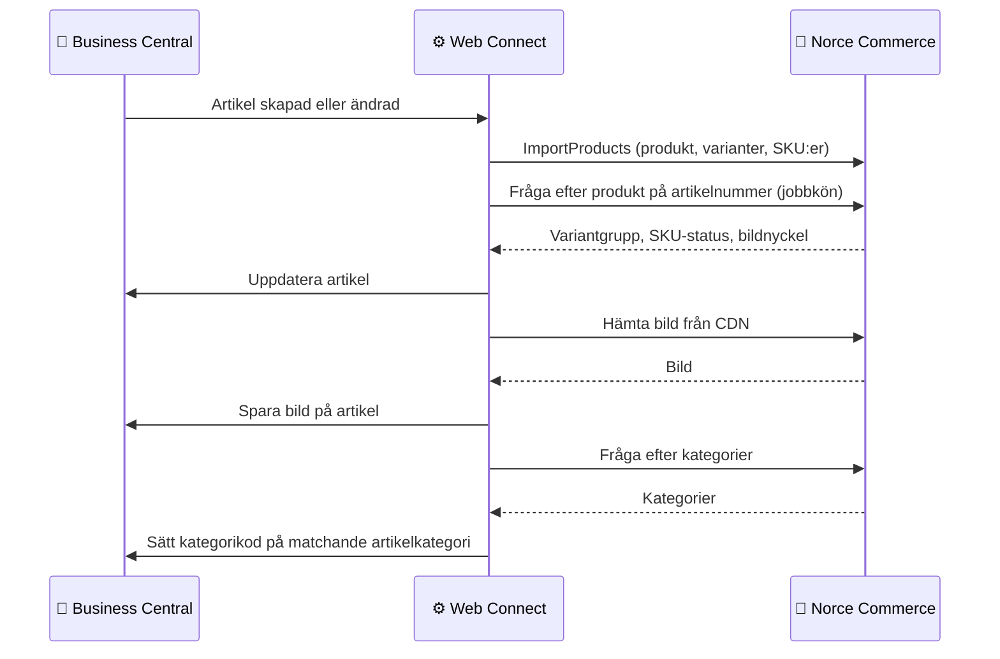

# Från Business Central till Norce Commerce: produkter

Produkter skapas i Business Central och skickas till Norce Commerce med varianter, SKU:er, texter, kategorier och attribut. Web Connect läser sedan tillbaka referenserna från Norce Commerce till artikeln, hämtar produktbilden och läser kategorikoder från Norce Commerce.

Sidan beskriver tre dataflöden: produkter (Business Central → Norce Commerce), produktbilder (Norce Commerce → Business Central) och kategorier (Norce Commerce → Business Central).

| | |
|---|---|
| **Riktning** | Business Central → Norce Commerce, där referenser, bilder och kategorier läses tillbaka |
| **Startas av** | Produkter: utgående synktriggers, som ställs in per integration. Oftast är fälten som skickas till Norce Commerce också triggerfält, så en ändring i något av dem skickar posten igen. Referenser: jobbkön, för artiklar som ännu saknar referens från Norce Commerce. Bilder: en ändring av bildreferensen på artikeln. Kategorier: ställs in per integration, på samma sätt |
| **Resultat** | Produkten finns i Norce Commerce, och artikeln i Business Central har variantgrupp, SKU-status, bildreferens och bild från Norce Commerce |
| **Del av** | [Business Central och Norce Commerce: integration](../overview.md) |

## Steg för steg

### Produkter till Norce Commerce

1. En artikel skapas eller ändras i Business Central. Lagerartiklar med en status för Norce Commerce tas med.
2. Web Connect bygger produkten med varianter och SKU:er, en produkt per anrop (`Product/ImportProducts`).
3. Produktens header listar vilka fält Norce Commerce får uppdatera. Fält utanför listan ignoreras.

### Referenser från Norce Commerce tillbaka till artikeln

4. En post i jobbkön letar efter artiklar som ännu saknar referens från Norce Commerce.
5. Web Connect läser produkten från Norce Commerce Query API på artikelnumret (part number).
6. Variantgruppen, SKU-statusen och bildnyckeln skrivs till artikeln.

### Produktbilder från Norce Commerce

7. När bildreferensen på artikeln ändras hämtar Web Connect bilden från bild-CDN:en i Norce Commerce och sparar den på artikeln.

### Kategorier från Norce Commerce

8. Web Connect läser kategorierna från Norce Commerce Query API och sätter kategorikoden från Norce Commerce på den artikelkategori som har samma namn. Inga nya artikelkategorier skapas.

## Mappning av data

### Produkter

| Data i Business Central | Fält i Norce Commerce | Kommentar |
|---|---|---|
| Artikelnr | `Code`, SKU `PartNo` | |
| Tillverkare | `ManufacturerCode`, `ManufacturerName` | |
| Artikelkategori | `Categories[].Code` | Använder koden som lästs från Norce Commerce |
| Artikeltexter | `Cultures[]` | Namn, beskrivning, metadata och URL-namn per språk |
| Variantdata | `Variants[]`, `VariantDefinitionGroup` | Med variantflaggor och variantattribut |
| EAN | SKU `EanCode` | |
| Tullnummer | SKU `CommodityCode` | |
| Mått och vikt | SKU `LogisticWidth`, `LogisticHeight`, `LogisticDepth`, `ActualWeight` | Från artikelns enhet |
| Standardpris | SKU `StandardPrice` | |
| Status | SKU `Status` | |
| Attribut | `ProductParametrics`, `ProductFlags` | Mappas per attribut |

### Läses tillbaka till artikeln

| Fält i Norce Commerce | Fält i Business Central | Kommentar |
|---|---|---|
| `ManufacturerPartNo` | Artikelnr | Används för att hitta artikeln |
| `Variant.Code` | Variantgrupp i Norce Commerce | |
| `Skus[].StatusId` | Status i Norce Commerce | |
| `ImageKey` | Bildreferens | Startar bildimporten |
| Kategorins `Code` | Kategorikod på artikelkategorin | Matchas på kategorins namn |

## Objekt i Web Connect

| Objekt | Roll |
|---|---|
| `NORCE_PRODUCT` | Skickar produkter med varianter och SKU:er |
| `NORCE_GET-PRODUCT` | Läser tillbaka produkten på artikelnummer |
| `NORCE-ITEM-IMAGE-IMPORT` | Hämtar produktbilden |
| `NORCE_GET_CATEGORY` | Läser kategorier |

## Felhantering

| Situation | Vad som händer | Vad du gör |
|---|---|---|
| Norce Commerce avvisar produkten | Felet loggas i Entries | Rätta artikeln och [skicka om meddelandet](../../../../../how-to/web-connect/resend-outgoing-message.md) |
| Produkten hittas inte när den läses tillbaka | Artikeln får ingen referens från Norce Commerce, och jobbet försöker igen nästa gång det körs | Kontrollera att produkten importerades med samma artikelnummer |
| Bilden har ändrats i Norce Commerce | Den nya bilden hämtas inte av sig själv | Skicka om bildimporten för artikeln |
| En kopierad artikel skickas innan den har ändrats | Kopian behåller originalets status och kan därför skickas direkt | Sätt statusen när artikeln är färdig |

## Vanliga frågor

### Vilka artiklar skickas till Norce Commerce?

Lagerartiklar som har en status för Norce Commerce ifylld. Filtret är en tabellvy för utgående synk i Web Connect och går att ändra.

### Varför syns inte en ny bild från Norce Commerce på artikeln i Business Central?

Bilden hämtas när artikeln får sin bildreferens från Norce Commerce. Byts bilden senare i Norce Commerce hämtas den inte igen av sig själv. Skicka om bildimporten för artikeln.

## Relaterat

- [Business Central och Norce Commerce: integration](../overview.md)
- [Priser](prices.md) · [Lagersaldo](stock-update.md)
- [Outgoing Data Web](../../../general/outgoing-mapping/outgoing-data-web.md)
