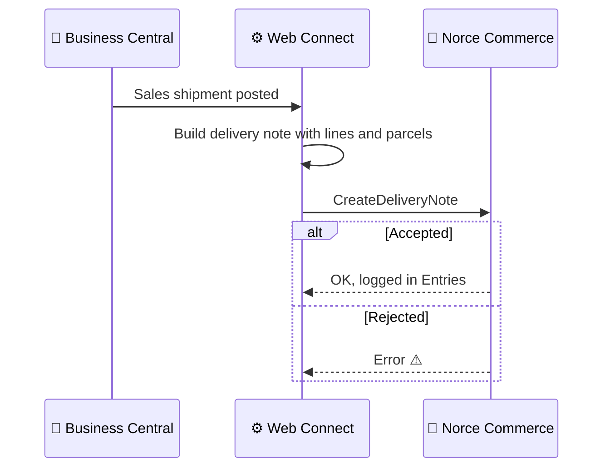

# Business Central to Norce Commerce: shipments

When a sales shipment for a Norce Commerce order is posted in Business Central, Web Connect creates a delivery note in Norce Commerce. The delivery note has the shipped lines, the delivery address, the parcel numbers and the order status.

| | |
|---|---|
| **Direction** | Business Central → Norce Commerce |
| **Trigger** | Posting of a sales shipment for an order that came from Norce Commerce |
| **Result** | A delivery note on the order in Norce Commerce, with parcel numbers for tracking |
| **Part of** | [Business Central and Norce Commerce integration](../overview.md) |

## Step by step

1. The warehouse ships the order, in Business Central or through a warehouse integration, and the sales shipment is posted.
2. The outgoing sync trigger picks up the posted shipment, if the order came from Norce Commerce and has an order number.
3. Web Connect builds the delivery note: shipment number, order number, delivery date, delivery address, shipped lines and parcels.
4. The order status from the sales order is added, translated to the Norce Commerce status.
5. Web Connect sends the delivery note to Norce Commerce (`Order/CreateDeliveryNote`).

## Data mapping

| Business Central field | Norce Commerce field | Note |
|---|---|---|
| Shipment no. | `NoteNo` | |
| Order no. | `OrderNo` | |
| Shipment date | `DeliveryDate` | |
| Ship-to address | `DeliveryAddress` | |
| Shipment line: item no., quantity, line no., description | `DeliverynoteItems[]` | |
| Package: parcel number | `DeliveryNotePackages[].ParcelNumber` | One row per parcel |
| Web Connect order status on the sales order | `OrderStatus` | Same text mapping as the [order status](order-status.md) flow |

## Web Connect objects

| Object | Role |
|---|---|
| `NORCE_DELIVERYNOTE` | Creates the delivery note |
| `NORCE_DELIVERYNOTEITEMS` | Shipped lines |
| `NORCE_DELIVERYNOTEPACKAGES` | Parcels with parcel numbers |
| `NORCE_DELIVERYADDRESS` | Delivery address |

## Error handling

| Situation | What happens | What to do |
|---|---|---|
| Norce Commerce rejects the delivery note | The error is logged in Entries | Correct the cause and [resend the message](../../../../../how-to/web-connect/resend-outgoing-message.md) |
| No parcel number on the shipment | The delivery note is sent without tracking | Check that the carrier or warehouse integration writes the parcel number before posting |

## Frequently asked questions

### Is a delivery note created for every partial shipment?

Yes. Each posted sales shipment on a Norce Commerce order creates its own delivery note with the lines and parcels in that shipment.

## Related

- [Business Central and Norce Commerce integration](../overview.md)
- [Order status](order-status.md) · [Order inbound](order-inbound.md)
