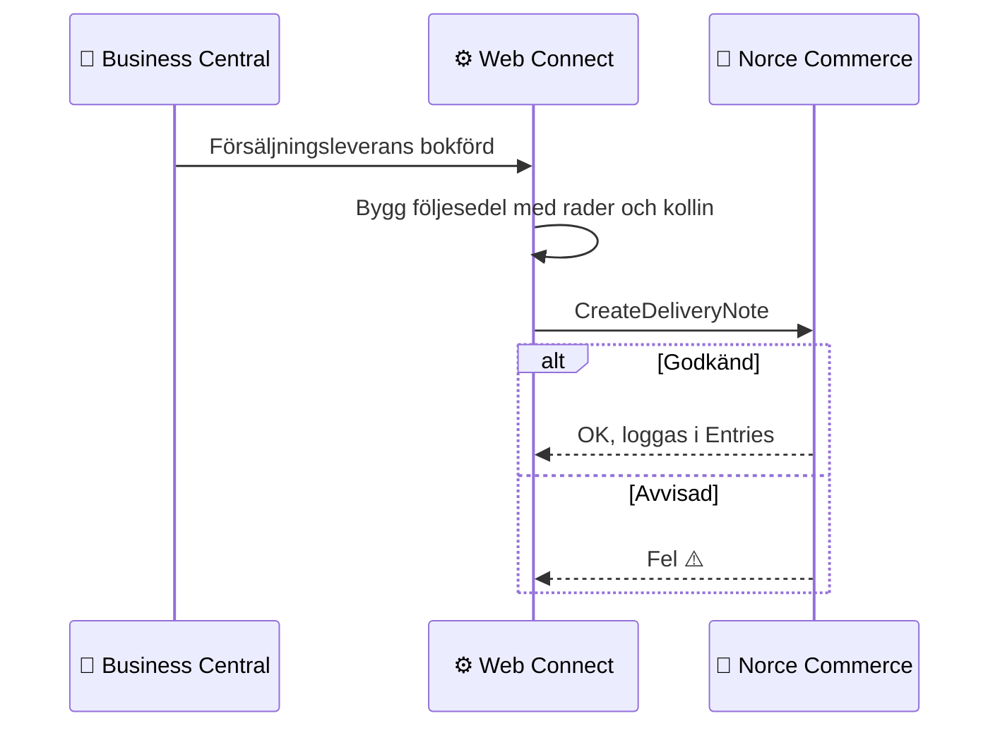

# Från Business Central till Norce Commerce: leveranser

När en försäljningsleverans för en order från Norce Commerce bokförs i Business Central skapar Web Connect en följesedel i Norce Commerce. Följesedeln innehåller de levererade raderna, leveransadressen, kollinumren och orderstatusen.

| | |
|---|---|
| **Riktning** | Business Central → Norce Commerce |
| **Startas av** | Bokföring av en försäljningsleverans för en order som kom från Norce Commerce |
| **Resultat** | En följesedel på ordern i Norce Commerce, med kollinummer för spårning |
| **Del av** | [Business Central och Norce Commerce: integration](../overview.md) |

## Steg för steg

1. Lagret skickar ordern, i Business Central eller via en lagerintegration, och försäljningsleveransen bokförs.
2. Den utgående synktriggern fångar upp den bokförda leveransen, om ordern kom från Norce Commerce och har ett ordernummer.
3. Web Connect bygger följesedeln: leveransnummer, ordernummer, leveransdatum, leveransadress, levererade rader och kollin.
4. Orderstatusen från försäljningsordern läggs till, översatt till status i Norce Commerce.
5. Web Connect skickar följesedeln till Norce Commerce (`Order/CreateDeliveryNote`).

## Mappning av data

| Fält i Business Central | Fält i Norce Commerce | Kommentar |
|---|---|---|
| Leveransnr | `NoteNo` | |
| Ordernr | `OrderNo` | |
| Leveransdatum | `DeliveryDate` | |
| Leveransadress | `DeliveryAddress` | |
| Leveransrad: artikelnr, antal, radnr, beskrivning | `DeliverynoteItems[]` | |
| Kolli: kollinummer | `DeliveryNotePackages[].ParcelNumber` | En rad per kolli |
| Orderstatus i Web Connect på försäljningsordern | `OrderStatus` | Samma textmappning som i flödet för [orderstatus](order-status.md) |

## Objekt i Web Connect

| Objekt | Roll |
|---|---|
| `NORCE_DELIVERYNOTE` | Skapar följesedeln |
| `NORCE_DELIVERYNOTEITEMS` | Levererade rader |
| `NORCE_DELIVERYNOTEPACKAGES` | Kollin med kollinummer |
| `NORCE_DELIVERYADDRESS` | Leveransadress |

## Felhantering

| Situation | Vad som händer | Vad du gör |
|---|---|---|
| Norce Commerce avvisar följesedeln | Felet loggas i Entries | Rätta orsaken och [skicka om meddelandet](../../../../../how-to/web-connect/resend-outgoing-message.md) |
| Inget kollinummer på leveransen | Följesedeln skickas utan spårning | Kontrollera att transportörs- eller lagerintegrationen skriver kollinumret innan leveransen bokförs |

## Vanliga frågor

### Skapas en följesedel för varje delleverans?

Ja. Varje bokförd försäljningsleverans på en order från Norce Commerce skapar en egen följesedel med raderna och kollina i den leveransen.

## Relaterat

- [Business Central och Norce Commerce: integration](../overview.md)
- [Orderstatus](order-status.md) · [Order in](order-inbound.md)
