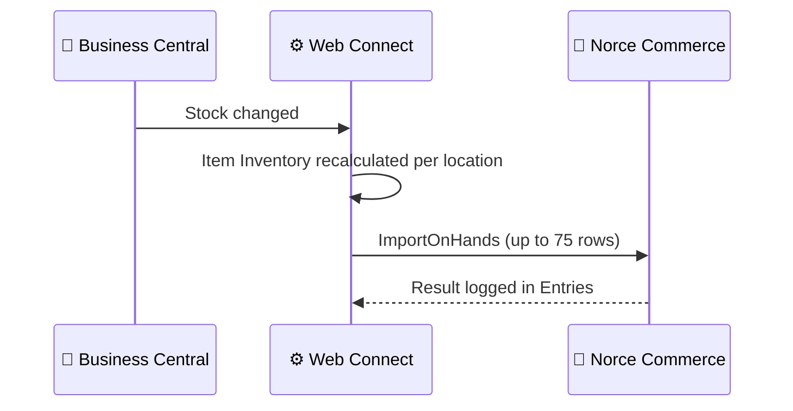

# Business Central to Norce Commerce: stock

Web Connect calculates stock per location in Business Central with Web Connect Item Inventory and sends it to the matching warehouse in Norce Commerce. Each row has the stock on hand, the incoming quantity and the next delivery date.

| | |
|---|---|
| **Direction** | Business Central → Norce Commerce |
| **Trigger** | A changed value in Web Connect Item Inventory, sent from the Business Central job queue. How often the job runs can be adjusted to what your business needs |
| **Result** | Stock on hand per SKU and warehouse in Norce Commerce |
| **Part of** | [Business Central and Norce Commerce integration](../overview.md) |

## Step by step

1. Stock changes in Business Central, for example when an order is created or a purchase is received.
2. Web Connect Item Inventory recalculates the stock for the location, using the rules in [Destinations](../../../general/destinations.md).
3. Web Connect calculates the incoming quantity at the next available date: quantity on purchase lines minus quantity on sales lines for that date.
4. The rows are sent to Norce Commerce in batches of up to 75 (`Product/ImportOnHands`).

## Data mapping

| Business Central field | Norce Commerce field | Note |
|---|---|---|
| Item no. | `PartNo` | |
| Location | `WarehouseCode`, `LocationCode` | Translated with a text mapping |
| Web inventory | `OnhandValue` | |
| Incoming quantity at next available date | `IncomingValue` | Dynamic flow field: purchase lines minus sales lines |
| Next available date | `NextDeliveryDate` | Left out when empty |
| Fixed value | `IsActive` = true | |

## Web Connect objects

| Object | Role |
|---|---|
| `NORCE_QTYONHAND` | Sends stock rows from Item Inventory |

## Error handling

| Situation | What happens | What to do |
|---|---|---|
| A location has no warehouse mapping | Norce Commerce cannot match the warehouse, and the error is logged in Entries | Add the location to the warehouse mapping |
| Norce Commerce deactivates products with zero stock | Products can disappear from the web shop when stock is zero | This is product logic in Norce Commerce, not in Web Connect. Decide in which system product status is controlled |

## Frequently asked questions

### Which warehouses in Norce Commerce get stock?

Each Business Central location used in Item Inventory is translated to a Norce Commerce warehouse with a text mapping. Only mapped locations reach Norce Commerce.

## Related

- [Business Central and Norce Commerce integration](../overview.md)
- [Item Inventory](../../../general/item-inventory.md) · [Destinations](../../../general/destinations.md) · [Dynamic Flow Fields](../../../general/dynamic-flow-fields.md)
