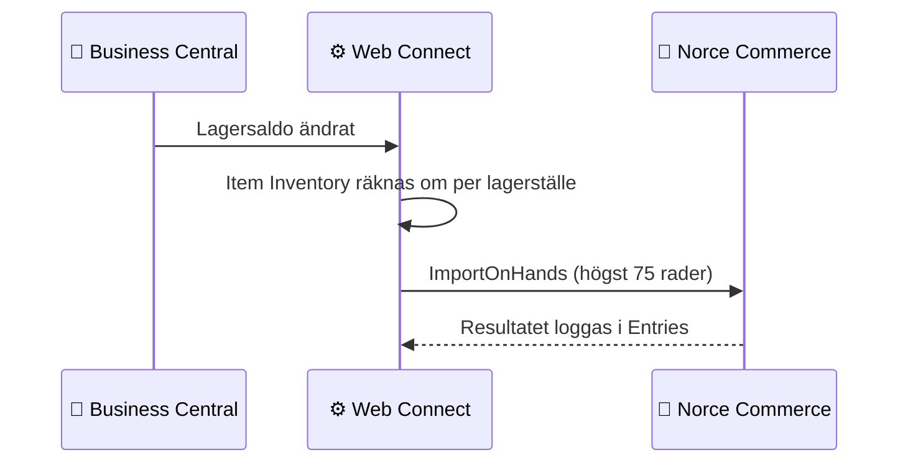

# Från Business Central till Norce Commerce: lagersaldo

Web Connect beräknar lagersaldot per lagerställe i Business Central med Web Connect Item Inventory och skickar det till motsvarande lager i Norce Commerce. Varje rad har lagersaldot, det inkommande antalet och nästa leveransdatum.

| | |
|---|---|
| **Riktning** | Business Central → Norce Commerce |
| **Startas av** | Ett ändrat värde i Web Connect Item Inventory, som skickas från jobbkön i Business Central. Hur ofta jobbet körs kan anpassas efter vad ditt företag behöver |
| **Resultat** | Lagersaldo per SKU och lager i Norce Commerce |
| **Del av** | [Business Central och Norce Commerce: integration](../overview.md) |

## Steg för steg

1. Lagersaldot ändras i Business Central, till exempel när en order skapas eller ett inköp tas emot.
2. Web Connect Item Inventory räknar om lagersaldot för lagerstället enligt reglerna i [Destinations](../../../general/destinations.md).
3. Web Connect beräknar det inkommande antalet vid nästa tillgängliga datum: antal på inköpsrader minus antal på försäljningsrader för det datumet.
4. Raderna skickas till Norce Commerce i omgångar om högst 75 (`Product/ImportOnHands`).

## Mappning av data

| Fält i Business Central | Fält i Norce Commerce | Kommentar |
|---|---|---|
| Artikelnr | `PartNo` | |
| Lagerställe | `WarehouseCode`, `LocationCode` | Översätts med en textmappning |
| Lagersaldo för webben | `OnhandValue` | |
| Inkommande antal vid nästa tillgängliga datum | `IncomingValue` | Dynamiskt flödesfält: inköpsrader minus försäljningsrader |
| Nästa tillgängliga datum | `NextDeliveryDate` | Utelämnas när det är tomt |
| Fast värde | `IsActive` = true | |

## Objekt i Web Connect

| Objekt | Roll |
|---|---|
| `NORCE_QTYONHAND` | Skickar lagersaldorader från Item Inventory |

## Felhantering

| Situation | Vad som händer | Vad du gör |
|---|---|---|
| Ett lagerställe saknar mappning till ett lager | Norce Commerce kan inte matcha lagret, och felet loggas i Entries | Lägg till lagerstället i lagermappningen |
| Norce Commerce inaktiverar produkter med noll i lagersaldo | Produkter kan försvinna från webbshoppen när lagersaldot är noll | Det här är produktlogik i Norce Commerce, inte i Web Connect. Bestäm i vilket system produktstatus ska styras |

## Vanliga frågor

### Vilka lager i Norce Commerce får lagersaldo?

Varje lagerställe i Business Central som används i Item Inventory översätts till ett lager i Norce Commerce med en textmappning. Bara mappade lagerställen når Norce Commerce.

## Relaterat

- [Business Central och Norce Commerce: integration](../overview.md)
- [Item Inventory](../../../general/item-inventory.md) · [Destinations](../../../general/destinations.md) · [Dynamic Flow Fields](../../../general/dynamic-flow-fields.md)
