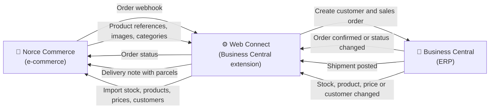
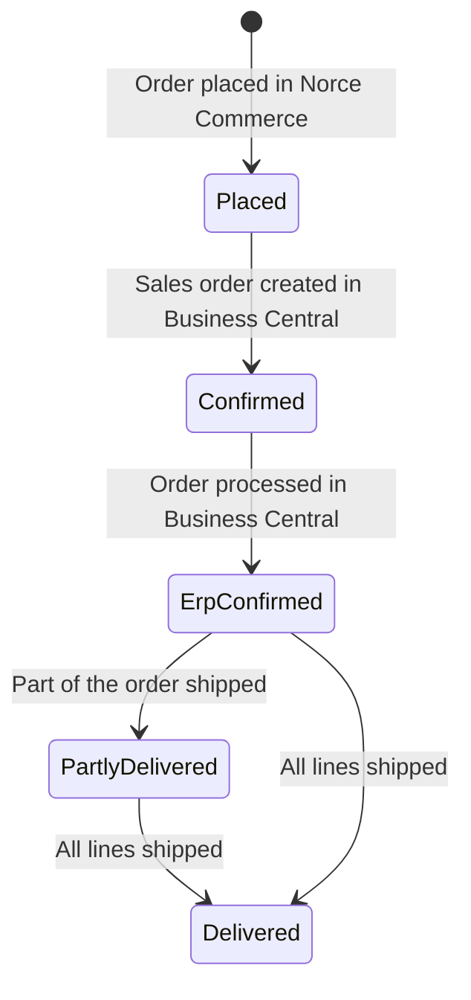
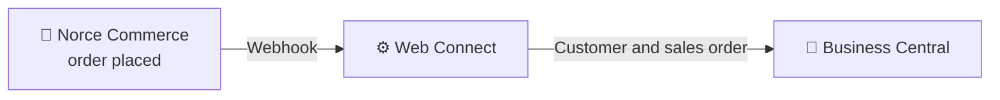
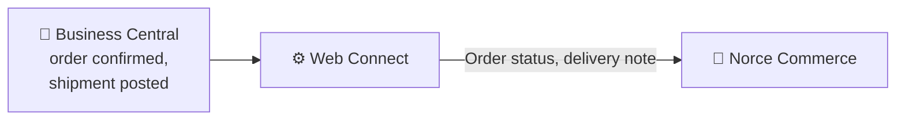
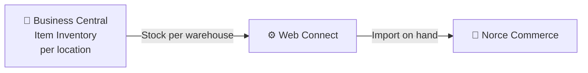
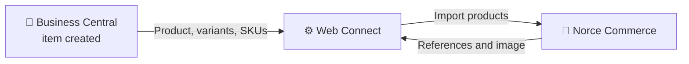
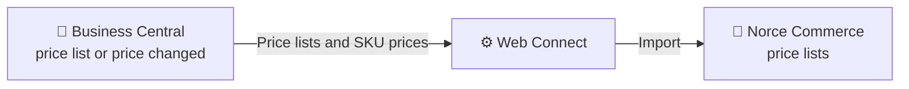
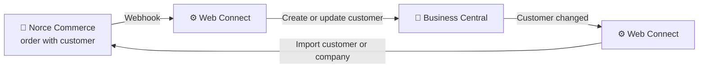

# Business Central and Norce Commerce integration

Web Connect by CombineIT connects Microsoft Dynamics 365 Business Central with Norce Commerce, the e-commerce platform. Orders from Norce Commerce are created as sales orders in Business Central, and order status, shipments, stock, products, price lists, prices and customers are sent back to Norce Commerce. All mappings and rules live in your own Business Central, where you can see and change them yourself.

## At a glance

| | |
|---|---|
| **System** | Norce Commerce (e-commerce, formerly Storm Commerce) |
| **Integration product** | Web Connect for Microsoft Dynamics 365 Business Central |
| **Runs in** | Your own Business Central environment, as an extension. Norce Commerce sends each new order as a webhook. An Azure endpoint receives it and passes it on to Web Connect, which processes it from the Business Central job queue. Changes in Business Central are sent to Norce Commerce by outgoing sync triggers. All processing and configuration stays in Business Central. |
| **Configured by** | You, in Business Central: mappings, conditions, triggers and flows. You can do all of it yourself. If you want, CombineIT takes part in any step, as a sounding board or by doing the work. |
| **Connection** | REST: Norce Commerce Connect API for imports and order status, Norce Commerce Query API for reading products and categories, incoming webhook for orders. OAuth 2.0 client credentials |
| **Norce Commerce API** | [Norce Commerce documentation](https://docs.norce.io/) |
| **Data flows** | 10: orders, order status, shipments, stock, products, product images, categories, price lists, prices, customers and companies |
| **Business Central editions** | All editions, Essentials and Premium, including the latest version |
| **Available from** | [Web Connect on Microsoft AppSource](https://marketplace.microsoft.com/sv-se/product/PUBID.martitab1633951001710%7CAID.webconnect%7CPAPPID.9f3a7223-19db-4ac7-832f-cf8e4699186f?tab=Overview). The Norce Commerce integration is not part of the Web Connect Ready Integrations app. It is set up as a configuration in Web Connect |

## What can be synchronized

Web Connect has ten data flows between Business Central and Norce Commerce.

| Data | Direction | What happens |
|---|---|---|
| [Orders](flows/order-inbound.md) | Norce Commerce → Business Central | Each new order arrives as a webhook. A sales order is created, and the customer is created or updated from the order |
| [Order status](flows/order-status.md) | Business Central → Norce Commerce | The order is confirmed in Norce Commerce, then marked as processed, partly delivered or delivered |
| [Shipments](flows/shipment.md) | Business Central → Norce Commerce | A posted sales shipment creates a delivery note in Norce Commerce with lines and parcel numbers |
| [Stock](flows/stock-update.md) | Business Central → Norce Commerce | Stock on hand per warehouse is sent, with incoming quantity and next delivery date |
| [Products](flows/product-data.md) | Business Central → Norce Commerce | Products, variants and SKUs are created or updated, and the Norce Commerce references are read back to the item |
| [Product images](flows/product-data.md#product-images-from-norce-commerce) | Norce Commerce → Business Central | The product image is fetched from Norce Commerce and stored on the item |
| [Categories](flows/product-data.md#categories-from-norce-commerce) | Norce Commerce → Business Central | Category codes are read from Norce Commerce and set on matching item categories |
| [Price lists](flows/prices.md) | Business Central → Norce Commerce | Price lists are created or updated with currency, dates, price rules and warehouses |
| [Prices](flows/prices.md#prices) | Business Central → Norce Commerce | SKU prices are set on the matching Norce Commerce price lists |
| [Customers and companies](flows/customers.md) | Business Central → Norce Commerce | Changes to customers are sent as Norce Commerce customers (consumers) or companies (business customers) |

Orders are part of every Norce Commerce integration. The other flows are chosen when the integration is set up, depending on where each kind of data is maintained in your business. See [Choose your setup](#choose-your-setup).

## How it works

Norce Commerce sends each new order to Web Connect as a webhook. An Azure endpoint receives the call and passes it on to Web Connect, which answers Norce Commerce at once and creates the incoming data. The download job in the Business Central job queue then creates the customer and the sales order. When something changes in Business Central (the order is confirmed, a shipment is posted, a customer, product, price or stock changes), Web Connect sends the change to the Norce Commerce Connect API. Every message in both directions is logged in Web Connect Entries, where it can be inspected and resent.

### Order status in Norce Commerce

## Choose your setup

Each flow has to fit how your business works: which system owns the data, where people do their work, and what the accounting needs. That is why the flows are decided together when a new integration is set up. **Common setup** marks the option most Web Connect customers with Norce Commerce use. **Recommended** marks CombineIT's best practice, where there is one.

One Web Connect customer uses Norce Commerce today. Each area below therefore shows the one option that is in use, and no option can be marked as the common setup yet. Other options can be set up, but they are not listed until a customer uses them.

### Orders

| Option | How it works | When it fits |
|---|---|---|
| **Norce Commerce → Business Central by webhook** | Norce Commerce sends each order to Web Connect, and a sales order is created in Business Central | Always. This is the core of the integration |

#### Orders from Norce Commerce by webhook

### Order status and shipments

| Option | How it works | When it fits |
|---|---|---|
| **Business Central → Norce Commerce** | The order status is sent when the order is confirmed and processed, and a delivery note with parcel numbers is created when a sales shipment is posted | The warehouse work is registered in Business Central, directly or through a warehouse integration |

#### Order status and shipments from Business Central

### Stock

| Option | How it works | When it fits |
|---|---|---|
| **Calculated in Business Central** | Web Connect Item Inventory calculates stock per location, and it is sent to the matching Norce Commerce warehouse with incoming quantity and next delivery date | Business Central has the correct stock |

#### Stock calculated in Business Central

### Products

| Option | How it works | When it fits |
|---|---|---|
| **Created in Business Central** | Products, variants and SKUs are created in Business Central and sent to Norce Commerce. Web Connect reads the Norce Commerce references back to the item, and fetches the product image | Business Central is where new products start |

#### Products created in Business Central

### Prices

| Option | How it works | When it fits |
|---|---|---|
| **Business Central → Norce Commerce** | Price lists and SKU prices are maintained in Business Central and imported to Norce Commerce | Prices are decided in Business Central |

#### Prices from Business Central to Norce Commerce

### Customers

| Option | How it works | When it fits |
|---|---|---|
| **Created from the order, maintained in Business Central** | The customer is created in Business Central from the first order. Later changes in Business Central are sent to Norce Commerce as a customer or a company | Customer service and credit control work in Business Central |

#### Customers created from the order and maintained in Business Central

Product enrichment (images, texts beyond what Business Central sends, category structure), campaigns and the web shop itself are maintained in Norce Commerce.

## What you need

- Microsoft Dynamics 365 Business Central, any edition (Essentials or Premium), including the latest version
- Web Connect installed from Microsoft AppSource, with an activated Web Connect license
- Your approval for Web Connect to be installed and to act in your Business Central environment
- An API client in Norce Commerce for the OAuth 2.0 client credentials flow (client ID and client secret), and the application ID and account ID that the Connect API needs. These are created in Norce Commerce.
- An order export in Norce Commerce that sends new orders to the Web Connect webhook address. The order export is set up in Norce Commerce.
- Warehouses and price lists set up in Norce Commerce, so that stock and prices from Business Central have somewhere to go

## Setting it up

1. Decide which flows to use and which option to choose for each, see [Choose your setup](#choose-your-setup).
2. Install Web Connect in Business Central, activate the license and give your approval. The Norce Commerce integration is set up as a configuration in Web Connect, not installed from the Ready Integrations app.
3. Create the API client in Norce Commerce and store the client secret in Web Connect [Secret Value Storage](../../general/secret-value-storage.md). Web Connect fetches and renews the access token itself.
4. Point the Norce Commerce order export at the Web Connect webhook address.
5. Set up the configuration choices below, including the Connect API headers for each import.
6. Test the whole order flow in a Business Central sandbox against a Norce Commerce test environment before going live. The account and application identifiers differ between environments.

## Configure it yourself in Business Central

All configuration and logic in the integration is visible and editable in Business Central. There is no external integration platform where the logic is hidden. The Azure endpoint that receives the order webhook only passes the call on to Web Connect.

| What you can change | Where in Web Connect | Example |
|---|---|---|
| Customer type routing | [Condition List](../../general/condition-list.md) | Create consumers and business customers with different objects and templates |
| Field mapping on orders | [Incoming Data mapping](../../general/incoming-data/mapping.md) | Map an additional info field on the Norce Commerce order to a field on the sales order |
| Value translation | [Text Mapping](../../general/text-mapping.md) | Translate Norce Commerce delivery methods to shipping agents, and payment methods to payment method codes |
| What Norce Commerce updates | [Integration Variables](../../general/integrations.md) | Change the list of fields in the Connect API header for companies, customers, products or prices |
| What triggers an update | [Outgoing Sync Triggers](../../general/outgoing-mapping/outgoing-sync-triggers.md) | Send a customer to Norce Commerce when the name, address or e-mail changes |
| Which stock is sent | [Item Inventory](../../general/item-inventory.md) and [Destinations](../../general/destinations.md) | Calculate stock for selected locations, mapped to Norce Commerce warehouses |
| Monitoring and resending | [Entries](../../general/entries.md) | See every order and update, and [resend a message](../../../../how-to/web-connect/resend-outgoing-message.md) |

## Configuration choices

- **Customer types:** how the customer type is read from the order, which customer template each type uses, and which customers are sent to Norce Commerce as companies and which as consumers.
- **Customer matching:** which fields identify an existing customer when an order arrives, for example customer code together with e-mail or VAT number.
- **Item matching:** order lines are matched to Business Central items on the Norce Commerce part number. Fees such as freight can be translated to a specific item number.
- **Prices including or excluding VAT:** a condition decides whether unit prices and discounts on the order are taken as including or excluding VAT.
- **Financial mappings:** payment methods (by currency and payment method code), shipping agents per delivery method and a dimension per market based on the country.
- **Release of orders:** a condition can release orders automatically, for example for all payment methods except invoice.
- **Order status values:** which Business Central order status gives which status in Norce Commerce.
- **Warehouses:** which Business Central location maps to which Norce Commerce warehouse.
- **Connect API headers:** which fields each import is allowed to update in Norce Commerce.

## Limitations

- **Only fields listed in the header are updated.** Norce Commerce Connect ignores fields that are sent but not listed in the header. Fields that are listed but sent empty can clear the value in Norce Commerce. Flags are only set when flags are listed.
- **The headers differ between environments.** Account ID and application key are not the same in test and production, so the configuration has to be adjusted when it is moved.
- **Duplicate customers can be created** when the fields used to match a customer differ between Business Central and the order, for example a company that has no VAT number in Business Central. Fill in the matching fields before orders start arriving.
- **Merge duplicate customers in Norce Commerce, not in Business Central.** Merging in Business Central does not reach Norce Commerce. Changing the customer number in Business Central updates the same company in Norce Commerce, since it is matched on the company ID.
- **Product images are fetched once.** A new image in Norce Commerce is not fetched again by itself, and the image import has to be resent for the item.
- **Norce Commerce can have its own product and status logic,** for example deactivating products with zero stock or setting an order to delivered by itself. Decide which system controls status, and turn the other logic off.
- **Cancellations and returns are not part of the integration today.** [ATT FYLLA I: whether cancellation and return flows exist for Norce Commerce; none is found in the configuration exports]
- **Products are imported one at a time** to Norce Commerce, and stock in batches of up to 75 rows per call.
- [ATT FYLLA I: other known limitations confirmed by CombineIT]

## Frequently asked questions

### Can Business Central be integrated with Norce Commerce?

Yes. Web Connect connects Business Central with Norce Commerce through the Norce Commerce Connect and Query APIs. Orders are created as sales orders in Business Central, and order status, shipments, stock, products, price lists, prices and customers are sent to Norce Commerce.

### How do orders get from Norce Commerce to Business Central?

Norce Commerce sends each order to Web Connect as soon as it is placed. An Azure endpoint receives the call and passes it on to Web Connect, which answers Norce Commerce and creates the sales order in Business Central from the job queue.

### Can business customers and consumers be handled differently?

Yes. Web Connect reads the customer type on the order with a condition and uses a separate customer object for each type. Each type can have its own customer template, and business customers are sent back to Norce Commerce as companies while consumers are sent as customers.

### Why was a field in Norce Commerce cleared when we updated a customer?

Norce Commerce Connect only updates the fields listed in the request header. A field that is in the list but sent empty can clear the value in Norce Commerce. Check the header in Web Connect and leave out fields that Business Central does not own.

### Can we change what is sent between Business Central and Norce Commerce ourselves?

Yes. Field mappings, conditions, triggers and which flows are active are configured in Web Connect inside your own Business Central. You can see and change them without asking a supplier to change an external platform.

## Related

- Flows: [Order inbound](flows/order-inbound.md) · [Order status](flows/order-status.md) · [Shipment](flows/shipment.md) · [Stock update](flows/stock-update.md) · [Product data](flows/product-data.md) · [Prices](flows/prices.md) · [Customers](flows/customers.md)
- How-to: [Resend an outgoing message](../../../../how-to/web-connect/resend-outgoing-message.md) · [Integrations not running](../../../../how-to/web-connect/integration-not-running.md)
- [Web Connect general documentation](../../general/README.md) · [Web Connect webhooks](../../general/webhooks.md)
- [Norce Commerce documentation](https://docs.norce.io/)

## About Web Connect

Web Connect is an integration platform for Microsoft Dynamics 365 Business Central, developed by CombineIT. It is installed in your own Business Central and connects it with e-commerce platforms, warehouse systems, POS, returns, marketplaces and EDI. Every flow, mapping and rule is configured in Business Central, where you can see and change it yourself, without custom code for each integration. [Web Connect on Microsoft AppSource](https://marketplace.microsoft.com/sv-se/product/PUBID.martitab1633951001710%7CAID.webconnect%7CPAPPID.9f3a7223-19db-4ac7-832f-cf8e4699186f?tab=Overview) · [Contact CombineIT](https://www.combineit.se/contact/)
