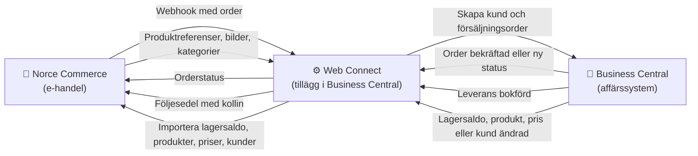
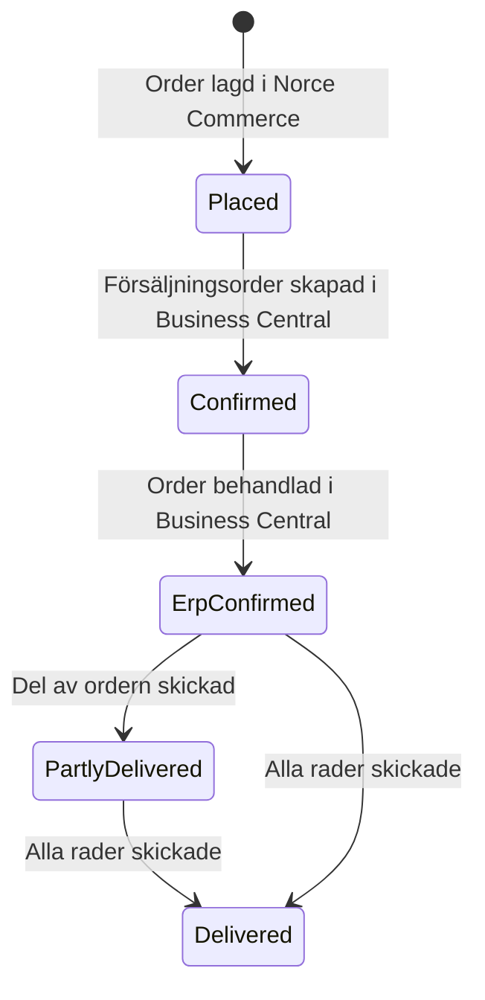
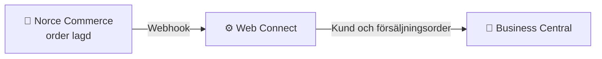
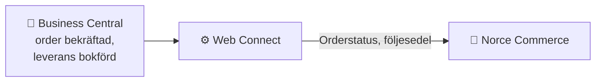
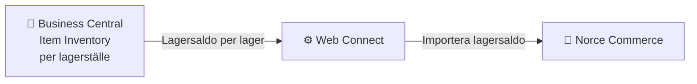
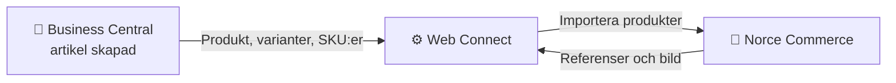
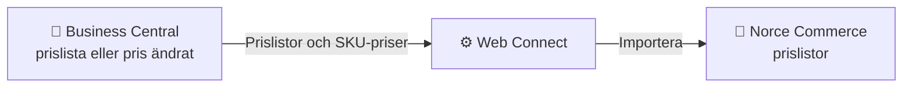
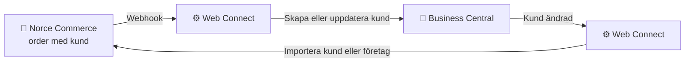

# Business Central och Norce Commerce: integration

Web Connect från CombineIT kopplar ihop Microsoft Dynamics 365 Business Central med e-handelsplattformen Norce Commerce. Order från Norce Commerce skapas som försäljningsorder i Business Central, och orderstatus, leveranser, lagersaldo, produkter, prislistor, priser och kunder skickas tillbaka till Norce Commerce. Alla mappningar och regler finns i ditt eget Business Central, där du själv kan se och ändra dem.

## I korthet

| | |
|---|---|
| **System** | Norce Commerce (e-handel, tidigare Storm Commerce) |
| **Integrationsprodukt** | Web Connect för Microsoft Dynamics 365 Business Central |
| **Körs i** | Din egen Business Central-miljö, som ett tillägg. Norce Commerce skickar varje ny order som en webhook. En Azure-endpoint tar emot den och skickar den vidare till Web Connect, som behandlar den från jobbkön i Business Central. Ändringar i Business Central skickas till Norce Commerce av utgående synktriggers. All behandling och konfiguration stannar i Business Central. |
| **Konfigureras av** | Dig, i Business Central: mappningar, villkor, triggers och flöden. Du kan göra allt själv. Om du vill är CombineIT med i vilket steg som helst, som bollplank eller genom att göra jobbet. |
| **Koppling** | REST: Norce Commerce Connect API för importer och orderstatus, Norce Commerce Query API för att läsa produkter och kategorier, inkommande webhook för order. OAuth 2.0 client credentials |
| **Norce Commerce API** | [Dokumentation för Norce Commerce](https://docs.norce.io/) |
| **Dataflöden** | 10: order, orderstatus, leveranser, lagersaldo, produkter, produktbilder, kategorier, prislistor, priser, kunder och företag |
| **Business Central-utgåvor** | Alla utgåvor, Essentials och Premium, även den senaste versionen |
| **Finns på** | [Web Connect på Microsoft AppSource](https://marketplace.microsoft.com/sv-se/product/PUBID.martitab1633951001710%7CAID.webconnect%7CPAPPID.9f3a7223-19db-4ac7-832f-cf8e4699186f?tab=Overview). Integrationen med Norce Commerce ingår i appen Web Connect Ready Integrations |

## Det här kan synkas

Web Connect har tio dataflöden mellan Business Central och Norce Commerce.

| Data | Riktning | Vad som händer |
|---|---|---|
| [Order](flows/order-inbound.md) | Norce Commerce → Business Central | Varje ny order kommer som en webhook. En försäljningsorder skapas, och kunden skapas eller uppdateras utifrån ordern |
| [Orderstatus](flows/order-status.md) | Business Central → Norce Commerce | Ordern bekräftas i Norce Commerce och markeras sedan som behandlad, dellevererad eller levererad |
| [Leveranser](flows/shipment.md) | Business Central → Norce Commerce | En bokförd försäljningsleverans skapar en följesedel i Norce Commerce med rader och kollinummer |
| [Lagersaldo](flows/stock-update.md) | Business Central → Norce Commerce | Lagersaldot per lager skickas, med inkommande antal och nästa leveransdatum |
| [Produkter](flows/product-data.md) | Business Central → Norce Commerce | Produkter, varianter och SKU:er skapas eller uppdateras, och referenserna från Norce Commerce läses tillbaka till artikeln |
| [Produktbilder](flows/product-data.md#product-images-from-norce-commerce) | Norce Commerce → Business Central | Produktbilden hämtas från Norce Commerce och sparas på artikeln |
| [Kategorier](flows/product-data.md#categories-from-norce-commerce) | Norce Commerce → Business Central | Kategorikoder läses från Norce Commerce och sätts på matchande artikelkategorier |
| [Prislistor](flows/prices.md) | Business Central → Norce Commerce | Prislistor skapas eller uppdateras med valuta, datum, prisregler och lager |
| [Priser](flows/prices.md#prices) | Business Central → Norce Commerce | SKU-priser sätts på de matchande prislistorna i Norce Commerce |
| [Kunder och företag](flows/customers.md) | Business Central → Norce Commerce | Ändringar på kunder skickas som kunder (privatkunder) eller företag (företagskunder) i Norce Commerce |

Order ingår i alla integrationer med Norce Commerce. De andra flödena väljs när integrationen sätts upp, beroende på var varje typ av data underhålls i ditt företag. Se [Välj upplägg](#choose-your-setup).

## Så fungerar det

Norce Commerce skickar varje ny order till Web Connect som en webhook. En Azure-endpoint tar emot anropet och skickar det vidare till Web Connect, som svarar Norce Commerce direkt och skapar inkommande data. Hämtningsjobbet i jobbkön i Business Central skapar sedan kunden och försäljningsordern. När något ändras i Business Central (ordern bekräftas, en leverans bokförs, en kund, produkt, ett pris eller lagersaldot ändras) skickar Web Connect ändringen till Norce Commerce Connect API. Varje meddelande i båda riktningarna loggas i Web Connect Entries, där det går att granska och skicka om.

### Orderstatus i Norce Commerce

## Välj upplägg

Varje flöde måste passa hur ditt företag arbetar: vilket system som äger datan, var personalen gör sitt arbete och vad bokföringen behöver. Därför bestäms flödena tillsammans när en ny integration sätts upp. **Vanligt upplägg** visar det alternativ som flest Web Connect-kunder med Norce Commerce använder. **Rekommenderas** visar CombineIT:s bästa praxis, där det finns en.

En Web Connect-kund använder Norce Commerce i dag. Varje område nedan visar därför det enda alternativ som används, och inget alternativ kan ännu markeras som vanligt upplägg. Andra alternativ går att sätta upp, men de listas inte förrän en kund använder dem.

### Order

| Alternativ | Så fungerar det | När det passar |
|---|---|---|
| **Norce Commerce → Business Central med webhook** | Norce Commerce skickar varje order till Web Connect, och en försäljningsorder skapas i Business Central | Alltid. Det här är kärnan i integrationen |

#### Order från Norce Commerce med webhook

### Orderstatus och leveranser

| Alternativ | Så fungerar det | När det passar |
|---|---|---|
| **Business Central → Norce Commerce** | Orderstatus skickas när ordern bekräftas och behandlas, och en följesedel med kollinummer skapas när en försäljningsleverans bokförs | Lagerarbetet registreras i Business Central, direkt eller via en lagerintegration |

#### Orderstatus och leveranser från Business Central

### Lagersaldo

| Alternativ | Så fungerar det | När det passar |
|---|---|---|
| **Beräknas i Business Central** | Web Connect Item Inventory beräknar lagersaldot per lagerställe, och det skickas till motsvarande lager i Norce Commerce med inkommande antal och nästa leveransdatum | Business Central har rätt lagersaldo |

#### Lagersaldo beräknat i Business Central

### Produkter

| Alternativ | Så fungerar det | När det passar |
|---|---|---|
| **Skapas i Business Central** | Produkter, varianter och SKU:er skapas i Business Central och skickas till Norce Commerce. Web Connect läser tillbaka referenserna från Norce Commerce till artikeln och hämtar produktbilden | Nya produkter börjar i Business Central |

#### Produkter skapade i Business Central

### Priser

| Alternativ | Så fungerar det | När det passar |
|---|---|---|
| **Business Central → Norce Commerce** | Prislistor och SKU-priser underhålls i Business Central och importeras till Norce Commerce | Priserna bestäms i Business Central |

#### Priser från Business Central till Norce Commerce

### Kunder

| Alternativ | Så fungerar det | När det passar |
|---|---|---|
| **Skapas från ordern, underhålls i Business Central** | Kunden skapas i Business Central från första ordern. Senare ändringar i Business Central skickas till Norce Commerce som kund eller företag | Kundtjänst och kreditkontroll arbetar i Business Central |

#### Kunder som skapas från ordern och underhålls i Business Central

Berikning av produkter (bilder, texter utöver det Business Central skickar, kategoristruktur), kampanjer och själva webbshoppen underhålls i Norce Commerce.

## Det här behöver du

- Microsoft Dynamics 365 Business Central, valfri utgåva (Essentials eller Premium), även den senaste versionen
- Web Connect installerat från Microsoft AppSource, med en aktiverad licens för Web Connect
- Appen Web Connect Ready Integrations installerad i samma Business Central-miljö. Integrationen med Norce Commerce ingår i den
- Ditt godkännande av att Web Connect installeras och agerar i din Business Central-miljö
- En API-klient i Norce Commerce för OAuth 2.0 client credentials (client ID och client secret), samt det applikations-ID och konto-ID som Connect API behöver. De skapas i Norce Commerce.
- En orderexport i Norce Commerce som skickar nya order till webhookadressen i Web Connect. Orderexporten sätts upp i Norce Commerce.
- Lager och prislistor uppsatta i Norce Commerce, så att lagersaldo och priser från Business Central har någonstans att ta vägen

## Så kommer du igång

1. Bestäm vilka flöden ni ska använda och vilket alternativ ni väljer för vart och ett, se [Välj upplägg](#choose-your-setup).
2. Installera Web Connect i Business Central, aktivera licensen och ge ditt godkännande. Installera appen Web Connect Ready Integrations i samma miljö och aktivera integrationen med Norce Commerce.
3. Skapa API-klienten i Norce Commerce och spara client secret i Web Connect [Secret Value Storage](../../general/secret-value-storage.md). Web Connect hämtar och förnyar access token själv.
4. Peka orderexporten i Norce Commerce mot webhookadressen i Web Connect.
5. Gör valen i konfigurationen nedan, även headrarna för Connect API för varje import.
6. Testa hela orderflödet i en sandlåda i Business Central mot en testmiljö i Norce Commerce innan ni går live. Konto- och applikations-ID skiljer sig mellan miljöerna.

## Konfigurera själv i Business Central

All konfiguration och logik i integrationen syns och går att ändra i Business Central. Det finns ingen extern integrationsplattform där logiken är dold. Azure-endpointen som tar emot webhooken med order skickar bara anropet vidare till Web Connect.

| Det här kan du ändra | Var i Web Connect | Exempel |
|---|---|---|
| Styrning per kundtyp | [Condition List](../../general/condition-list.md) | Skapa privatkunder och företagskunder med olika objekt och mallar |
| Fältmappning på order | [Incoming Data mapping](../../general/incoming-data/mapping.md) | Mappa ett extra informationsfält på ordern i Norce Commerce till ett fält på försäljningsordern |
| Översättning av värden | [Text Mapping](../../general/text-mapping.md) | Översätt leveranssätt i Norce Commerce till speditörer, och betalsätt till betalsättskoder |
| Vad Norce Commerce uppdaterar | [Integration Variables](../../general/integrations.md) | Ändra listan med fält i headern för Connect API för företag, kunder, produkter eller priser |
| Vad som startar en uppdatering | [Outgoing Sync Triggers](../../general/outgoing-mapping/outgoing-sync-triggers.md) | Skicka en kund till Norce Commerce när namn, adress eller e-post ändras |
| Vilket lagersaldo som skickas | [Item Inventory](../../general/item-inventory.md) och [Destinations](../../general/destinations.md) | Beräkna lagersaldo för utvalda lagerställen, mappade till lager i Norce Commerce |
| Övervakning och omsändning | [Entries](../../general/entries.md) | Se varje order och uppdatering, och [skicka om ett meddelande](../../../../how-to/web-connect/resend-outgoing-message.md) |

## Val i konfigurationen

- **Kundtyper:** hur kundtypen läses från ordern, vilken kundmall varje typ använder, och vilka kunder som skickas till Norce Commerce som företag och vilka som privatkunder.
- **Matchning av kunder:** vilka fält som identifierar en befintlig kund när en order kommer in, till exempel kundkod tillsammans med e-post eller momsregistreringsnummer.
- **Matchning av artiklar:** orderrader matchas mot artiklar i Business Central på artikelnumret i Norce Commerce (part number). Avgifter som frakt kan översättas till ett bestämt artikelnummer.
- **Priser inklusive eller exklusive moms:** ett villkor avgör om á-priser och rabatter på ordern tolkas som inklusive eller exklusive moms.
- **Ekonomiska mappningar:** betalsätt (per valuta och betalsättskod), speditör per leveranssätt och en dimension per marknad utifrån landet.
- **Släppning av order:** ett villkor kan släppa order automatiskt, till exempel för alla betalsätt utom faktura.
- **Orderstatusvärden:** vilken orderstatus i Business Central som ger vilken status i Norce Commerce.
- **Lager:** vilket lagerställe i Business Central som motsvarar vilket lager i Norce Commerce.
- **Headrar för Connect API:** vilka fält varje import får uppdatera i Norce Commerce.

## Begränsningar

- **Varje import måste lista vilka fält som sätts.** Norce Commerce Connect API kräver en header som listar det numeriska ID:t för varje fält som importen får uppdatera. Web Connect kan inte bara skicka fälten, som med många andra e-handelsplattformar, så ett nytt fält kräver både en mappning och en ändring i headern. Norce Commerce Connect ignorerar fält som skickas men inte står i headern. Fält som står i listan men skickas tomma kan tömma värdet i Norce Commerce. Flaggor sätts bara när flaggor står i listan.
- **Headrarna skiljer sig mellan miljöer.** Konto-ID och applikationsnyckel är inte desamma i test och produktion, så konfigurationen måste justeras när den flyttas.
- **Dubbletter av kunder kan skapas** när fälten som används för att matcha en kund skiljer sig mellan Business Central och ordern, till exempel ett företag som saknar momsregistreringsnummer i Business Central. Fyll i matchningsfälten innan order börjar komma in.
- **Slå ihop dubbletter av kunder i Norce Commerce, inte i Business Central.** En sammanslagning i Business Central når inte Norce Commerce. Ändrar du kundnumret i Business Central uppdateras samma företag i Norce Commerce, eftersom det matchas på företagets ID.
- **Produktbilder hämtas en gång.** En ny bild i Norce Commerce hämtas inte igen av sig själv, utan bildimporten måste skickas om för artikeln.
- **Norce Commerce kan ha egen produktlogik,** till exempel att produkter med noll i lagersaldo inaktiveras. Bestäm vilket system som styr produktstatus, och stäng av logiken i det andra.
- **Makuleringar och returer ingår inte i integrationen i dag.** Norce Commerce Connect API kan makulera en order och har statusen Cancelled, så ett flöde för makuleringar kan byggas i Web Connect. Returer hanteras inte i Norce Commerce, men en betalning kan krediteras via Norce Commerce när betalleverantören stöder det.
- **Produkter importeras en i taget** till Norce Commerce, och lagersaldo i omgångar om högst 75 rader per anrop.

## Vanliga frågor

### Går det att integrera Business Central med Norce Commerce?

Ja. Web Connect kopplar ihop Business Central med Norce Commerce via Norce Commerce Connect API och Query API. Order skapas som försäljningsorder i Business Central, och orderstatus, leveranser, lagersaldo, produkter, prislistor, priser och kunder skickas till Norce Commerce.

### Hur kommer order från Norce Commerce till Business Central?

Norce Commerce skickar varje order till Web Connect så snart den läggs. En Azure-endpoint tar emot anropet och skickar det vidare till Web Connect, som svarar Norce Commerce och skapar försäljningsordern i Business Central från jobbkön.

### Kan företagskunder och privatkunder hanteras olika?

Ja. Web Connect läser kundtypen på ordern med ett villkor och använder ett eget kundobjekt för varje typ. Varje typ kan ha en egen kundmall. Företagskunder skickas tillbaka till Norce Commerce som företag och privatkunder som kunder.

### Varför tömdes ett fält i Norce Commerce när vi uppdaterade en kund?

Norce Commerce Connect uppdaterar bara de fält som står i anropets header. Ett fält som står i listan men skickas tomt kan tömma värdet i Norce Commerce. Kontrollera headern i Web Connect och ta bort fält som Business Central inte äger.

### Kan vi själva ändra vad som skickas mellan Business Central och Norce Commerce?

Ja. Fältmappningar, villkor, triggers och vilka flöden som är aktiva konfigureras i Web Connect i ditt eget Business Central. Du kan se och ändra dem utan att be en leverantör ändra i en extern plattform.

## Relaterat

- Flöden: [Order in](flows/order-inbound.md) · [Orderstatus](flows/order-status.md) · [Leveranser](flows/shipment.md) · [Lagersaldo](flows/stock-update.md) · [Produktdata](flows/product-data.md) · [Priser](flows/prices.md) · [Kunder](flows/customers.md)
- Instruktioner: [Skicka om ett utgående meddelande](../../../../how-to/web-connect/resend-outgoing-message.md) · [Integrationer som inte körs](../../../../how-to/web-connect/integration-not-running.md)
- [Allmän dokumentation för Web Connect](../../general/README.md) · [Webhooks i Web Connect](../../general/webhooks.md)
- [Dokumentation för Norce Commerce](https://docs.norce.io/)

## Om Web Connect

Web Connect är en integrationsplattform för Microsoft Dynamics 365 Business Central, utvecklad av CombineIT. Den installeras i ditt eget Business Central och kopplar ihop det med e-handelsplattformar, lagersystem, kassasystem, returer, marknadsplatser och EDI. Varje flöde, varje mappning och varje regel konfigureras i Business Central, där du själv kan se och ändra dem, utan specialkod för varje integration. [Web Connect på Microsoft AppSource](https://marketplace.microsoft.com/sv-se/product/PUBID.martitab1633951001710%7CAID.webconnect%7CPAPPID.9f3a7223-19db-4ac7-832f-cf8e4699186f?tab=Overview) · [Kontakta CombineIT](https://www.combineit.se/contact/)
